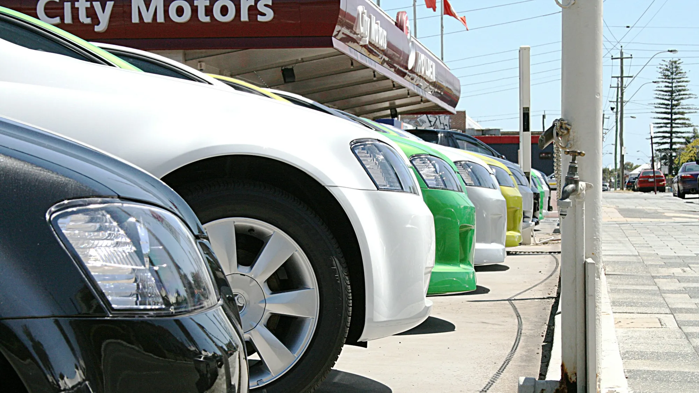

La batería es la pieza que más preocupa a quien compra un eléctrico, y con razón: es la más cara del carro y la que define cuánto vale cuando se vende. La buena noticia es que los fabricantes le calculan entre 15 y 20 años de vida útil. La mala es que, si hay que cambiarla fuera de garantía, la cuenta es alta.

## Lo esencial

- **Vida útil estimada:** entre 15 y 20 años, según fabricantes y el gremio Acomoves.
- **Pérdida de capacidad:** alrededor de 1,8 % por año; tras diez años conservaría cerca del 82 %.
- **Garantía típica:** 8 años y entre 150.000 y 200.000 km, según la marca.
- **Precio de las celdas:** promedio mundial de 108 dólares por kWh a finales de 2025, según BloombergNEF.
- **Costo de un cambio completo:** entre 40 % y 45 % del valor del carro, según un cálculo citado por Noticias Caracol.

## ¿Cuánto cuesta una batería?

Hay dos formas de hacer la cuenta, y dan resultados muy distintos:

| Cálculo | Batería de 60 a 80 kWh |
|---|---|
| Solo el precio de las celdas (108 dólares por kWh) | Entre 6.480 y 8.640 dólares, unos $21 a $29 millones |
| Cambio completo en concesionario (40 % a 45 % del valor del carro) | Para un carro de $100 millones, unos $40 millones |

La diferencia está en que el precio de las celdas no incluye la carcasa, la electrónica de control, la importación, la mano de obra ni el margen del concesionario. En la práctica, el valor que va a ver en una cotización se parece más al segundo.

Y no siempre hay que cambiar toda la batería. Muchas fallas se resuelven cambiando **un módulo** o un componente de control, a un costo mucho menor.

*En el mercado de usados, el estado de la batería pesa más que el kilometraje. Foto: Vaughan Willis en Unsplash.*

## Cómo afecta la reventa

El mercado de eléctricos usados en Colombia es todavía muy joven y no hay suficientes datos para saber cuánto se deprecian. En Europa, la revista ONMOTOR reporta modelos que perdieron hasta **52 %** de su precio en tres años, por miedo a las baterías usadas y por la velocidad con que salen nuevas generaciones.

El periodista Juan Pablo Clopatofsky lo compara con un celular: sigue funcionando, pero pierde capacidad, y eso lo hace menos atractivo. Por eso, al vender o comprar un eléctrico usado, el dato más importante es el **estado de salud de la batería** (SOH, por su sigla en inglés), que el concesionario puede medir con un diagnóstico.

> Si va a vender su eléctrico, pida un reporte del estado de la batería antes de publicarlo. Un SOH alto y la garantía vigente son los dos argumentos que más sostienen el precio.

## Qué la desgasta más

La carga rápida diaria es el hábito que más acelera el desgaste, porque calienta las celdas y las somete a corrientes altas. Dejar el carro varios días al 100 % o cerca del 0 % también las estresa, por eso muchos fabricantes recomiendan cargar hasta 80 % en el uso diario. El calor extremo suma, algo a tener en cuenta en ciudades como Cali o Barranquilla si el carro duerme al sol.

Lo explicamos con más detalle en [nuestra nota sobre la vida útil y la garantía de la batería](/es/notas/bateria-carro-electrico-vida-util-garantia/).

## Preguntas frecuentes

### ¿Cuánto cuesta la batería de un carro eléctrico en Colombia?

Las celdas de una batería de 60 a 80 kWh costarían entre $21 y $29 millones, pero un cambio completo en concesionario puede acercarse al 40 % del valor del carro.

### ¿Cuánto dura la batería de un carro eléctrico?

Entre 15 y 20 años, según fabricantes, aunque pierde alrededor de 1,8 % de capacidad por año.

### ¿La garantía cubre la batería?

Sí, normalmente 8 años y entre 150.000 y 200.000 km. Revise también el porcentaje mínimo de capacidad que la marca garantiza.

### ¿Vale la pena comprar un eléctrico usado?

Puede valer la pena si la batería tiene buen estado de salud y la garantía sigue vigente. Pida el diagnóstico antes de comprar.

Compare las garantías de batería de cada modelo en el [comparador de Mejor Eléctrico](/es/comparador/).

---

**Fuentes:** [Semana: cuánto duran y cuánto valen las baterías](https://www.semana.com/vehiculos/articulo/marcas-revelan-cuando-duran-y-cuanto-valen-las-baterias-de-los-autos-electricos-que-llegan-a-colombia/202637/) · [Pulzo: reventa de eléctricos usados](https://www.pulzo.com/carros/venta-carros-electricos-segunda-colombia-clopatofsky-dice-que-pasara-PP5103945) · [ONMOTOR: problemas reales de los eléctricos en 2026](https://onmotor.es/problemas-reales-en-los-coches-electricos-en-2026/)
