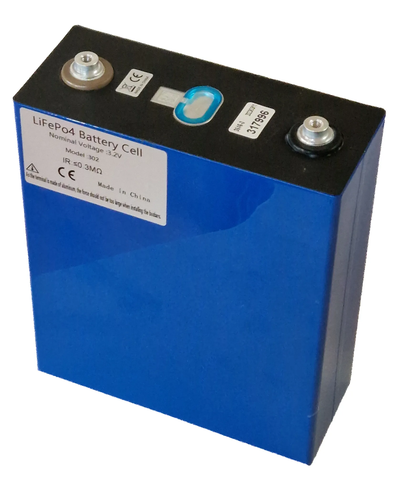

Casi todos los carros eléctricos que se venden en Latinoamérica usan una de dos químicas: **LFP** (litio, hierro y fosfato) o **NMC** (níquel, manganeso y cobalto). Una tercera, la de **iones de sodio**, empezó a montarse en carros de pasajeros en 2026. La ficha técnica rara vez la destaca, pero cambia tres cosas que le importan al dueño: el peso, la forma correcta de cargar y el precio.

## Las diferencias en una tabla

| | LFP | NMC | Sodio |
|---|---|---|---|
| Energía por kilo | Menor | Alrededor de 30 % más por celda; entre 5 % y 20 % más en el paquete completo | Hasta 175 Wh/kg según CATL, cerca de una LFP |
| Precio promedio del paquete en 2025 | 81 dólares por kWh | 128 dólares por kWh | Sin cifra pública comparable |
| Carga diaria recomendada | Hasta 100 % en varios fabricantes | Normalmente hasta 80 % o 90 % | Sin recomendaciones publicadas todavía |
| Dónde se ve | Chery E5, Kia EV2, BYD, Model 3 de entrada | Eléctricos de gama alta y de mucha autonomía | Primeros modelos de Changan en China |

Los precios son de BloombergNEF; las diferencias de energía, de un análisis de McKinsey. La fila del sodio se apoya en cifras de CATL, el mayor fabricante de baterías del mundo, que todavía no han sido confirmadas por pruebas independientes en carros de serie.

*Una celda LFP de CATL. Esta química no usa níquel ni cobalto, y por eso es la más barata. Foto: Aeroid, CC BY-SA 4.0, vía Wikimedia Commons.*

## LFP: la batería de los eléctricos que bajaron de precio

La LFP no usa níquel ni cobalto, los dos metales más caros y con más problemas de suministro de una batería. Por eso cuesta menos: según BloombergNEF, en 2025 un paquete LFP salió en promedio a **81 dólares por kWh**, frente a **128 dólares** uno NMC. En una batería de 60 kWh, la diferencia ronda los 2.800 dólares solo en el paquete de baterías.

Esa es una de las razones por las que los eléctricos chinos de precio medio llegan a Latinoamérica con LFP, y por las que en China su participación entre los carros eléctricos de pasajeros subió del 45 % en 2021 al 60 % en 2023.

La desventaja es el peso. Para la misma autonomía, una LFP necesita más celdas. McKinsey lo ilustra con el Tesla Model 3: la versión con LFP de 55 kWh recorre unos 450 km WLTP, y la de NMC de 82 kWh unos 630 km.

Hay una ventaja práctica que muchos dueños no conocen: **la LFP tolera mejor la carga al 100 %**. Tesla, por ejemplo, recomienda a los dueños del Model 3 con LFP dejar el límite de carga en 100 %, incluso para el uso diario, y llenar la batería por completo al menos una vez por semana para que el carro calcule bien su autonomía. Con una NMC, la recomendación habitual es quedarse en 80 % o 90 % salvo antes de un viaje largo.

## NMC: más autonomía por kilo, más cara

La NMC guarda más energía en el mismo espacio. Por eso la usan los carros que buscan autonomías de 600 km o más sin cargar una batería enorme, y los deportivos, donde cada kilo cuenta. A cambio es más cara y depende de metales cuyo precio se mueve mucho.

Algunas marcas usan mezclas propias. La Chevrolet Equinox EV que se vende en Colombia, por ejemplo, declara una química NMCA, que agrega aluminio.

## Sodio: la que llega en 2026

CATL y Changan presentaron en febrero de 2026 lo que describen como el primer carro de pasajeros de producción en serie con batería de iones de sodio, con salida al mercado chino prevista para mediados de año. Según CATL, su batería Naxtra guarda hasta **175 Wh/kg**, una densidad parecida a la de una LFP, y con un paquete de 45 kWh permite unos **400 km** de autonomía. Donde más se separa es en el frío: conserva más del **90 % de su capacidad a −40 °C** y, a −30 °C, entrega casi el triple de potencia que una LFP equivalente.

El sodio es abundante y barato, y no depende del litio. Su gran argumento es el frío, algo que en casi toda Latinoamérica pesa menos que en el norte de China. Lo que más le puede servir a la región es otra cosa: si el sodio baja el costo de las baterías pequeñas, los eléctricos urbanos podrían abaratarse. Por ahora no hay ningún modelo con batería de sodio anunciado para Latinoamérica.

## Cómo saber qué batería tiene un carro

La ficha técnica de la marca suele decirlo en la línea de la batería: "LFP", "fosfato de hierro y litio", "litio ferrofosfato" o "Blade", que es el nombre comercial de la LFP de BYD. Si dice "ternaria" o "NCM", es de la familia NMC. En el [comparador](/es/comparador/) la química aparece en la ficha de cada versión cuando la marca la publica.

## Preguntas frecuentes

### ¿Qué batería dura más, la LFP o la NMC?

La LFP suele soportar más ciclos de carga antes de degradarse, pero la duración real depende más de cómo se use el carro y de la gestión térmica que de la química. Las garantías tampoco cambian por química: la mayoría de marcas cubren la batería por ocho años.

### ¿Puedo cargar mi batería LFP al 100 % todos los días?

Varios fabricantes lo recomiendan, entre ellos Tesla. Revise el manual de su carro, porque la instrucción de la marca es la que cuenta para la garantía.

### ¿Ya hay carros con batería de sodio en Latinoamérica?

No en octubre de 2026. Los primeros salieron en China.

---

**Fuentes:** [BloombergNEF: precios de baterías en 2025](https://about.bnef.com/insights/clean-transport/lithium-ion-battery-pack-prices-fall-to-108-per-kilowatt-hour-despite-rising-metal-prices-bloombergnef/) · [McKinsey: las químicas de batería de los eléctricos](https://www.mckinsey.com.br/industries/automotive-and-assembly/our-insights/the-battery-chemistries-powering-the-future-of-electric-vehicles) · [CnEVPost: CATL y Changan, primer carro con batería de sodio](https://cnevpost.com/2026/02/05/catl-sodium-batteries-begin-deployment-in-production-passenger-vehicles/) · [InsideEVs: recomendación de carga de Tesla para LFP](https://insideevs.com/news/557527/tesla-model3-lfp-charging-recommendations/) · [El Carro Colombiano: Chevrolet Equinox EV en Colombia](https://www.elcarrocolombiano.com/lanzamientos/chevrolet-equinox-ev-colombia-precio-datos-respuesta-americana-a-byd/)
