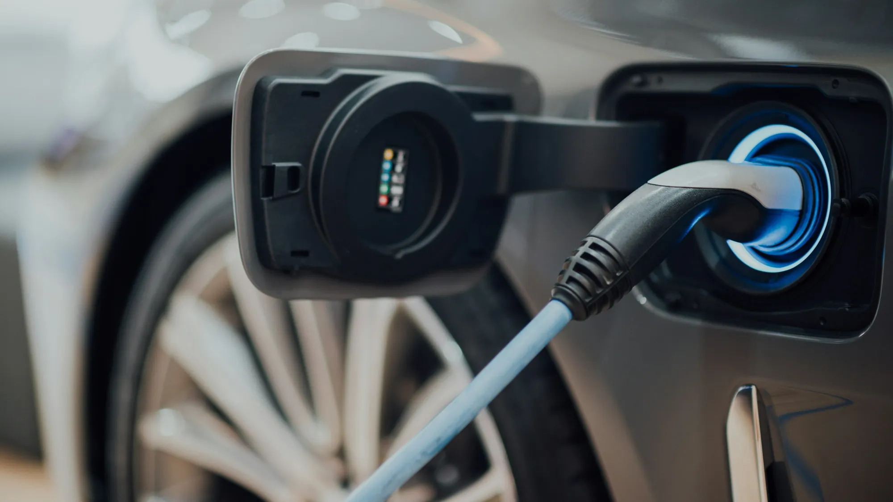

"¿Y cuando se dañe la batería, cuánto vale?" Es la objeción que más aparece en los comentarios de cualquier video sobre eléctricos. Es una duda razonable: la batería es la pieza más costosa del carro. Pero la experiencia de los mercados donde los eléctricos llevan más de diez años rodando muestra que **la batería rara vez se daña de golpe**: pierde capacidad poco a poco.

## Qué le pasa a una batería con los años

Con cada ciclo de carga y descarga, la batería pierde una pequeña parte de su capacidad. En la práctica, eso se traduce en menos kilómetros por carga, no en un carro que deja de arrancar. Los estudios con grandes flotas en Europa y Estados Unidos muestran pérdidas graduales, que varían mucho según el modelo, la química y el uso.

Dos químicas dominan el mercado colombiano:

| Química | Dónde la verá | Fortaleza | Debilidad |
|---|---|---|---|
| **LFP** (litio ferrofosfato) | La mayoría de eléctricos chinos y de entrada, como el Chery E5 o el Kia EV2 | Muy durable y tolera bien cargar al 100 % | Menos energía por kilo |
| **NMC** (níquel, manganeso y cobalto) | Muchos modelos europeos, coreanos y de gama alta | Más autonomía con menos peso | Se recomienda no dejarla al 100 % por mucho tiempo |

## Qué garantía ofrecen en Colombia

Las marcas compiten cada vez más con la garantía. Dos ejemplos de lanzamientos de 2026:

- **Kia EV2:** 8 años o 160.000 km, lo que ocurra primero.
- **Chery E5:** 8 años o 200.000 km, lo que ocurra primero.

Lo importante está en la letra pequeña. Antes de firmar, pregunte:

1. **¿La garantía es de la batería o de todo el carro?** A veces son plazos distintos.
2. **¿Qué porcentaje de capacidad garantizan?** Muchas marcas cubren la batería si cae por debajo de cierto nivel, por ejemplo 70 %, dentro del plazo.
3. **¿Qué la anula?** Usar cargadores no certificados, saltarse los mantenimientos en el concesionario o modificaciones eléctricas.
4. **¿Se transfiere al vender el carro?** Clave si piensa revenderlo.

*La carga lenta en casa es la que menos estresa la batería. Foto: CHUTTERSNAP en Unsplash.*

## Los hábitos que más la cuidan

- **Cargue en casa la mayoría de las veces.** La carga rápida en corriente continua calienta más la batería. Usarla en viajes es normal; usarla todos los días acelera el desgaste.
- **Siga la recomendación de su química.** Con LFP, muchas marcas sugieren cargar al 100 % de vez en cuando para calibrar el sistema. Con NMC, lo usual es dejar el límite diario en 80 %.
- **No deje el carro mucho tiempo vacío.** Una batería que pasa semanas por debajo del 10 % se degrada más.
- **Evite el calor extremo cuando pueda.** Parquear a la sombra en ciudades calientes ayuda.

> Si compra usado, pida el reporte de estado de salud de la batería (SoH) en el concesionario de la marca. Es el dato más importante del carro. Lo explicamos en nuestra [guía para comprar un eléctrico usado](/es/notas/comprar-carro-electrico-usado-que-revisar/).

## Preguntas frecuentes

### ¿Cuánto cuesta cambiar la batería?

Depende mucho del modelo y de si se cambia completa o por módulos. Pida la cotización en el concesionario antes de comprar, sobre todo si el carro es usado y está cerca del fin de la garantía.

### ¿La batería se puede reparar?

En muchos modelos sí: se reemplazan los módulos dañados y no la batería entera. No todas las marcas ofrecen ese servicio en Colombia.

### ¿El clima de Bogotá afecta la batería?

El clima templado de Bogotá es favorable. El frío extremo y el calor intenso son los que más afectan, y ninguno es habitual en la ciudad.

Revise la capacidad de batería y la garantía de cada modelo en el [comparador de Mejor Eléctrico](/es/comparador/).

---

**Fuentes:** [El Carro Colombiano: Kia EV2 en Colombia](https://www.elcarrocolombiano.com/lanzamientos/kia-ev2-colombia-precio-caracteristicas-suv-electrico/) · [El Carro Colombiano: Chery E5 en Colombia](https://www.elcarrocolombiano.com/resenas/chery-e5-primer-contacto-suv-electrica-precio-colombia/)
