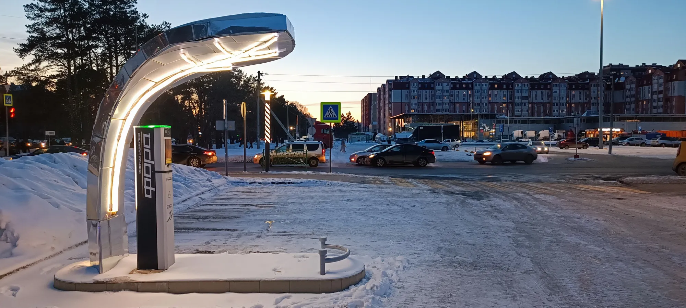

Un carro de gasolina calienta la cabina con el calor que le sobra al motor. Un eléctrico no tiene ese calor de sobra: su motor es tan eficiente que casi no lo produce. Para calentar la cabina y la batería tiene dos opciones. La más simple es una **resistencia eléctrica**, como la de un calentador, que gasta mucha energía. La otra es una **bomba de calor**, que funciona como un aire acondicionado al revés: mueve calor del aire de afuera hacia adentro y gasta bastante menos energía para lograr el mismo efecto.

## Cuánta autonomía ahorra

La empresa Recurrent analizó datos reales de más de 18.000 eléctricos en Estados Unidos durante el invierno de 2024 y 2025. A **0 °C**, los resultados fueron estos:

| Tipo de carro | Autonomía que conserva a 0 °C |
|---|---|
| Eléctricos con bomba de calor | 83 % |
| Eléctricos sin bomba de calor | 75 % |
| Tesla Model 3 2025 con bomba de calor | 87 % |
| Tesla Model 3 sin bomba de calor | 79 % |

Fuente: Recurrent, citado por The Car Guide en enero de 2025.

En frío, la bomba de calor recupera unos 8 puntos de autonomía. En un carro de 400 km, eso son unos 30 km más en un día de invierno.

*Donde hiela, la bomba de calor recupera unos 8 puntos de autonomía. En casi toda Latinoamérica el beneficio es mucho menor. Foto: RG72, CC BY 4.0, vía Wikimedia Commons.*

## ¿Y en Latinoamérica?

Buena parte de las ciudades latinoamericanas rara vez tiene temperaturas bajo cero, y muchas viven entre 20 °C y 30 °C buena parte del año. Ahí, el problema no es calentar la cabina sino enfriarla, y el aire acondicionado de un eléctrico ya funciona con un compresor eficiente, tenga o no bomba de calor. Por eso, en la costa colombiana, en Ciudad de México o en São Paulo, la bomba de calor aporta poco.

Hay excepciones. En ciudades de altura con mañanas frías, como Bogotá, Quito o La Paz, la calefacción y el desempañador se usan a diario, y la bomba de calor ayuda algo en las mañanas. En el sur de Chile y de Argentina, con inviernos de temperaturas bajo cero, el beneficio se acerca al del estudio de Recurrent.

| Situación | ¿Vale la pena la bomba de calor? |
|---|---|
| Clima cálido todo el año | Poco: el gasto es en aire acondicionado |
| Ciudad de altura con mañanas frías | Algo, en las mañanas y con lluvia |
| Inviernos con temperaturas bajo cero | Sí: puede sumar decenas de kilómetros por carga |

## Lo que la bomba de calor no resuelve

La batería también sufre con el frío extremo: carga más lento y entrega menos energía, con o sin bomba de calor. Y en calor intenso, el que trabaja es el sistema de refrigeración de la batería, que no depende de la bomba de calor. En Latinoamérica, para la autonomía pesan más la velocidad en carretera y la topografía que la temperatura. Lo explicamos en [autonomía real en Colombia](/es/notas/autonomia-real-carro-electrico-colombia-montana-autopista/).

> Si vive en un clima templado o cálido, no pague una versión más cara solo por la bomba de calor. Si vive donde hiela, póngala en la lista de requisitos.

## Preguntas frecuentes

### ¿Qué es la bomba de calor de un carro eléctrico?

Un sistema que calienta la cabina moviendo calor del aire exterior, como un aire acondicionado al revés, con menos gasto de energía que una resistencia eléctrica.

### ¿Cuánta autonomía ahorra la bomba de calor?

A 0 °C, los eléctricos con bomba de calor conservaron en promedio el 83 % de su autonomía, frente al 75 % de los que no la tienen, según Recurrent.

### ¿Hace falta bomba de calor en Colombia?

En la mayoría del país, no. Puede ayudar algo en ciudades frías de altura, pero el gasto principal en Colombia es el aire acondicionado y la montaña.

---

**Fuentes:** [The Car Guide: estudio de Recurrent sobre la bomba de calor en invierno](https://www.guideautoweb.com/en/articles/77130/this-key-feature-will-boost-your-ev-s-range-in-winter-study-shows) · [Driven: el frío reduce la autonomía en 20 % en promedio](https://www.drivencarguide.co.nz/news/cold-weather-slashes-ev-range-by-20-on-average-study)
