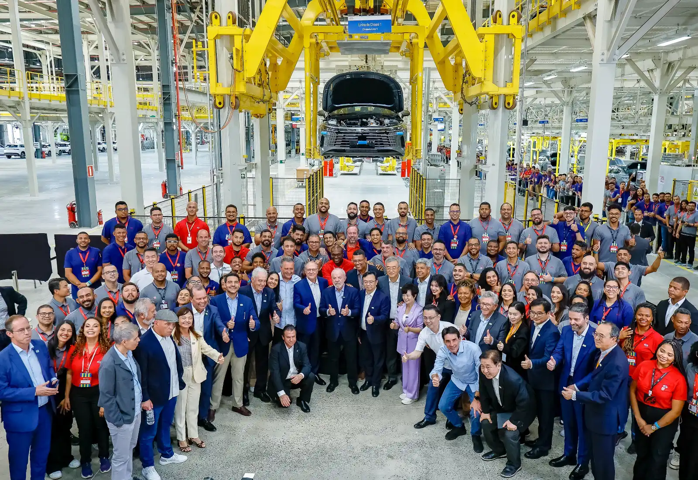

Desde julio de 2026, un carro eléctrico importado paga en Brasil un **arancel del 35 %**. Es el último paso de un calendario que el gobierno anunció en noviembre de 2023: la tasa arrancó en 10 % en enero de 2024 y subió por etapas. La medida busca una cosa: que las marcas que venden en Brasil, el mayor mercado eléctrico de Latinoamérica, fabriquen allá.

## El calendario completo

| Tipo de carro | Enero de 2024 | Julio de 2024 | Julio de 2025 | Julio de 2026 |
|---|---|---|---|---|
| Eléctrico | 10 % | 18 % | 25 % | 35 % |
| Híbrido enchufable | 12 % | 20 % | 28 % | 35 % |
| Híbrido | 12 % | 25 % | 30 % | 35 % |

Calendario aprobado por el comité Gecex-Camex, según Eixos.

Al subir más rápido el arancel de los híbridos que el de los eléctricos, el gobierno dejó a los eléctricos puros con el impuesto más bajo durante la transición. Desde julio de 2026, sin embargo, los tres tipos pagan lo mismo.

## La respuesta de BYD: ensamblar en Bahía

BYD es la marca más expuesta, porque vende más eléctricos que nadie en Brasil. Su respuesta fue comprar la antigua planta de Ford en **Camaçari**, en el estado de Bahía, y empezar a producir allí en 2025. El **16 de julio de 2026** salió de esa fábrica el carro número 100.000, un **Dolphin Mini**. La planta ensambla también el sedán King y la SUV Song Pro, emplea a unas 5.500 personas y tiene capacidad para 150.000 carros al año, con espacio para duplicarla.

Hay una letra pequeña. Según InvestNews, los carros llegan a Camaçari como **kits semidesarmados**, con la carrocería soldada y pintada en China, y en Brasil se hace el montaje final. Las etapas de estampado, soldadura y pintura todavía estaban en construcción a mediados de 2026, y la producción en serie de esas etapas se aplazó para final de año.

*La planta de Camaçari emplea a unas 5.500 personas y ensambla carros a partir de kits importados de China. Foto: Lula Oficial, CC BY-SA 4.0, vía Wikimedia Commons.*

## El arancel también llega a los kits

El gobierno cerró ese atajo de forma gradual. Los kits semidesarmados pagan el 35 % desde julio de 2026, y a partir del **1 de enero de 2027** lo pagarán también los kits completamente desarmados, que hasta diciembre pagan el 14 %. Mientras tanto, una cuota de 463 millones de dólares permite importar kits sin arancel. El gobierno la renovó el 23 de junio de 2026 por seis meses, con la oposición de Anfavea, el gremio de los fabricantes tradicionales.

La presión, entonces, no es solo vender carros hechos en Brasil, sino hacerlos con más piezas brasileñas. BYD dice que espera llegar a cerca del 50 % de contenido local a fin de año.

## Por qué importa fuera de Brasil

BYD planea usar Camaçari como base de exportación para Latinoamérica, empezando por **Argentina** y **México**. Si eso se concreta, parte de los Dolphin Mini que se venden en la región podrían salir de Bahía y no de China.

Para Colombia, el efecto directo es menor por ahora, porque casi todos los eléctricos que se venden en el país llegan de China. La decisión de Brasil sirve más como antecedente: es el primer gran mercado de la región que usó el arancel para obligar a las marcas de eléctricos a fabricar en casa.

## Preguntas frecuentes

### ¿Cuánto es el arancel a los carros eléctricos en Brasil?

35 % desde julio de 2026 para los eléctricos importados, el mismo que pagan los híbridos y los híbridos enchufables.

### ¿BYD fabrica carros en Brasil?

Ensambla el Dolphin Mini, el King y la Song Pro en Camaçari desde 2025, a partir de kits importados de China. La producción con estampado, soldadura y pintura locales está prevista para finales de 2026.

### ¿El arancel subió las ventas de eléctricos en Brasil?

No las frenó en el primer semestre de 2026: crecieron un 193 % frente al mismo periodo de 2025, según Olade. El aumento al 35 % empezó a regir después.

---

**Fuentes:** [Eixos: por qué Brasil vuelve a cobrar arancel a los eléctricos](https://eixos.com.br/por-que-o-brasil-vai-voltar-a-taxar-importacao-de-carros-eletricos/) · [InvestNews: BYD llega a 100.000 carros en Camaçari](https://investnews.com.br/negocios/byd-chega-a-100-mil-carros-em-camacari-mas-ainda-depende-de-kits-chineses-o-que-falta/) · [Autopapo: BYD inaugura la antigua fábrica de Ford en Bahía](https://autopapo.com.br/noticia/byd-inaugura-fabrica-comprada-da-ford-na-bahia/) · [Forbes Perú: ventas de eléctricos en Latinoamérica, datos de Olade](https://forbes.pe/negocios/2026-09-22/latinoamerica-supera-el-millon-de-vehiculos-electricos-con-mas-de-la-mitad-en-brasil/)
