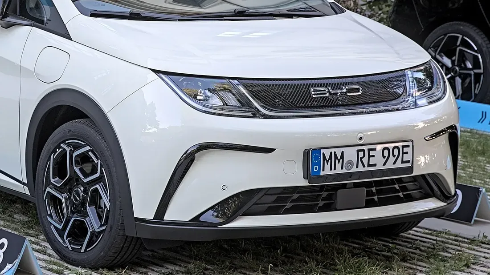

El 17 de diciembre de 2024, **Latin NCAP**, el programa que evalúa la seguridad de los carros que se venden en América Latina, le dio **cinco estrellas** al **BYD Dolphin Plus**. Fue la primera vez que un carro eléctrico y un fabricante chino lograban la calificación máxima en la historia del programa. Para Colombia hay un matiz importante: Latin NCAP aclaró que el resultado aplica solo a esa versión, que se vende en Brasil.

## Lo esencial

- **Calificación:** 5 estrellas, publicada el 17 de diciembre de 2024.
- **Versión evaluada:** Dolphin Plus, con siete airbags, control de estabilidad y asistencias a la conducción de serie.
- **Protección de adultos:** 92,60 %.
- **Protección de niños:** 93,17 %.
- **Peatones y usuarios vulnerables:** 77,03 %.
- **Asistencias a la conducción:** 85,17 %.

## Qué evaluó Latin NCAP

Latin NCAP hizo choque frontal, choque lateral, choque lateral contra poste y prueba de latigazo cervical. También evaluó la protección de peatones, el control de estabilidad, el frenado autónomo en ciudad, en carretera y con usuarios vulnerables, el mantenimiento de carril, el asistente de velocidad y la detección de punto ciego.

En el choque frontal, la estructura y la zona de los pies se mantuvieron estables. La protección en el impacto lateral y la de los niños fue buena. En el choque contra poste, la protección del pecho fue marginal.

*El frente del Dolphin. La estructura delantera es la misma en el Dolphin Plus de Brasil y en el Dolphin que se vende en Colombia. Foto: Alexander-93, CC BY-SA 4.0, recortada, vía Wikimedia Commons.*

## Los puntos flojos

El más bajo de los cuatro puntajes fue el de **peatones**, con 77,03 %. Latin NCAP señaló que la protección de peatones podría ser mejor, aunque combinada con el frenado autónomo el resultado fue bueno. En asistencias, el **mantenimiento de carril** y el **asistente de velocidad** no sumaron puntos.

## Por qué no aplica al Dolphin colombiano

| | Dolphin Plus evaluado (Brasil) | Dolphin en Colombia |
|---|---|---|
| Airbags | 7 | 6 |
| Asistencias avanzadas a la conducción | Sí, de serie | No |
| Estructura frontal | La misma | La misma |

El Dolphin que se vende en Colombia comparte la estructura base, así que el comportamiento del choque frontal y de la zona de los pies debería ser el mismo. Pero tiene un airbag menos y no trae asistencias avanzadas, que pesan en las áreas de asistencias y de usuarios vulnerables.

> Latin NCAP recomienda comprar las versiones que tienen el equipo evaluado. En el caso del Dolphin, ese equipo no está disponible en Colombia. Por eso no es correcto anunciar el Dolphin colombiano como un carro de cinco estrellas.

Stephan Brodziak, presidente de Latin NCAP, advirtió además que el resultado **no significa que todos los eléctricos ni todos los carros chinos sean más seguros**: cada modelo hay que evaluarlo por separado.

## Preguntas frecuentes

### ¿El BYD Dolphin tiene cinco estrellas en Latin NCAP?

La versión Dolphin Plus de Brasil, sí. El Dolphin que se vende en Colombia no fue evaluado y tiene menos equipo.

### ¿El BYD Seagull también sacó cinco estrellas?

No en Latin NCAP. Algunos medios confundieron el Seagull con el Dolphin Plus. El Seagull tiene cinco estrellas de Euro NCAP en su versión europea, el Dolphin Surf, como contamos en [esta nota](/es/notas/byd-seagull-dolphin-surf-euro-ncap-5-estrellas/).

### ¿Qué diferencia hay entre Latin NCAP y Euro NCAP?

Son programas independientes con protocolos parecidos. Latin NCAP evalúa los carros tal como se venden en América Latina, que muchas veces traen menos equipo que sus versiones europeas.

Compare el Dolphin con otros eléctricos urbanos en el [comparador de Mejor Eléctrico](/es/comparador/).

---

**Fuentes:** [Latin NCAP: BYD Dolphin Plus, cinco estrellas](https://www.latinncap.com/es/area-de-prensa/noticia/867617e084abbd/byd-dolphin-plus-primer-fabricante-chino-y-primer-auto-electrico-en-lograr-cinco-estrellas-en-latin-ncap) · [El Carro Colombiano: el resultado y el Dolphin de Colombia](https://www.elcarrocolombiano.com/industria/byd-tiene-al-primer-carro-chino-y-electrico-con-5-estrellas-de-seguridad-en-latin-ncap/) · [Xataka México: detalles de la prueba](https://www.xataka.com.mx/automovil/uno-autos-populares-byd-mexico-fue-sometido-a-pruebas-impacto-latin-ncap-resultado-sorprendente)
