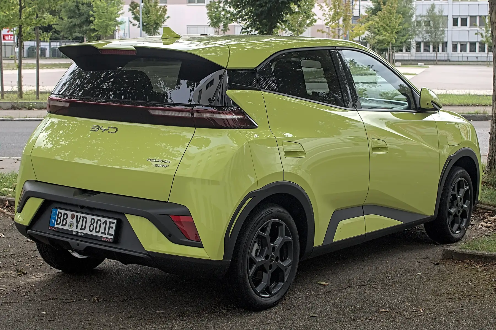

El **BYD Seagull** es el carro eléctrico de entrada de BYD en Colombia y se vende en dos versiones: **GL** y **GS**. Las dos tienen el mismo motor y la misma carrocería; cambian la batería, la autonomía, la carga rápida y parte del equipo de seguridad. Durante el BYD Fest de agosto de 2026 se ofreció desde **$69,99 millones**.

Si llegó aquí buscando un "Seagull Lite" o un "Seagull Go": no son nombres de versiones que BYD publique para Colombia. Las versiones colombianas son GL y GS.

## GL o GS: lo que cambia

| Dato | Seagull GL | Seagull GS |
|---|---|---|
| Batería | 30,08 kWh, LFP | 38 kWh, LFP |
| Autonomía | 300 km NEDC | 380 km NEDC |
| Carga rápida máxima | 30 kW | 40 kW |
| Carga en corriente alterna | 5,6 kW | 5,6 kW |
| Airbags | 4 | 6 |
| Cámara | De reversa | 360 grados |
| Peso | 1.165 kg | 1.245 kg |

Datos de la ficha de BYD Colombia y de El Carro Colombiano. La autonomía es NEDC, un ciclo más optimista que el WLTP: en uso real, sobre todo en carretera, hay que esperar menos.

## Lo que comparten

| Dato | GL y GS |
|---|---|
| Motor | 74 hp y 135 Nm, tracción delantera |
| Largo | 3.780 mm |
| Ancho | 1.715 mm |
| Alto | 1.580 mm |
| Distancia entre ejes | 2.500 mm |
| Baúl | 230 L |
| Puestos | 5 |
| Equipo | Apple CarPlay, Android Auto, sensores de parqueo, llave NFC, pantalla giratoria de 10,1 pulgadas y función V2L |

Con 3,78 metros de largo, el Seagull es fácil de parquear en ciudades con poco espacio. La contracara es el baúl de 230 litros, que alcanza para el mercado de la semana, no para un viaje familiar.

*Con 3,78 metros de largo, el Seagull cabe en casi cualquier parqueadero, pero su baúl es de 230 litros. En la foto, el Dolphin Surf europeo. Foto: Alexander-93, CC BY-SA 4.0, vía Wikimedia Commons.*

## Cuánto tarda en cargar

Con un cargador de pared en casa, a 5,6 kW, la batería de la GL se llena en unas seis horas y la de la GS en unas siete, si se parte de casi cero. Es un cálculo aproximado: divide la capacidad entre la potencia, y las pérdidas de carga agregan algo de tiempo. En una electrolinera rápida, los 30 o 40 kW máximos son bajos frente a SUV que cargan a más de 100 kW, aunque la batería pequeña compensa en parte: hay menos energía que reponer.

El V2L permite usar el carro como fuente de energía para aparatos externos, algo útil en un paseo o en un corte de luz. Lo explicamos en [esta nota](/es/notas/v2l-carro-electrico-planta-electrica/).

## Cuál conviene

La **GS** cuesta más, pero suma 80 km de autonomía NEDC, carga rápida un tercio más potente, dos airbags más y cámara de 360 grados. Para quien sale de la ciudad aunque sea de vez en cuando, la diferencia de batería pesa. La **GL** alcanza para un uso estrictamente urbano con carga en casa.

Un punto de seguridad: la versión europea, el Dolphin Surf, tiene cinco estrellas en Euro NCAP, pero trae asistencias que el Seagull colombiano no tiene. Lo explicamos en [esta nota](/es/notas/byd-seagull-dolphin-surf-euro-ncap-5-estrellas/).

## Lo que viene: un Seagull más grande

En julio de 2026, BYD registró en China un Seagull de nueva generación, **42,5 cm más largo** (4.205 mm) y con 150 mm más entre ejes, un motor de 95 kW frente a los 55 kW actuales y la opción de un sensor LiDAR para asistencias más avanzadas. BYD no ha anunciado fecha de llegada a Latinoamérica.

## Preguntas frecuentes

### ¿Cuánta autonomía tiene el BYD Seagull?

300 km NEDC la GL y 380 km NEDC la GS.

### ¿Cuánto mide el BYD Seagull?

3.780 mm de largo, 1.715 mm de ancho y 1.580 mm de alto, con 2.500 mm entre ejes y 230 litros de baúl.

### ¿Qué potencia de carga rápida acepta el Seagull?

Hasta 30 kW la GL y 40 kW la GS. En corriente alterna, 5,6 kW.

---

**Fuentes:** [El Carro Colombiano: BYD Seagull en el BYD Fest 2026](https://www.elcarrocolombiano.com/recomendados/byd-seagull-nuevo-precio-colombia-byd-fest-2026/) · [BYD Colombia: ficha del Seagull](https://bydauto.com.co/7ff4ca2d229ddd4fd33205ed1f468676.pdf) · [CnEVPost: BYD registra un Seagull de nueva generación](https://cnevpost.com/2026/07/11/byd-files-all-new-seagull/)
