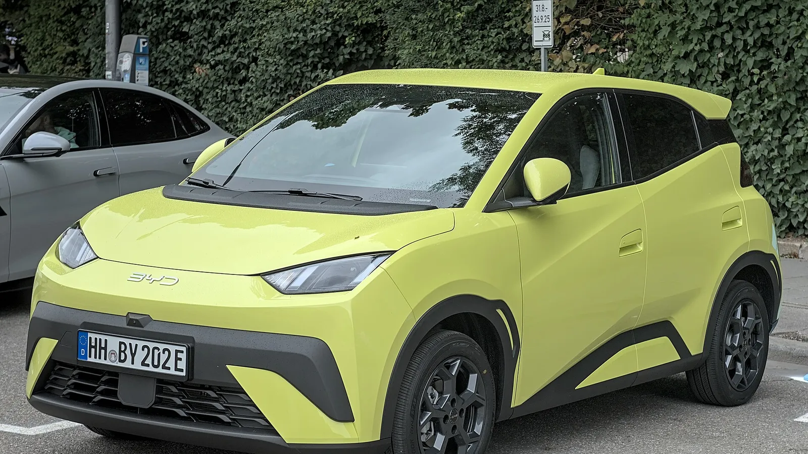

El **BYD Seagull**, uno de los eléctricos más baratos de Colombia, se vende en Europa como **Dolphin Surf**. Y en Europa, **Euro NCAP** le dio **cinco estrellas** en septiembre de 2025, algo poco común en un carro de 3,99 metros. La noticia es buena, pero no se puede trasladar tal cual al Seagull colombiano, porque el equipo de seguridad no es el mismo.

## Lo esencial

- **Calificación:** 5 estrellas, publicada en septiembre de 2025.
- **Versión evaluada:** Dolphin Surf Comfort, 1.390 kg. La calificación cubre todas las versiones europeas.
- **Protección de adultos:** 82 %.
- **Protección de niños:** 86 %.
- **Usuarios vulnerables:** 76 %.
- **Asistencias a la conducción:** 77 %.

## Los choques

| Prueba | Resultado |
|---|---|
| Frontal contra barrera móvil | Habitáculo estable, buena protección de rodillas y piernas |
| Frontal contra muro | Bueno para el conductor, pecho del pasajero trasero marginal |
| Lateral contra otro vehículo y contra poste | Puntaje máximo |
| Movimiento del ocupante del lado opuesto al choque | Malo, sin airbag central |
| Latigazo cervical | Bueno |

Que un carro tan pequeño saque el puntaje máximo en los dos choques laterales es lo más destacado de la prueba. El punto débil es que no tiene un airbag entre los asientos delanteros, así que en un golpe por un lado el ocupante del otro lado se mueve demasiado.

*El Dolphin Surf mide 3,99 metros, uno de los carros más pequeños con cinco estrellas de Euro NCAP. Foto: Alexander-93, CC BY-SA 4.0, vía Wikimedia Commons.*

## Asistencias: lo que hizo la diferencia

La versión europea trae frenado autónomo que funcionó bien frente a otros carros (8 de 9), ciclistas (7,6 de 8) y motociclistas (6 de 6). Con peatones fue adecuado (5,8 de 9) y no reacciona a peatones detrás del carro. También trae mantenimiento de carril, monitor del conductor con cámara y asistente de velocidad.

Sin ese equipo, el Dolphin Surf no habría llegado al mínimo de 70 % en asistencias que Euro NCAP exige para cinco estrellas.

## La diferencia con el Seagull colombiano

| | Dolphin Surf europeo | Seagull en Colombia |
|---|---|---|
| Airbags | Frontales, laterales y de cortina | 4 en la versión GL; 6 en la GS |
| Frenado autónomo de emergencia | Sí | No |
| Mantenimiento de carril | Sí | No |
| Monitor del conductor | Sí | No |

Cuando BYD lanzó el Seagull en Colombia, en abril de 2024, lo ofreció en dos versiones: **300 GL**, con cuatro airbags, y **400 GS**, con seis. Ninguna traía las asistencias avanzadas que tiene el modelo europeo.

> La estructura es la misma, así que la protección en los choques debería parecerse. Pero la calificación de cinco estrellas también premia sistemas que el Seagull colombiano no tiene. No es correcto decir que el Seagull que se vende aquí tiene cinco estrellas.

## Preguntas frecuentes

### ¿El BYD Seagull tiene cinco estrellas?

Su versión europea, el Dolphin Surf, sí, en Euro NCAP. El Seagull colombiano no ha sido evaluado y trae menos equipo.

### ¿Cuántos airbags tiene el Seagull en Colombia?

Cuatro en la versión 300 GL y seis en la 400 GS, según el lanzamiento de 2024. Confirme con el concesionario el equipo actual.

### ¿Es cierto que el Seagull sacó cinco estrellas en Latin NCAP?

No. En diciembre de 2024 algunos medios lo publicaron así, pero el carro que Latin NCAP evaluó fue el **BYD Dolphin Plus**, un modelo más grande que se vende en Brasil. Lo explicamos en nuestra [nota sobre esa prueba](/es/notas/byd-dolphin-plus-latin-ncap-5-estrellas/). Latin NCAP no ha publicado una prueba del Seagull ni del Dolphin Mini.

Compare las dos versiones del Seagull en el [comparador de Mejor Eléctrico](/es/comparador/?a=byd-seagull-gl-300-2026-co&b=byd-seagull-gs-400-2026-co).

---

**Fuentes:** [Euro NCAP: ficha de la prueba del BYD Dolphin Surf](https://cdn.euroncap.com/media/89338/euroncap-2025-byd-dolphin-surf-datasheet.pdf) · [The Driven: cinco estrellas del Dolphin Surf](https://thedriven.io/2025/09/10/byds-smallest-electric-car-gets-5-stars-for-safety/) · [El Carro Colombiano: lanzamiento del Seagull en Colombia](https://www.elcarrocolombiano.com/lanzamientos/byd-seagull-colombia-precio-carro-electrico-para-todos/)
