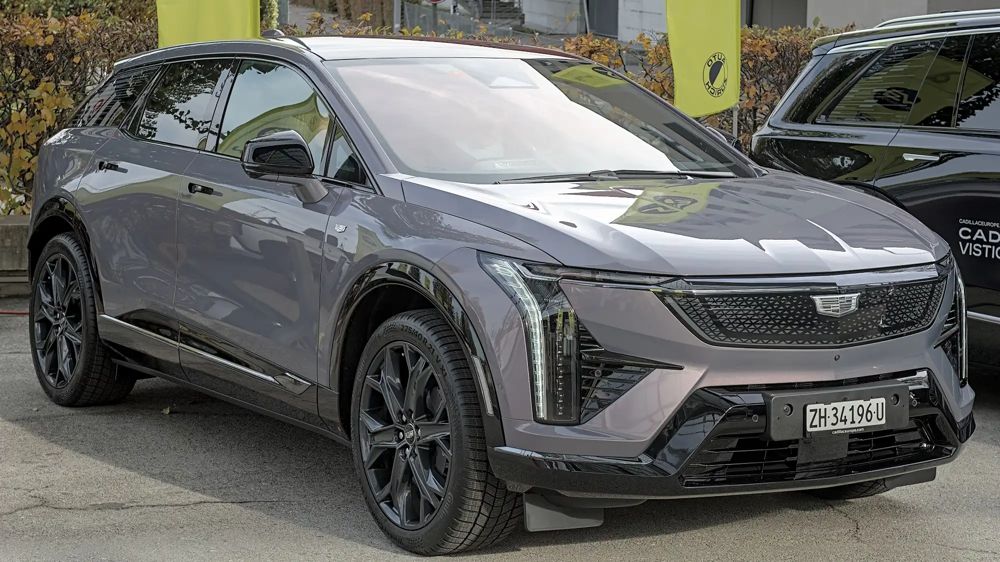

**Cadillac**, la marca de lujo de General Motors, vuelve a Colombia después de más de tres décadas de ausencia. Lo hará con una condición poco común: **solo venderá carros eléctricos**. La operación estará a cargo de **GM Colmotores**, y la marca aparece en el listado de las que debutarán alrededor del Salón del Automóvil de Bogotá, en noviembre de 2026.

## Lo esencial

- **Importador:** GM Colmotores.
- **Llegada:** prevista para 2026, sin fecha exacta anunciada.
- **Modelos mencionados:** Lyriq, Optiq y Vistiq. En el anuncio de mayo también se mencionó el sedán Celestiq.
- **Motores de combustión:** no vendrán.
- **Precios:** no anunciados.

## Los modelos

| Modelo | Tipo | Lo que se sabe |
|---|---|---|
| Lyriq | SUV mediana | Versión de tracción total con dos motores y hasta 500 hp. En Colombia vendría con doble motor. Hasta 505 km de autonomía en ciclo EPA |
| Optiq | SUV compacta | Dos motores, 300 hp y batería de 85 kWh. Hasta 486 km EPA |
| Vistiq | SUV de tres filas | Mencionada en el listado del Salón, sin datos para Colombia |
| Celestiq | Sedán de superlujo | 655 hp y 0 a 100 km/h en 3,7 segundos. Se produce en Estados Unidos |

La autonomía en ciclo **EPA** es la más exigente de las que publican las marcas, más que la WLTP europea. Los 505 km del Lyriq son, en ese sentido, una cifra conservadora.

*La Optiq, la SUV eléctrica más pequeña de Cadillac. Foto: Alexander Migl, CC BY-SA 4.0, recortada, vía Wikimedia Commons.*

## Contra quién compite

Cadillac llega a competir con las marcas premium alemanas, con Volvo y, pronto, con las marcas de lujo chinas que también debutan en el país, como **Avatr** y **Denza**. A diferencia de esas marcas chinas, Cadillac llega con un importador que ya opera en el país, GM Colmotores, aunque la marca no ha dicho si usará talleres de la red de Chevrolet.

Que una marca de lujo vuelva al país sin un solo modelo de gasolina muestra hasta dónde se movió el mercado: en septiembre de 2026, los eléctricos fueron el 17,4 % de los carros nuevos.

## Preguntas frecuentes

### ¿Cadillac vuelve a Colombia?

Sí. GM Colmotores la traerá de vuelta en 2026, después de más de 30 años sin presencia oficial.

### ¿Qué modelos venderá?

Solo eléctricos: el Lyriq, la Optiq y otros como la Vistiq. No vendrán modelos de gasolina.

### ¿Cuánto costará un Cadillac en Colombia?

Los precios no se han anunciado.

Compare SUV eléctricas de lujo en el [comparador de Mejor Eléctrico](/es/comparador/?a=volvo-ex30-p8-awd-2026-eu&b=kia-ev9-99-8-kwh-awd-gt-line-2026-eu).

---

**Fuentes:** [El Carro Colombiano: Cadillac regresa a Colombia](https://www.elcarrocolombiano.com/industria/cadillac-regresa-colombia-carros-electricos-lyriq-optiq-celestiq/) · [El Heraldo: regreso de Cadillac](https://www.elheraldo.co/economia/2026/05/12/marca-de-lujo-regresa-a-colombia-tras-32-anos-de-ausencia-su-enfoque-seran-los-modelos-electricos-de-alta-gama/) · [El Carro Colombiano: marcas nuevas del Salón 2026](https://www.elcarrocolombiano.com/lanzamientos/carros-nuevas-marcas-vienen-colombia-salon-del-automovil-bogota-2026/) · [Infobae: eléctricos en septiembre de 2026](https://www.infobae.com/colombia/2026/10/10/crece-la-venta-de-vehiculos-electricos-en-colombia-cerca-de-40000-automotores-en-lo-corrido-del-2026/)
