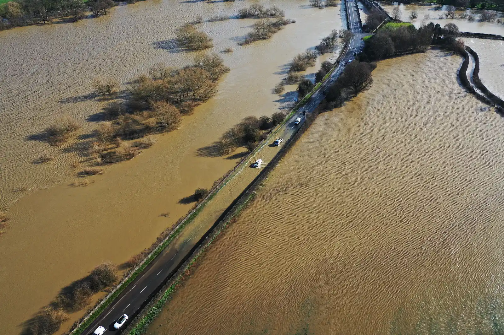

Manejar un carro eléctrico bajo la lluvia, lavarlo con manguera o cargarlo en una estación al aire libre mientras llueve no es peligroso. La batería y los conectores de alto voltaje van sellados, y los cargadores están diseñados para trabajar a la intemperie. El riesgo aparece con el agua profunda: atravesar una calle inundada o, peor, que el carro quede sumergido, en especial en agua de mar.

## Cuánta agua aguanta un eléctrico

Algunos fabricantes publican la profundidad de agua que el carro puede atravesar, medida desde la base de la llanta. Según SlashGear:

| Modelo | Profundidad máxima publicada |
|---|---|
| Tesla (cifra general de la marca) | 32 pulgadas, unos 81 cm |
| Nissan Leaf (probado) | 27,5 pulgadas, unos 70 cm |
| Ford F-150 Lightning | 24 pulgadas, unos 61 cm |
| Audi Q8 e-tron | 11,8 pulgadas, unos 30 cm |

Las cifras dependen de la altura del carro, de los componentes y de modificaciones como una suspensión rebajada. Y son una capacidad técnica, no una recomendación: la Asociación del Automóvil del Reino Unido aconseja no atravesar agua de más de unos 10 centímetros si está en movimiento, sea cual sea el carro. El agua que corre puede arrastrar un vehículo con mucha menos profundidad de la que parece, y una calle inundada esconde huecos y alcantarillas destapadas.

*La Asociación del Automóvil del Reino Unido aconseja no atravesar agua de más de unos 10 centímetros en movimiento, sea cual sea el carro. Foto: TCExplorer, CC BY-SA 2.0, vía Wikimedia Commons.*

## El agua salada, el riesgo más serio

El caso que más se cita es el del huracán Ian, en Florida, en 2022. En los días siguientes, los bomberos de un distrito cerca de Naples apagaron **seis incendios de eléctricos** que habían quedado bajo el agua de mar. Un profesor de la Universidad de Purdue explicó a E&E News que el agua salada, muy conductora, puede generar un cortocircuito entre los terminales de la batería, y que el fuego puede durar horas y reavivarse. En Florida se repitieron casos con los huracanes Idalia, en 2023, y Helene, en 2024.

El agua dulce también daña, pero la salada es la más peligrosa porque conduce mucho mejor la electricidad. Para Latinoamérica es una advertencia concreta en ciudades costeras expuestas a mares de leva o huracanes, como las del Caribe colombiano o la costa del golfo de México.

## Qué hacer si su eléctrico quedó bajo el agua

1. **No lo prenda ni lo conecte a cargar.** Aunque parezca que funciona, puede haber agua dentro de la batería.
2. **Si es posible, sáquelo de la zona de inundación** y estaciónelo al aire libre, lejos de casas y de otros carros, por si se incendia después.
3. **Avise a la aseguradora y al concesionario** para que lo revisen en un taller preparado para eléctricos antes de volver a usarlo.
4. **Esté atento a humo, olores o ruidos** que salgan de la parte de abajo, incluso días después. Si los nota, aléjese y llame a los bomberos.

En los eventos de inundación en Florida, las autoridades pidieron mover los aparatos con baterías de iones de litio, incluidos los carros, fuera de las zonas que podía alcanzar el mar.

> Una batería que estuvo sumergida no se evalúa a simple vista. Que el carro prenda no significa que esté bien.

## Preguntas frecuentes

### ¿Se puede manejar un carro eléctrico bajo la lluvia?

Sí. La batería y el sistema de alto voltaje están sellados, y la lluvia no representa un riesgo distinto al de un carro de gasolina.

### ¿Se puede cargar un carro eléctrico cuando llueve?

Sí, en cargadores diseñados para exteriores y con los cables en buen estado. Evite manipular conectores dañados o sumergidos.

### ¿Qué pasa si un carro eléctrico se inunda?

Puede dañarse la batería y, con agua salada, hay riesgo de incendio, incluso días después. No lo encienda ni lo cargue, y llévelo a revisión.

---

**Fuentes:** [SlashGear: ¿es seguro manejar un eléctrico en agua?](https://www.slashgear.com/1712474/electric-cars-drive-flood-water-safety-concerns/) · [E&E News: por qué seis eléctricos inundados se incendiaron tras el huracán Ian](https://www.eenews.net/articles/why-6-flooded-evs-burst-into-flames-after-hurricane-ian/)
