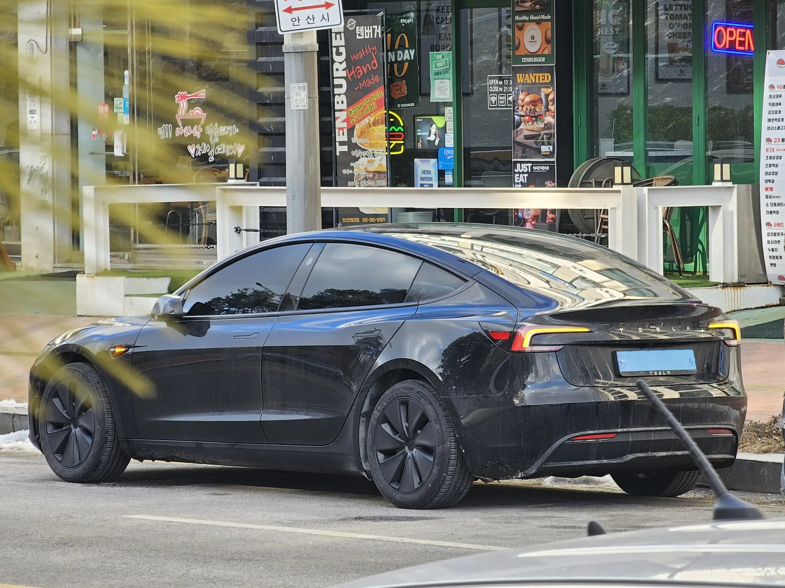

Un carro eléctrico usado puede ser la mejor compra del mercado o una mala sorpresa, y la diferencia casi nunca está en el kilometraje. Los eléctricos se devalúan más rápido que los de gasolina, así que el usado sale barato. A cambio, el comprador recibe menos garantía, pierde parte de los beneficios tributarios y se queda con tecnología de una o dos generaciones atrás. La decisión depende de cuánto pesa cada una de esas tres cosas para usted.

## Por qué los eléctricos usados son baratos

En España, donde el mercado de usados es más maduro, un estudio de Ganvam y DAT encontró que a los tres años un eléctrico **conserva el 52,9 % de su valor**, frente al **71,5 %** de uno de gasolina y el **72,6 %** de un híbrido convencional. Es casi 19 puntos menos que el de gasolina.

En Latinoamérica no hay todavía series de precios suficientes para hacer el mismo cálculo. En Colombia, el mercado de eléctricos de segunda es incipiente y la prensa especializada coincide en que, por ahora, el precio depende más de la percepción que de datos. Pero hay una señal clara: la guerra de precios que empezó con la llegada de Tesla a finales de 2025 bajó algunos modelos nuevos **hasta $80 millones**, según cifras de Fasecolda reportadas por Blu Radio. Quien compró en 2024 compite hoy contra nuevos más baratos, y tiene que rebajar para vender.

La revista española ONMOTOR atribuye la caída de los usados en Europa al miedo a las baterías de segunda y a la velocidad con que salen nuevas generaciones, cada una con más autonomía y más asistencias. El miedo a la batería es la parte que menos se sostiene con datos.

*El Model 3 renovado trae cambios de diseño y equipo frente al de primera generación. Quien compra usado se ahorra la primera caída de precio, pero se queda con la tecnología anterior. Foto: Damian B Oh, CC BY-SA 4.0, vía Wikimedia Commons.*

## La batería, el miedo que los datos no confirman

La empresa Recurrent, que analiza datos de batería de eléctricos en Estados Unidos, encontró que un eléctrico moderno conserva en promedio el **97 % de su autonomía a los tres años** y el **95 % a los cinco**. Solo el **0,3 %** de los carros que siguió necesitó un cambio de batería. El calor extremo y el uso diario de carga rápida aceleran el desgaste, pero en condiciones normales la pérdida es lenta.

Eso no quiere decir que no haya que revisarla. Un cambio de batería por fuera de garantía puede costar entre el **40 % y el 45 % del valor del carro**, según el sector citado por Noticias Caracol. Por eso el reporte de estado de salud de la batería es el documento más importante en la compra de un usado.

## Nuevo o usado: cuándo conviene cada uno

| Situación | Conviene más |
|---|---|
| Quiere el precio más bajo posible y va a cargar en casa | Usado de dos a tres años, con reporte de batería |
| Quiere la devolución del IVA o la deducción en renta | Nuevo |
| Maneja mucho, más de 20.000 km al año | Nuevo, por la garantía completa de kilometraje |
| Le importan las asistencias de seguridad | Nuevo, o un usado de una generación que ya las traía |
| Quiere vender en pocos años | Usado: ya absorbió la primera caída de precio |
| No puede revisar la batería ni conseguir el historial | Nuevo |

## Lo que se pierde al comprar usado en Colombia

Algunos beneficios son para quien compra el carro nuevo y no pasan al segundo dueño. La **devolución del IVA** y la **deducción en renta** están atadas a la compra original con certificado de la UPME. El **descuento del 60 % en el impuesto vehicular de Bogotá** dura cinco años contados desde la matrícula: si el carro tiene tres, a usted le quedan dos. La **exención del pico y placa** y la tarifa máxima del 1 % en el impuesto vehicular sí siguen al carro. El detalle está en [beneficios de comprar un eléctrico](/es/notas/beneficios-tributarios-carro-electrico-2026/).

Con la **garantía** hay que hacer la cuenta. La de la batería suele durar ocho años con un tope de kilómetros, así que un carro de tres años con 60.000 km todavía tiene cinco años de respaldo si el tope es de 160.000 km. La garantía general del carro, en cambio, puede ser de solo tres años, como en la Chevrolet Equinox EV. Lo explicamos en [cuánto dura la garantía de un eléctrico](/es/notas/cuanto-dura-la-garantia-de-un-carro-electrico/).

## Qué revisar en un eléctrico usado

Antes de pagar, pida cinco cosas:

1. **El reporte de estado de salud de la batería**, hecho en el concesionario de la marca o con un equipo de diagnóstico, y por escrito.
2. **El certificado de garantía vigente**, con la fecha de inicio y el tope de kilómetros, confirmado con el número VIN en el concesionario.
3. **El historial de mantenimientos** en la red autorizada. Sin él, la marca puede negar un reclamo de garantía.
4. **La consulta en el RUNT**, para confirmar que no tenga prendas, embargos ni comparendos, y que la tecnología del motor aparezca como eléctrica.
5. **Los cables de carga originales** y el conector, que debe coincidir con las electrolineras que usted va a usar.

La lista completa, con lo que se revisa en llantas, frenos y software, está en [qué revisar al comprar un eléctrico usado](/es/notas/comprar-carro-electrico-usado-que-revisar/).

> Una regla práctica: si el usado cuesta casi lo mismo que un nuevo de entrada de otra marca, el nuevo suele ganar, porque trae garantía completa, beneficios tributarios y asistencias más recientes. El usado gana cuando la diferencia de precio es grande y la batería está comprobada.

## Preguntas frecuentes

### ¿Vale la pena comprar un carro eléctrico usado?

Sí, si la diferencia de precio frente a un nuevo es grande y la batería tiene un reporte de buen estado. Los eléctricos se devalúan rápido, así que el segundo dueño se ahorra la primera caída de precio.

### ¿Cuánto se devalúa un carro eléctrico?

En España, un eléctrico conserva cerca del 53 % de su valor a los tres años, frente a cerca del 72 % de uno de gasolina. En Latinoamérica todavía no hay datos suficientes para una cifra confiable.

### ¿Cuánto dura la batería de un eléctrico usado?

Según los datos de Recurrent, un eléctrico moderno conserva en promedio el 95 % de su autonomía a los cinco años. Lo que más la desgasta es el calor extremo y la carga rápida diaria.

---

**Fuentes:** [El Carro Colombiano: estudio de Ganvam y DAT sobre el valor de los eléctricos a tres años](https://www.elcarrocolombiano.com/notas-de-interes/cuanto-vale-un-carro-electrico-despues-de-tres-anos-estudio-revela-datos-impactantes/) · [InsideEVs: salud de la batería en eléctricos usados, datos de Recurrent](https://insideevs.com/features/794674/used-ev-battery-health-guide-2026/) · [ONMOTOR: problemas reales de los eléctricos en 2026](https://onmotor.es/problemas-reales-en-los-coches-electricos-en-2026/) · [Pulzo: reventa de eléctricos en Colombia](https://www.pulzo.com/carros/venta-carros-electricos-segunda-colombia-clopatofsky-dice-que-pasara-PP5103945) · [Blu Radio: carros que más bajaron de precio según Fasecolda](https://www.bluradio.com/motor/los-20-carros-byd-kia-y-mas-que-mas-han-bajado-de-precio-tras-exito-de-tesla-segun-fasecolda-so35) · [Valora Analitik: descuentos de impuesto vehicular en Bogotá](https://www.valoraanalitik.com/carros-electricos-en-bogota-tendran-hasta-70-de-descuento-en-impuesto-vehicular/)
