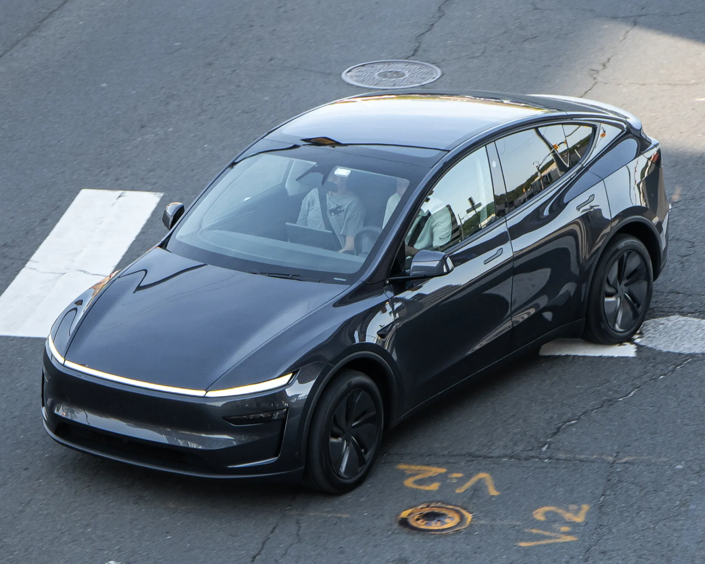

Colombia matriculó **39.784 carros eléctricos** entre enero y septiembre de 2026, un 221,7 % más que en el mismo periodo de 2025. En septiembre fueron el **17,4 % de los carros nuevos** del país, casi uno de cada seis. Esta guía reúne lo que hay que saber antes de comprar uno: precios, beneficios, carga, seguridad y costos de uso.

## Cuánto cuesta un carro eléctrico en Colombia

El rango va desde microcarros urbanos de unos $47 millones hasta SUV de lujo de más de $250 millones. La mayoría de las ventas se concentra entre $80 y $120 millones:

| Modelo | Precio de entrada publicado |
|---|---|
| Chery E5 Comfort | $79,99 millones |
| Kia EV2 Air | $89,99 millones |
| Nuevo BYD Dolphin | $89,99 millones |
| Geely EX5 SE | $92,9 millones |
| MG S5 EV | $94,99 millones |
| Tesla Model 3 | $115,99 millones |
| Tesla Model Y | $120,99 millones |

Precios de lanzamiento o de lista reportados por la prensa y las marcas en 2026; las promociones los mueven con frecuencia. La guerra de precios que empezó con la llegada de Tesla, en noviembre de 2025, bajó varios modelos. Lo explicamos en [el efecto Tesla](/es/notas/guerra-de-precios-carros-electricos-efecto-tesla/), y en [por qué los eléctricos son caros](/es/notas/por-que-los-carros-electricos-son-tan-caros/) está el origen del precio.

## Los beneficios que tiene un eléctrico

Los eléctricos pagan **IVA del 5 %** en lugar del 19 %, entran sin arancel, pagan un impuesto vehicular de máximo el 1 % del avalúo y tienen descuento en el SOAT. En Bogotá, el impuesto vehicular tiene un descuento adicional del 60 % durante cinco años, y están exentos del pico y placa por una ley nacional. Quien compra nuevo puede pedir además la devolución del IVA y una deducción en renta, con certificado de la UPME.

La lista completa está en [beneficios de comprar un eléctrico](/es/notas/beneficios-tributarios-carro-electrico-2026/), y el paso a paso de la devolución, en [esta nota](/es/notas/devolucion-iva-carro-electrico-dian-paso-a-paso/).

*El Tesla Model Y fue el carro más vendido de Colombia en septiembre de 2026, entre todas las tecnologías. Foto: OWS Photography, CC BY 4.0, vía Wikimedia Commons.*

## Los más vendidos

El **Tesla Model Y** domina: en septiembre de 2026 tuvo 2.220 matrículas, el 37,7 % de los eléctricos, y fue el carro más vendido del país entre todas las tecnologías. Lo siguieron la Chery E5, el BYD Yuan Up, la MG S5 y el Tesla Model 3. Bogotá concentra más de la mitad de los eléctricos matriculados en el año, seguida de Medellín y Cali. El detalle está en [cómo cerró septiembre](/es/notas/ventas-carros-electricos-colombia-septiembre-2026/).

## Dónde se cargan

Lo más barato es cargar en casa: con la tarifa de Enel de agosto de 2026, el kWh costó $863,6 en estrato 4 en Bogotá. En la calle, el país tenía cerca de **520 puntos de carga públicos** en 229 estaciones a mediados de 2026, con cuatro de cada diez en Bogotá, y Tesla cobra $1.300 por kWh en sus supercargadores de Bogotá y Medellín.

Para quien vive en apartamento, la ley no permite prohibir un cargador en un parqueadero privado, aunque el conjunto puede regularlo. Lo explicamos en [qué dice la ley](/es/notas/instalar-cargador-electrico-conjunto-residencial/), y los costos están en [cuánto cuesta una carga](/es/notas/cuanto-cuesta-una-carga-de-carro-electrico-latinoamerica/).

## Seguridad: la versión colombiana importa

Varios eléctricos que se venden en Colombia tienen cinco estrellas en Euro NCAP, pero la calificación vale para la versión europea. Algunas versiones colombianas de entrada llegan sin frenado autónomo ni asistente de carril. Antes de comprar, revise el equipo de la versión exacta con [esta lista](/es/notas/carros-electricos-pequenos-punto-ciego-asistente-de-carril/).

## Lo que cuesta mantenerlo

Un eléctrico no cambia aceite ni filtros de motor, y el freno regenerativo gasta menos las pastillas. En cambio, las llantas se desgastan más rápido por el peso, y conviene revisar la garantía: la de la batería suele ser de ocho años, pero la del resto del carro puede ser de solo tres. Más detalle en [mantenimiento](/es/notas/mantenimiento-carro-electrico-que-incluye/) y [garantías](/es/notas/cuanto-dura-la-garantia-de-un-carro-electrico/).

> La pregunta que más define la compra no es qué carro, sino dónde lo va a cargar. Si tiene dónde enchufarlo en casa o en el trabajo, casi cualquier eléctrico del mercado le sirve para la ciudad.

## Preguntas frecuentes

### ¿Cuántos carros eléctricos hay en Colombia?

El RUNT tenía 77.215 eléctricos registrados a mayo de 2026, según el Ministerio de Minas y Energía. Entre enero y septiembre se matricularon 39.784 más.

### ¿Cuál es el carro eléctrico más vendido en Colombia?

El Tesla Model Y, con 14.381 matrículas entre enero y septiembre de 2026.

### ¿Los carros eléctricos tienen pico y placa en Colombia?

No. La exención de los eléctricos sale de una ley nacional. La de los híbridos, en cambio, depende de cada ciudad.

---

**Fuentes:** [Portafolio: eléctricos más vendidos en septiembre de 2026](https://www.portafolio.co/negocios/vehiculo/tesla-domina-los-electricos-mas-vendidos-en-colombia-concentro-41-3-de-las-matriculas-durante-septiembre-504120) · [Infobae: eléctricos de enero a septiembre de 2026](https://www.infobae.com/colombia/2026/10/10/crece-la-venta-de-vehiculos-electricos-en-colombia-cerca-de-40000-automotores-en-lo-corrido-del-2026/) · [Portafolio: beneficios tributarios para eléctricos](https://www.portafolio.co/negocios/vehiculo/carros-electricos-ganan-terreno-en-colombia-por-tasas-bajas-iva-reducido-y-alivios-tributarios-493822) · [Ley 1964 de 2019](https://www.alcaldiabogota.gov.co/sisjur/normas/Norma1.jsp?i=85510) · [Enel Colombia: tarifas de agosto de 2026](https://www.enel.com.co/content/dam/enel-co/español/personas/1-17-1/2026/pliego%20tarifario%20digital%20_agosto_2026.pdf) · [Minuto60: 520 puntos de carga en 229 estaciones](https://minuto60.com/vida-moderna/esta-preparada-colombia-boom-los-vehiculos-electricos/13487) · [Portafolio: financiación de Tesla y precios de octubre de 2026](https://www.portafolio.co/negocios/vehiculo/tesla-ofrece-financiacion-al-0-de-interes-en-colombia-para-model-3-y-model-y-asi-puede-acceder-505120)
