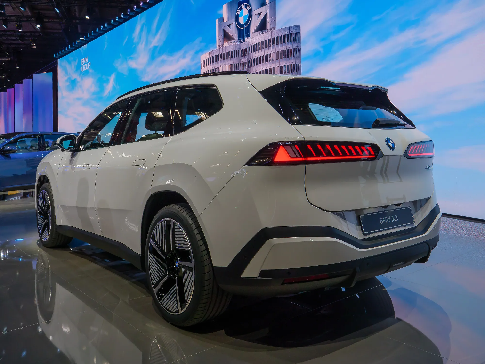

El carro eléctrico con más autonomía homologada del mundo en 2026 es el **Lucid Air Grand Touring**, con **960 km WLTP**. Detrás vienen el **Mercedes EQS 450+**, con 920 km, y el **BMW i3 50 xDrive**, la nueva berlina eléctrica de BMW, con 906 km.

## Los diez con más autonomía WLTP

| Puesto | Modelo y versión | Autonomía WLTP |
|---|---|---|
| 1 | Lucid Air Grand Touring | 960 km |
| 2 | Mercedes-Benz EQS 450+ (versión de 800 voltios) | 920 km |
| 3 | BMW i3 50 xDrive First Edition | 906 km |
| 4 | BMW iX3 50 xDrive | 805 km |
| 5 | Mercedes-Benz CLA 250+ | 792 km |
| 6 | Audi A6 Sportback e-tron Performance | 777 km |
| 7 | Mercedes-Benz Clase C eléctrico C 400 4Matic | 753 km |
| 8 | Tesla Model 3 Premium Long Range RWD | 750 km |
| 9 | DS N°8 FWD Long Range | 749 km |
| 10 | Lucid Gravity Grand Touring | 748 km |

Ranking publicado en julio de 2026 por el portal alemán Elektroquatsch con cifras de homologación europea.

Siete de los diez son berlinas o carros de techo bajo. No es coincidencia: a más de 100 km/h, la resistencia del aire es lo que más energía consume, y una carrocería baja y alargada la reduce. Un SUV con la misma batería recorre menos.

*El nuevo BMW iX3 50 xDrive llega a 805 km WLTP, la mayor cifra para un SUV en el ranking. Foto: Matti Blume, CC BY-SA 4.0, vía Wikimedia Commons.*

## Por qué estas cifras no se cumplen en la calle

El ciclo WLTP mezcla ciudad, carretera y autopista a velocidades moderadas y a unos 23 °C. En condiciones reales la cifra baja, sobre todo en autopista, con el aire acondicionado encendido o con mucha subida. En Colombia, la montaña pesa más que el clima: una subida larga gasta mucha energía, y la bajada solo recupera una parte. El detalle está en [autonomía real en Colombia](/es/notas/autonomia-real-carro-electrico-colombia-montana-autopista/).

Tampoco conviene comparar estas cifras con las de fichas chinas. Una autonomía **CLTC** es casi siempre más alta que la WLTP del mismo carro, y la **NEDC** también. Solo se comparan cifras del mismo ciclo, como explicamos en [CLTC, NEDC o WLTP](/es/notas/autonomia-electricos-cltc-nedc-wltp-como-leerla/).

## Qué autonomía tienen los eléctricos que se venden en Colombia

La mayoría de los diez del ranking no se vende en Colombia, o no en la versión de la tabla. Estas son las autonomías WLTP publicadas para algunos eléctricos del mercado colombiano:

| Modelo y versión en Colombia | Autonomía WLTP publicada |
|---|---|
| Chevrolet Equinox EV LT AWD | 552 km |
| Geely EX5 Pro y Max | 425 km |
| Chery E5 | 350 km |
| Geely EX5 SE | 345 km |
| Chevrolet Captiva EV | 318 km |
| Kia EV2 Air | 312 km |
| Chevrolet Spark EUV | 298 km |

Varias marcas publican en Colombia solo la cifra NEDC o CLTC, así que no todos los modelos del mercado pueden entrar en esta tabla.

> Para quien maneja 40 km al día en ciudad, un carro de 300 km WLTP se carga una o dos veces por semana. Pagar por 600 km solo tiene sentido si hace viajes largos a menudo y no tiene dónde cargar en la ruta.

## Preguntas frecuentes

### ¿Cuál es el carro eléctrico con más autonomía?

El Lucid Air Grand Touring, con 960 km WLTP, según el ranking de julio de 2026.

### ¿Cuál es el eléctrico con más autonomía en Colombia?

Entre los modelos con cifra WLTP publicada en Colombia, la Chevrolet Equinox EV, con 552 km.

### ¿Cuánto baja la autonomía en carretera?

Depende del carro, la velocidad, la temperatura y la pendiente. Lo más confiable son las pruebas de autonomía real que publica la prensa especializada para cada modelo.

---

**Fuentes:** [Elektroquatsch: ranking de autonomía WLTP de 2026](https://www.elektroquatsch.de/artikel/reichweiten-ranking-2026-drei-e-autos-ueber-900-km-wltp-lucid-eqs-bmw-i3) · [El Carro Colombiano: Chevrolet Equinox EV en Colombia](https://www.elcarrocolombiano.com/lanzamientos/chevrolet-equinox-ev-colombia-precio-datos-respuesta-americana-a-byd/) · [El Carro Colombiano: Geely EX5 en Colombia](https://www.elcarrocolombiano.com/lanzamientos/geely-ex5-colombia-precios-datos-suv-electrica-mas-completa-por-su-precio/) · [Portafolio: Geely EX5 SE](https://www.portafolio.co/negocios/vehiculo/nueva-suv-electrica-llega-a-colombia-este-es-el-precio-de-lanzamiento-y-las-caracteristicas-de-la-geely-ex5-se-497330) · [Chevrolet Colombia: Captiva EV](https://www.chevrolet.com.co/vehiculos-electricos/captiva-ev) · [Chevrolet Colombia: Spark EUV](https://www.chevrolet.com.co/vehiculos-electricos/spark-euv) · [Kia Colombia: EV2 Air](https://kia.com.co/nuestros-vehiculos/ev2/especificaciones/air) · [Chery Colombia: ficha técnica de la E5](https://www.chery.com.co/wp-content/uploads/2026/04/FICHATECNICA_E5_2026_v3.pdf)
