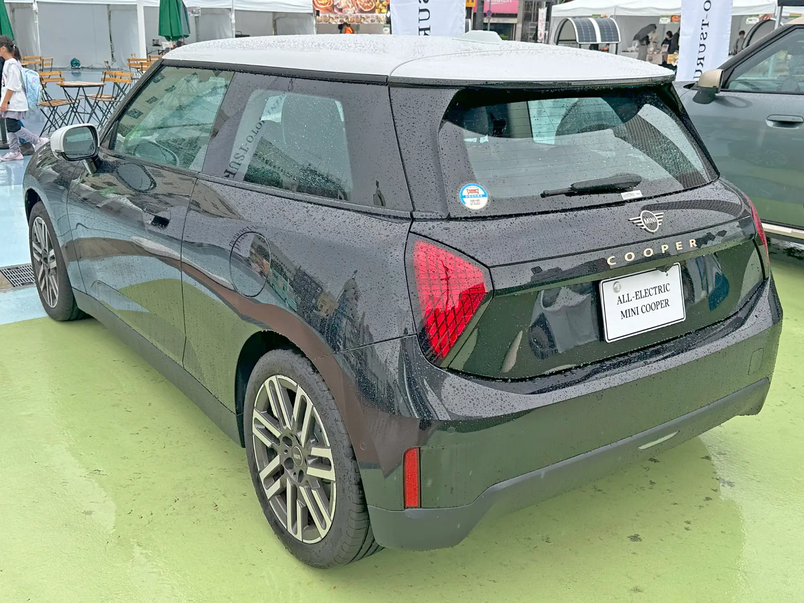

La berlina más segura que probó Euro NCAP en 2025 es el **Mercedes-Benz CLA**. No solo ganó su categoría: fue el carro con mejor puntaje de todo el año, con **94 % en protección de adultos**. El organismo europeo publicó sus "Best in Class" el 14 de enero de 2026, y los seis ganadores tienen versión eléctrica.

Que todos los primeros puestos tengan versión eléctrica no es casualidad. La batería va en el piso y exige una estructura inferior muy rígida para protegerla, lo que ayuda en los choques laterales. Y las plataformas eléctricas nuevas suelen estrenar las asistencias más recientes de cada marca, un área que pesa cada vez más en la nota.

## Los ganadores por categoría

| Categoría | Ganador | Adultos | Niños | Peatones y ciclistas | Asistencias |
|---|---|---|---|---|---|
| Mejor del año y familiar pequeño | Mercedes-Benz CLA | 94 % | 89 % | 93 % | 85 % |
| Urbano y supermini | MINI Cooper E | 89 % | 87 % | 77 % | 79 % |
| Familiar grande | Tesla Model 3 | 90 % | 93 % | 89 % | 87 % |
| SUV pequeño | Tesla Model Y | 91 % | 93 % | 86 % | 92 % |
| SUV grande | smart #5 | 88 % | 93 % | 84 % | 92 % |
| Ejecutivo | Polestar 3 | 90 % | 93 % | 79 % | 83 % |

Las cuatro columnas son las áreas que Euro NCAP evalúa. Cada una tiene un mínimo para llegar a cinco estrellas, y por eso un carro excelente en choques puede quedarse en cuatro si falla en asistencias.

*El MINI Cooper E ganó la categoría de urbanos, con 89 % en protección de adultos. Foto: Tokumeigakarinoaoshima, CC BY-SA 4.0, vía Wikimedia Commons.*

## Qué dice cada resultado

**El CLA** gana por equilibrio. Ninguno de los otros cinco supera el 90 % en adultos y en peatones al mismo tiempo, y esa segunda cifra es la que más cuesta: depende del diseño del capó, del parabrisas y de qué tan bien frena el carro solo ante una persona. Euro NCAP probó la versión eléctrica.

**Tesla** pone dos carros en la lista, y el Model Y tiene el mejor puntaje en asistencias de todo el grupo, empatado con el smart #5. En Latinoamérica es el dato más útil de esta tabla: el Model 3 y el Model Y son, de lejos, los ganadores que más se venden en la región. Sus resultados completos están en las notas del [Model Y](/es/notas/tesla-model-y-euro-ncap-2025-5-estrellas/) y del [Model 3](/es/notas/tesla-model-3-euro-ncap-5-estrellas/).

**El MINI Cooper E** es el único urbano. Su punto débil está en peatones y ciclistas (77 %), algo común en carros cortos, donde hay menos espacio entre el capó y el motor para absorber un golpe.

**El Polestar 3** saca 93 % en niños, empatado con la mejor nota del año en esa área, pero se queda en 79 % en peatones y ciclistas, la segunda más baja de la lista.

## Por qué una prueba europea importa en Latinoamérica

Latin NCAP prueba pocos modelos al año y muy pocos eléctricos. Por eso el resultado europeo suele ser la única referencia de choque para un carro chino o europeo que llega a la región. La advertencia es la misma de siempre: la calificación vale para el carro que se probó. Si la versión latinoamericana trae menos airbags o le quitan el frenado autónomo, la nota no se le puede trasladar. Pasó con la [Chery E5](/es/notas/chery-e5-omoda-e5-euro-ncap-estrellas/) y con el [BYD Seagull](/es/notas/byd-seagull-dolphin-surf-euro-ncap-5-estrellas/).

Antes de comprar, compare la lista de equipo de la versión que vende el concesionario con la del carro que probó Euro NCAP. La ficha técnica de cada prueba está publicada en euroncap.com.

## Preguntas frecuentes

### ¿Cuál es la berlina eléctrica más segura?

Entre las probadas en 2025, el Mercedes-Benz CLA, con 94 % en adultos, 89 % en niños, 93 % en peatones y ciclistas y 85 % en asistencias. Entre las berlinas grandes, el Tesla Model 3.

### ¿Cuál es el SUV eléctrico más seguro?

En SUV pequeños, el Tesla Model Y; en SUV grandes, el smart #5. Los dos tienen 92 % en asistencias.

### ¿Euro NCAP y Latin NCAP califican igual?

No. Usan protocolos parecidos, pero no idénticos, y prueban carros distintos. Una estrella europea no equivale automáticamente a una latinoamericana.

---

**Fuentes:** [Euro NCAP: ganadores Best in Class de 2025](https://www.euroncap.com/articles/euro-ncap-names-best-in-class-cars-tested-in-2025) · [Carwow: puntajes de los carros más seguros de 2025](https://www.carwow.co.uk/news/10124/euro-ncap-safest-cars-2025) · [BMWBlog: puntajes del MINI Cooper E](https://www.bmwblog.com/2026/01/15/mini-cooper-electric-euro-ncap-best-in-class-2025/) · [ArenaEV: cinco estrellas del CLA eléctrico](https://www.arenaev.com/ncap_awards_the_new_electric_mercedesbenz_cla_five_stars-news-5414.php)
