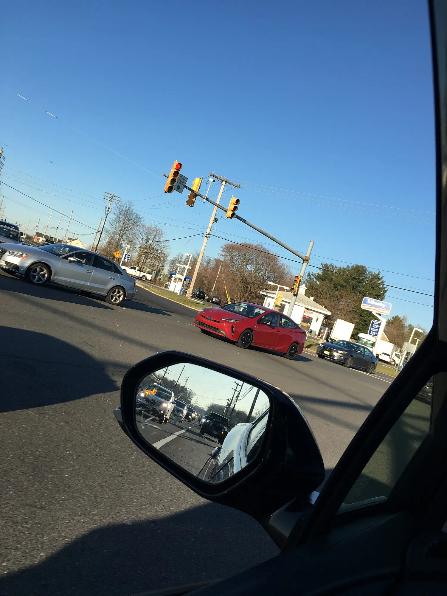

Desde el 7 de julio de 2024, todo carro nuevo que se matricula en la Unión Europea debe traer **frenado autónomo de emergencia** y un **sistema de emergencia para mantener el carril**, entre otras ayudas. En Colombia no existe esa obligación, y por eso un mismo modelo puede llegar con todas las asistencias en Europa y con ninguna en Bogotá. En los eléctricos pequeños, donde las marcas recortan equipo para bajar el precio, la diferencia se nota más.

El **monitor de punto ciego**, que avisa con una luz en el espejo cuando hay un carro donde no se ve, ni siquiera es obligatorio en Europa para los carros de pasajeros: la norma lo exige solo a buses y camiones. Por eso es la ayuda que más falta en los urbanos.

## Qué trae cada uno en Colombia

| Modelo y versión | Frenado autónomo | Asistente de carril | Punto ciego | Crucero adaptativo |
|---|---|---|---|---|
| Nuevo BYD Dolphin GS | Sí | Sí | Sí | Sí |
| Chery E5 Luxury | Sí | Sí | Sí | Sí |
| Chery iCar 03 (las dos versiones) | Sí | Sí | Sí | Sí |
| Kia EV2 Air | Sí | Sí | No | Sí |
| Chevrolet Spark EUV | Sí | Sí | No | Sí |
| Renault Kwid E-Tech Techno | Sí | Sí | No publicado | No |
| Chery E5 Comfort | No | No | No | No |
| iCAUR V23 | No | No | Solo en la 4x4, como alerta | No |

Equipo publicado por las marcas o por la prensa especializada para las versiones que se venden en Colombia. "No publicado" significa que la fuente no lo dice, no que el carro no lo tenga.

*El monitor de punto ciego avisa con una luz en el espejo; no frena ni mueve el timón. Foto: Jonathan Schilling, CC BY-SA 4.0, vía Wikimedia Commons.*

## Lo que muestra la tabla

**Por menos de $90 millones ya hay equipo completo.** El nuevo BYD Dolphin, de $89,99 millones, trae las cuatro ayudas de la tabla. Es el cambio más grande frente al Dolphin anterior, que no traía ninguna. El Kia EV2, al mismo precio, se queda sin punto ciego.

**La misma carrocería, dos niveles de seguridad.** La Chery E5 Comfort no trae ninguna asistencia y la Luxury las trae todas. Para quien maneja mucho en autopistas urbanas, como la Avenida Boyacá o la Autopista Norte, el punto ciego y el frenado autónomo son la razón más fuerte para pagar la diferencia entre las dos versiones.

**Una alerta no es una asistencia.** La iCAUR V23 4x4 avisa del punto ciego y de un posible choque, pero no frena ni corrige. Lo explicamos en [la nota de la V23](/es/notas/icaur-v23-colombia-precio-versiones/).

## Cómo comprobarlo antes de comprar

La lista de equipo cambia entre versiones y entre años modelo. Pida la ficha técnica de la versión exacta y busque los nombres en inglés que suelen usar las marcas: **AEB** para el frenado autónomo, **LKA** o **LKAS** para el asistente de carril, **BSD** o **BSM** para el punto ciego y **ACC** para el crucero adaptativo. Si la ficha dice "alerta" en lugar de "asistente", el sistema solo avisa.

En la prueba de manejo, pida al asesor que le muestre cómo se encienden y apagan. En muchos carros estos sistemas vienen activos por defecto y se pueden desactivar desde la pantalla. Más detalle en [qué hace cada asistente de conducción](/es/notas/asistentes-de-conduccion-adas-que-hace-cada-uno/).

## Preguntas frecuentes

### ¿Qué carros eléctricos pequeños traen monitor de punto ciego en Colombia?

Entre los de la tabla, el nuevo BYD Dolphin, la Chery E5 Luxury y el Chery iCar 03. La iCAUR V23 4x4 lo trae como alerta.

### ¿Qué carros eléctricos traen asistente de carril?

El Dolphin, la E5 Luxury, el iCar 03, el Kia EV2, el Spark EUV y el Kwid E-Tech Techno, según el equipo publicado para Colombia.

### ¿Es obligatorio el frenado autónomo en Colombia?

No en octubre de 2026. En la Unión Europea lo es para todos los carros nuevos desde julio de 2024.

---

**Fuentes:** [SIMI: sistemas obligatorios por el Reglamento General de Seguridad de la UE](https://www.simi.ie/en/road-safety/gsr) · [El Carro Colombiano: nuevo BYD Dolphin en Colombia](https://www.elcarrocolombiano.com/novedades/byd-dolphin-nuevo-colombia-precio-versiones-caracteristicas-2026/) · [El Carro Colombiano: Chery E5](https://www.elcarrocolombiano.com/resenas/chery-e5-primer-contacto-suv-electrica-precio-colombia/) · [El Carro Colombiano: Chery iCar 03](https://www.elcarrocolombiano.com/resenas/chery-icar-03-el-4x4-electrico-definitivo-candidato-a-el-carro-del-ano-2025-en-colombia/) · [El Carro Colombiano: Kia EV2](https://www.elcarrocolombiano.com/lanzamientos/kia-ev2-colombia-precio-caracteristicas-suv-electrico/) · [Xataka Colombia: Chevrolet Spark EUV](https://www.xataka.com.co/vehiculos/asi-chevrolet-spark-euv-vehiculo-100-electrico-que-renueva-diseno-esta-iconica-linea-al-llegar-a-colombia-formato-suv-precio-caracteristicas) · [Renault Colombia: Kwid E-Tech](https://cdn-prensa.renault.com.co/wp-content/uploads/2025/10/17152750/EL-KWID-E-TECH-EVOLUCIONA-CON-DISENO-MODERNO-TECNOLOGIA-AVANZADA-Y-SEGURIDAD-SUPERIOR.pdf) · [El Carro Colombiano: iCAUR V23](https://www.elcarrocolombiano.com/lanzamientos/icaur-v23-colombia-precio-versiones-datos-campero-electrico/)
