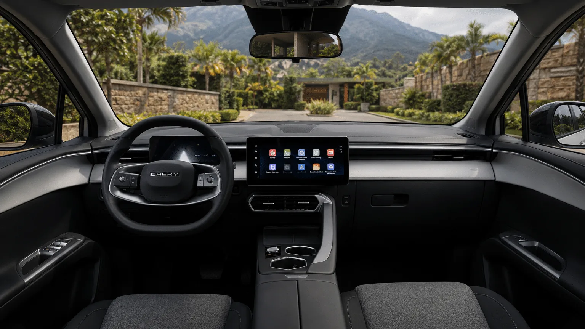

La **Chery E5** se vende en Colombia en dos versiones, **Comfort** y **Luxury**, y mecánicamente son el mismo carro. Comparten motor, batería, autonomía, carga y medidas. Lo que las separa es el equipo: la Luxury suma el paquete de asistencias a la conducción, el monitor de punto ciego y la cámara de 540 grados, entre otros elementos. En la preventa de abril de 2026, la diferencia de precio era de **$11 millones**.

## Lo que comparten

| Dato | Comfort y Luxury |
|---|---|
| Motor | 208 hp y 288 Nm, tracción delantera |
| Aceleración de 0 a 100 km/h | 7,1 segundos |
| Velocidad máxima | 171 km/h |
| Batería | 50,6 kWh, de fosfato de hierro y litio (LFP) |
| Autonomía | 350 km WLTP, 422 km NEDC |
| Carga rápida | Hasta 110 kW, del 30 % al 80 % en 30 minutos |
| Carga en corriente alterna | 6,6 kW |
| Largo, ancho y alto | 4.540, 1.830 y 1.580 mm |
| Altura libre al piso | 154 mm |
| Baúl | 442 L, más 32 L adelante |
| Peso en vacío | 1.735 kg |
| Airbags | 7 |
| Garantía | 8 años o 200.000 km |

Datos de la ficha técnica de Chery Colombia y de las pruebas de El Carro Colombiano. La ficha oficial no separa la mecánica por versión.

La velocidad máxima de **171 km/h** queda muy por encima de los límites de las carreteras colombianas. En un eléctrico, además, ir rápido en autopista gasta mucha batería, así que esa cifra importa menos que la autonomía.

## Lo que agrega la Luxury

| Elemento | Comfort | Luxury |
|---|---|---|
| Frenado autónomo de emergencia | No | Sí |
| Crucero adaptativo | No | Sí |
| Asistente de mantenimiento de carril | No | Sí |
| Monitor de punto ciego | No | Sí |
| Alerta de tráfico cruzado trasero | No | Sí |
| Cámara de 540 grados | No | Sí |
| Asiento del conductor con calefacción y masaje | No | Sí |
| Cargador inalámbrico de celular | Sin dato en las fuentes | Sí |

*El tablero de la Chery E5 colombiana. La Luxury suma el paquete de asistencias, el monitor de punto ciego y la cámara de 540 grados. Foto: Chery Colombia.*

## Precio: cuánto cuesta la diferencia

En la preventa de abril de 2026, Chery anunció la Comfort en **$74,99 millones** para las primeras 200 unidades y la Luxury en **$85,99 millones**. Después, la Comfort quedó en $79,99 millones de lista. La Luxury cuesta, entonces, entre $6 y $11 millones más según la referencia de precio, y la diferencia se va casi toda en seguridad activa.

## Cuál conviene

**La Comfort** tiene sentido para quien maneja sobre todo en ciudad, a baja velocidad, y quiere el SUV eléctrico más barato de su tamaño. Tiene el mismo baúl de 442 litros y los mismos 350 km WLTP que la Luxury, que es lo que más pesa en el uso diario.

**La Luxury** es la versión a elegir para quien usa autopistas urbanas o carretera. El frenado autónomo es la asistencia con más evidencia de reducir choques: según el Instituto de Seguros para la Seguridad Vial de Estados Unidos, los carros que lo traen tienen la mitad de choques por alcance. Por un precio cercano al de la Luxury, el [Kia EV2](/es/notas/kia-ev2-colombia-precio-autonomia-ficha/) y el [nuevo BYD Dolphin](/es/notas/nuevo-byd-dolphin-colombia-precio-equipo/) también traen asistencias de serie, aunque son más pequeños.

Un punto más: la calificación de cinco estrellas de Euro NCAP que suele citarse es de la **Omoda E5**, un carro distinto, como explicamos en [esta nota](/es/notas/chery-e5-omoda-e5-euro-ncap-estrellas/).

## Preguntas frecuentes

### ¿Cuál es la velocidad máxima de la Chery E5?

171 km/h en las dos versiones.

### ¿Qué diferencia hay entre la Chery E5 Comfort y la Luxury?

El equipo. La Luxury agrega frenado autónomo, crucero adaptativo, asistente de carril, monitor de punto ciego, cámara de 540 grados y asiento del conductor con calefacción y masaje. Motor, batería y autonomía son iguales.

### ¿Cuánto cuesta la Chery E5 en Colombia?

La Comfort, $79,99 millones de lista. En la preventa de abril de 2026, la Luxury se anunció en $85,99 millones.

---

**Fuentes:** [Chery Colombia: ficha técnica de la E5](https://www.chery.com.co/wp-content/uploads/2026/04/FICHATECNICA_E5_2026_v3.pdf) · [El Carro Colombiano: primer contacto con la Chery E5](https://www.elcarrocolombiano.com/resenas/chery-e5-primer-contacto-suv-electrica-precio-colombia/) · [El Carro Colombiano: inicio de entregas de la E5 Luxury](https://www.elcarrocolombiano.com/novedades/chery-e5-luxury-inicio-entregas-colombia-precio/) · [Valora Analitik: preventa y precios de la Chery E5](https://www.valoraanalitik.com/?p=572159) · [IIHS: el frenado autónomo reduce los choques por alcance](https://www.iihs.org/news/detail/front-crash-prevention-slashes-police-reported-rear-end-crashes)
