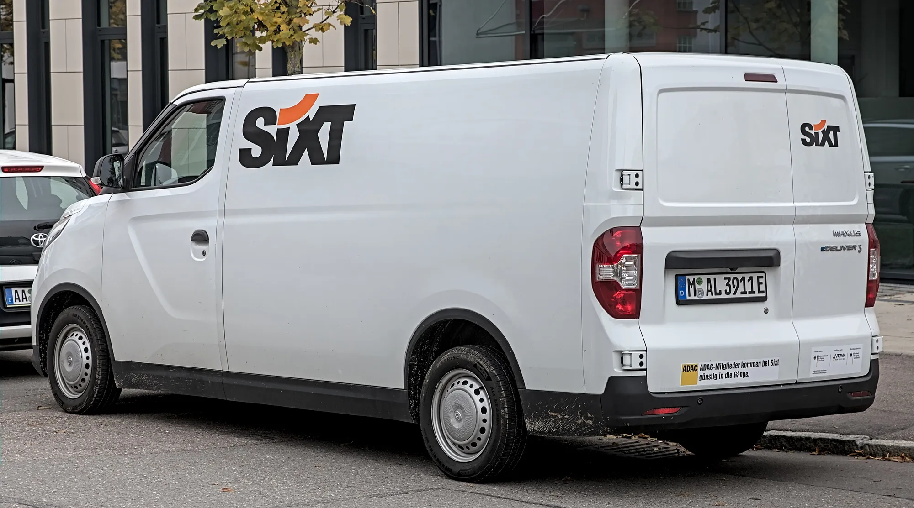

Chile vendió **9.978 carros enchufables** entre enero y junio de 2026, un 165,4 % más que un año antes, según la Asociación Nacional Automotriz de Chile (ANAC). Son el **6,5 % del mercado** de vehículos livianos y medianos. Los eléctricos puros fueron 5.425, y el resto se repartió entre híbridos enchufables (3.811) y eléctricos de rango extendido enchufables (742), que crecieron más de 2.400 %.

El dato que preocupa al sector va por otro lado: mientras las ventas se duplican, la instalación de cargadores públicos cayó a menos de la mitad.

## Las cifras del primer semestre

| Tecnología | Enero a junio de 2026 | Crecimiento |
|---|---|---|
| Eléctricos puros | 5.425 | +113,8 % |
| Híbridos enchufables | 3.811 | +219,4 % |
| Rango extendido enchufables | 742 | Más de +2.400 % |
| Total enchufables | 9.978 | +165,4 % |
| Híbridos no enchufables | 20.344 | +84,3 % |

Fuente: ANAC.

El perfil del comprador cambió rápido. Hace tres años, cerca del 70 % de los eléctricos los compraban empresas. Hoy, siete de cada diez compradores son personas naturales, sobre todo de entre 35 y 55 años.

## Los eléctricos más vendidos

| Puesto | Modelo | Unidades, primer semestre de 2026 |
|---|---|---|
| 1 | Tesla Model Y | 865 |
| 2 | Tesla Model 3 | 709 |
| 3 | Volvo EX30 | 377 |
| 4 | Maxus eDeliver 3 | 289 |
| 5 | Renault Kwid E-Tech | 254 |
| 6 | BYD Yuan Plus | 244 |
| 7 | BYD Dolphin Mini | 210 |
| 8 | Geely EX2 | 209 |

Fuente: Autocosmos Chile con datos de ANAC.

Tesla se lleva el 29 % de los eléctricos puros del país, con 1.575 unidades en el semestre, una concentración parecida a la de Colombia. A diferencia de otros mercados de la región, en Chile aparece un furgón eléctrico, el Maxus eDeliver 3, entre los más vendidos: las empresas de reparto también están comprando eléctricos.

*El Maxus eDeliver 3 está entre los eléctricos más vendidos de Chile: las empresas de reparto también se pasan a la electricidad. Foto: Alexander Migl, CC BY-SA 4.0, vía Wikimedia Commons.*

## La red de carga pierde ritmo

Chile tenía **2.245 puntos de carga públicos** en junio de 2026. En el primer semestre se instalaron 143 nuevos, un 54,7 % menos que los 316 de igual periodo de 2025. Casi toda la caída vino de los cargadores de corriente alterna, los lentos: pasaron de 190 nuevos a 20. Los rápidos de corriente continua se mantuvieron, con 123, y ya son el 86 % de lo nuevo.

La carga privada también se desaceleró: 656 cargadores nuevos en el semestre, frente a 1.754 en todo 2025. Para ANAC, la expansión de la infraestructura no está acompañando el crecimiento de las ventas.

## La meta de 2030 se ve lejos

La Estrategia Nacional de Electromovilidad de Chile apunta a que el 20 % de los carros nuevos vendidos en 2030 sean enchufables. Con la tendencia actual, ANAC proyecta un 15,7 %. Para llegar a la meta harían falta unas 74.000 ventas al año, en un mercado de 370.000 vehículos; el escenario base calcula unas 58.000.

> Chile es el ejemplo de que vender eléctricos y construir dónde cargarlos son dos curvas distintas. Si la segunda se queda atrás, la primera termina frenándose.

## Preguntas frecuentes

### ¿Cuántos carros eléctricos se venden en Chile?

5.425 eléctricos puros entre enero y junio de 2026, y 9.978 contando híbridos enchufables y de rango extendido.

### ¿Cuál es el carro eléctrico más vendido en Chile?

El Tesla Model Y, con 865 unidades en el primer semestre de 2026.

### ¿Cuántos puntos de carga hay en Chile?

2.245 puntos públicos en junio de 2026, según ANAC.

---

**Fuentes:** [El Mostrador: ventas de cero y bajas emisiones a junio de 2026, datos de ANAC](https://www.elmostrador.cl/agenda-pais/movilidad/2026/08/03/electromovilidad-acelera-en-chile-ventas-se-duplican-pero-desafio-para-cumplir-meta-2030-sigue/) · [La Tercera: ventas se duplican pero se enfría la infraestructura](https://www.latercera.com/pulso/noticia/ventas-de-vehiculos-de-cero-y-bajas-emisiones-se-duplican-a-junio-pero-se-enfria-la-infraestructura-para-carga/) · [Autocosmos Chile: los ecológicos más vendidos del primer semestre de 2026](https://noticias.autocosmos.cl/2026/08/03/top-10-los-autos-ecologicos-mas-vendidos-en-chile-en-el-primer-semestre-de-2026)
