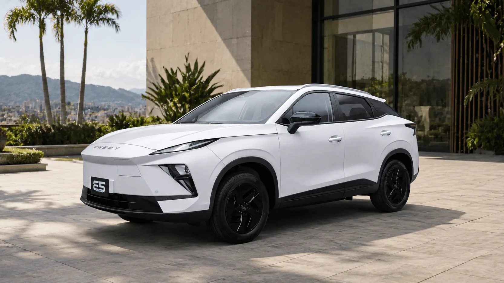

Comparar dos carros eléctricos con la ficha técnica en la mano es más difícil que comparar dos de gasolina. Las marcas publican cifras medidas con ciclos distintos, potencias de carga que el carro solo alcanza unos segundos y baterías en las que no toda la energía se puede usar. Estas son las cifras que conviene mirar, en orden de importancia, y las trampas de cada una.

## 1. Autonomía, siempre con el mismo ciclo

Es la cifra más buscada y la más fácil de malinterpretar. Una autonomía **CLTC** o **NEDC** es más optimista que una **WLTP** del mismo carro. La Geely EX5 Pro, por ejemplo, homologa 490 km NEDC y 425 km WLTP. Si un carro publica WLTP y el otro solo CLTC, no hay comparación posible hasta conseguir el mismo ciclo para los dos. Lo explicamos en [CLTC, NEDC o WLTP](/es/notas/autonomia-electricos-cltc-nedc-wltp-como-leerla/).

## 2. Consumo en kWh cada 100 km

El consumo dice cuánta energía gasta el carro, y por eso decide cuánto se paga al mes. Dos carros con la misma autonomía pueden tener consumos distintos si uno tiene una batería más grande. Un carro que gasta 15 kWh cada 100 km cuesta, con la tarifa de Bogotá en estrato 4, unos $130 por kilómetro; uno que gasta 20, unos $173. En 20.000 km al año son unos $860.000 de diferencia, cada año.

## 3. Tiempo de carga rápida, no potencia máxima

La potencia máxima de carga, por ejemplo "110 kW", es un pico que el carro alcanza un rato y luego baja. Lo útil es el **tiempo para pasar del 10 % o 30 % al 80 %**, y siempre con el mismo punto de partida: un carro que carga del 30 % al 80 % en 30 minutos no es más rápido que uno que carga del 10 % al 80 % en 29.

## 4. Seguridad de la versión exacta

Las estrellas de Euro NCAP o Latin NCAP valen para la versión que se probó. Si la versión que vende el concesionario trae menos airbags o no tiene frenado autónomo, la calificación no aplica igual. Compare la lista de asistencias de las dos versiones que está considerando, no la de las versiones tope.

## 5. Garantía, peso, baúl y conector

Son las cifras que más se olvidan. La garantía del carro puede ir de tres a ocho años según la marca. El peso afecta el consumo y el desgaste de llantas. El baúl decide si caben el equipaje de un viaje familiar o la silla de un bebé. Y el conector define en qué electrolineras se puede cargar sin adaptador.

*La Chery E5 cuesta $12,9 millones menos que la EX5 SE en su versión de entrada, pero esa versión no trae asistencias. Foto: Chery Colombia.*

## Un ejemplo: Chery E5 frente a Geely EX5 SE

Dos SUV compactos chinos que compiten en Colombia por menos de $95 millones:

| Cifra | Chery E5 Comfort | Geely EX5 SE |
|---|---|---|
| Precio | $79,99 millones | $92,9 millones |
| Batería | 50,6 kWh | 49,5 kWh |
| Autonomía WLTP | 350 km | 345 km |
| Carga rápida | 30 % a 80 % en 30 minutos | No publicada |
| Peso en vacío | 1.735 kg | 1.620 kg |
| Baúl | 442 L | 461 L |
| Frenado autónomo y asistente de carril | No | Sí |
| Euro NCAP | La Omoda E5 europea tiene 5 estrellas, con otro equipo | 5 estrellas, con equipo similar al colombiano |
| Garantía | 8 años o 200.000 km | No publicada en las fuentes consultadas |

Fichas de Chery Colombia y Geely Colombia, y notas de prensa especializada.

En autonomía y batería son casi iguales, así que la decisión pasa por otra parte. La E5 Comfort cuesta $12,9 millones menos y tiene una garantía larga. La EX5 SE trae las asistencias que la E5 solo ofrece en su versión Luxury, y su calificación europea aplica mejor a la versión colombiana. Para quien maneja mucho en autopista, esa diferencia en seguridad pesa más que el precio.

> Antes de decidir, ponga los dos carros lado a lado en el [comparador](/es/comparador/), que solo cruza cifras del mismo ciclo y muestra cuál gana en cada área.

## Preguntas frecuentes

### ¿Qué es más importante, la autonomía o la carga rápida?

Para quien carga en casa, la autonomía. Para quien viaja seguido por carretera o depende de electrolineras, la carga rápida pesa igual o más.

### ¿Cómo sé cuál gasta menos energía?

Compare el consumo en kWh cada 100 km medido con el mismo ciclo. Si la marca no lo publica, divida la batería entre la autonomía WLTP para tener una aproximación.

### ¿Sirve comparar la potencia en caballos?

Para un uso normal, poco. Casi todos los eléctricos aceleran con soltura. La potencia importa más en carretera, al adelantar, y en subidas largas.

---

**Fuentes:** [Chery Colombia: ficha técnica de la E5](https://www.chery.com.co/wp-content/uploads/2026/04/FICHATECNICA_E5_2026_v3.pdf) · [El Carro Colombiano: prueba de la Chery E5](https://www.elcarrocolombiano.com/resenas/chery-e5-primer-contacto-suv-electrica-precio-colombia/) · [Portafolio: Geely EX5 SE](https://www.portafolio.co/negocios/vehiculo/nueva-suv-electrica-llega-a-colombia-este-es-el-precio-de-lanzamiento-y-las-caracteristicas-de-la-geely-ex5-se-497330) · [El Carro Colombiano: Geely EX5 SE](https://www.elcarrocolombiano.com/novedades/geely-ex5-se-suv-electrica-barata-precio-colombia/) · [Geely Colombia: ficha técnica de la EX5](https://geely.com.co/wp-content/uploads/2026/03/EX5_Bajav4.pdf) · [Enel Colombia: tarifas de agosto de 2026](https://www.enel.com.co/content/dam/enel-co/español/personas/1-17-1/2026/pliego%20tarifario%20digital%20_agosto_2026.pdf)
