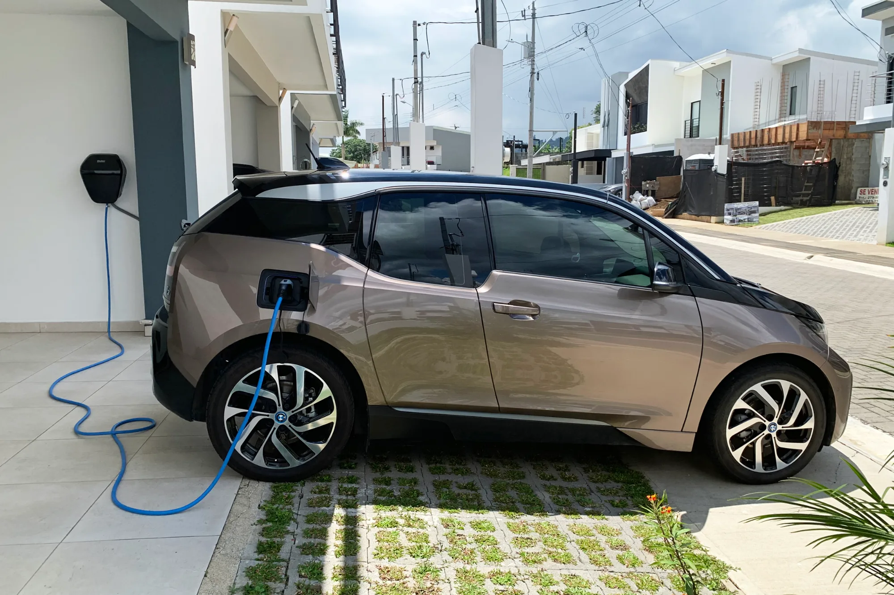

Comprar un eléctrico en Colombia tiene más pasos que comprar un carro de gasolina, porque varios beneficios dependen de trámites posteriores a la compra. Un error en la factura o en el orden de los papeles puede costar la devolución del IVA, que en un carro de $90 millones son unos $4,3 millones. Este es el recorrido completo.

## 1. Verifique que la versión tenga beneficios

La devolución del IVA y la deducción en renta exigen el **certificado de la UPME**, y solo se expide para vehículos que aparecen en los listados de la Resolución 135 de 2025. Califican los eléctricos puros, los híbridos enchufables (PHEV) y los híbridos convencionales (HEV). **No califican los híbridos suaves (MHEV)**. Pregunte al concesionario si la versión exacta que va a comprar está en el listado; dos versiones del mismo modelo pueden tener tratamiento distinto.

## 2. Cotice el crédito antes de ir al concesionario

Lleve una preaprobación de su banco. Con ella puede comparar la financiación que ofrece la marca contra una tasa que ya conoce, en efectivo anual y con la cuota total. Las tasas verdes reportadas en 2026 van de cerca de 12,5 % a 16,6 % EA. Lo que hay que preguntar está en [los costos ocultos del crédito](/es/notas/costos-ocultos-credito-vehicular/).

## 3. Revise la factura antes de firmar

La factura electrónica debe salir **a nombre de quien va a pedir los beneficios** y con el **IVA discriminado**, que para eléctricos es del 5 %. Sin eso, la devolución no procede. Si el carro va a nombre de una empresa, los beneficios son de la empresa, como explicamos en [esta nota](/es/notas/comprar-carro-electrico-empresa-beneficios-tributarios/).

## 4. Seguro y SOAT

El banco pedirá un seguro todo riesgo con él como beneficiario. El SOAT de un eléctrico tiene **10 % de descuento** en la prima. Cotice el seguro por fuera de la oferta del banco si le permiten elegir: según el estudio de Seguro Canguro de 2026, la oferta más barata para un eléctrico de $90 a $120 millones rondaba el 2,07 % del valor del carro al año, unos $1,86 millones en un carro de $89,99 millones. Lo comparamos en [cuánto cuesta asegurar un eléctrico](/es/notas/seguro-carro-electrico-colombia-2026-costo/).

## 5. Matrícula

En Bogotá, la matrícula de un automóvil cuesta **$708.200** y la inscripción en el RUNT **$22.100** en 2026. Muchos concesionarios la hacen por usted e incluyen el costo en el precio; pregunte si es su caso. Con la matrícula sale la tarjeta de propiedad, que necesitará para el certificado de la UPME.

*Un cargador de pared instalado cuesta alrededor de $3 millones según Enel; en conjuntos residenciales requiere autorización. Foto: Mariordo (Mario Roberto Durán Ortiz), CC BY-SA 4.0, vía Wikimedia Commons.*

## 6. Cargador en casa

Si vive en un conjunto, el cargador requiere autorización de la administración y una instalación con su propio circuito. Enel calcula unos $3 millones por un cargador de pared instalado. Lo explicamos en [cómo instalar un cargador en un conjunto residencial](/es/notas/instalar-cargador-electrico-conjunto-residencial/).

## 7. Certificado de la UPME

Se pide en el portal **Muévete Eléctrico** con la factura, los datos del vehículo, la tarjeta de propiedad y el pago de la tarifa. La UPME puede tardar **hasta 35 días** en responder. La firma RSM indica que las solicitudes se reciben en dos ciclos al año, del 15 de febrero al 14 de mayo y del 15 de agosto al 14 de noviembre: si compró en 2026, el ciclo abierto cierra el **14 de noviembre**.

## 8. Devolución del IVA ante la DIAN

Con el certificado, se radica ante la DIAN el **Formato 010**, la certificación bancaria, la factura con el IVA discriminado y, para personas no obligadas a llevar contabilidad, una declaración juramentada. En Bogotá, Medellín, Cali y Bucaramanga se necesita cita; en otros municipios se puede enviar por correo a la seccional. El plazo es de **cinco años desde la fecha de la factura**, y ni la cita ni el trámite ante la UPME lo suspenden. El detalle está en [el paso a paso ante la DIAN](/es/notas/devolucion-iva-carro-electrico-dian-paso-a-paso/).

## 9. Deducción en renta, al año siguiente

Si declara renta, el mismo certificado permite deducir hasta el 50 % del valor del carro. Según la DIAN, la deducción empieza en el año gravable siguiente a la entrada en operación del vehículo. Para personas naturales tiene límites que pueden dejarla muy por debajo de lo prometido, como calculamos en [la nota sobre la deducción](/es/notas/deduccion-renta-carro-electrico-ley-1715/).

> El paso que más se olvida es el séptimo. Sin certificado de la UPME no hay devolución del IVA ni deducción en renta, y el ciclo para pedirlo no está abierto todo el año.

## Preguntas frecuentes

### ¿Qué documentos necesito para pedir el certificado de la UPME?

La factura electrónica de compra, la tarjeta de propiedad y los datos del vehículo, además del pago de la tarifa en el portal Muévete Eléctrico.

### ¿Cuánto tiempo tengo para pedir la devolución del IVA?

Cinco años desde la fecha de la factura de venta.

### ¿Los híbridos también tienen devolución del IVA?

Los híbridos enchufables y los convencionales sí. Los híbridos suaves (MHEV) no.

*Esta nota es informativa y no reemplaza la asesoría de un contador.*

---

**Fuentes:** [Portafolio: plazo y proceso de la devolución del IVA](https://www.portafolio.co/negocios/vehiculo/este-es-el-plazo-y-el-proceso-para-que-le-devuelvan-el-iva-si-compro-un-carro-hibrido-o-electrico-503819) · [RSM Colombia: beneficio tributario por compra de eléctricos o híbridos](https://www.rsm.global/colombia/es/node/538) · [Valora Analitik: DIAN explica cuándo aplicar la deducción](https://www.valoraanalitik.com/dian-aclara-como-aplicar-a-deduccion-en-renta-si-como-vehiculo-electrico-o-hibrido/) · [Infobae: tarifas de tránsito de Bogotá en 2026](https://www.infobae.com/colombia/2026/01/06/suben-los-precios-de-licencias-de-conduccion-y-tramites-de-transito-en-2026-en-bogota-consulte-las-nuevas-tarifas/) · [La Nota Económica: estudio de Seguro Canguro](https://lanotaeconomica.com.co/movidas-empresarial/el-carro-nuevo-mas-cotizado-para-asegurar-en-colombia-en-2026-es-un-tesla-y-asegurar-un-electrico-ya-cuesta-lo-mismo-que-uno-a-gasolina/) · [Blu Radio: costo de instalar un cargador](https://www.bluradio.com/motor/cuanto-cuesta-cargar-un-carro-electrico-en-colombia-so35)
