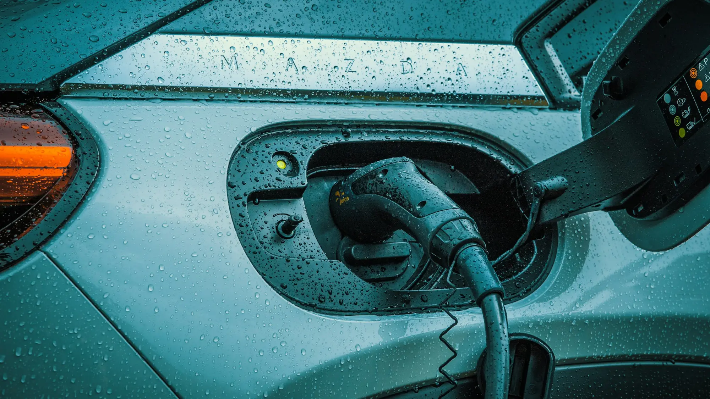

La llegada de Tesla a finales de 2025 desató una guerra de precios, y según un reporte basado en cifras de Fasecolda, algunos carros bajaron **hasta $80 millones** entre 2025 y 2026. Eso tiene un efecto directo en los usados: quien compró un eléctrico en 2024 hoy compite contra modelos nuevos más baratos, y tiene que bajar el precio para vender.

Para el comprador es una oportunidad, siempre que revise lo que de verdad importa en un eléctrico de segunda.

## 1. El estado de salud de la batería

Es el dato más importante y el que más se omite. Pida un **reporte de estado de salud (SoH, por sus siglas en inglés)** hecho en el concesionario de la marca o con un equipo de diagnóstico. Le dice qué porcentaje de la capacidad original conserva la batería.

Como referencia general, un carro de dos o tres años con buen uso debería conservar más del 90 %. Si el vendedor no deja hacer la prueba, desconfíe.

## 2. La garantía de la batería y si se transfiere

La mayoría de marcas ofrece 8 años en la batería, con un tope de kilometraje. Confirme con el concesionario, con el número de VIN, cuánto tiempo le queda y si la garantía pasa al nuevo dueño.

## 3. Cómo se cargó

Pregunte si el carro se cargaba sobre todo en casa o en carga rápida. El uso intensivo de carga rápida acelera el desgaste. Algunos carros guardan ese historial y el concesionario puede consultarlo.

*Pregunte cómo se cargaba el carro: el uso diario de carga rápida desgasta más la batería. Foto: JUICE en Unsplash.*

## 4. Las actualizaciones de software

Muchos eléctricos mejoran autonomía, carga o funciones con actualizaciones remotas. Verifique que el carro tenga el software al día y que no haya perdido funciones por estar desconectado o importado de forma paralela.

## 5. El conector y los cables

Revise qué conector trae (Tipo 1, Tipo 2, CCS o GB/T) y que vengan los cables de carga originales. Un cable de carga portátil nuevo puede costar bastante. Lo explicamos en nuestra [guía de conectores](/es/notas/conectores-carga-electricos-colombia-tipo-1-tipo-2-ccs-gbt/).

## 6. Llantas, frenos y suspensión

Los eléctricos pesan más que un carro de gasolina equivalente, y su torque instantáneo gasta más rápido las llantas. Los frenos, en cambio, suelen estar en buen estado por el frenado regenerativo. Si los discos están muy gastados, pregunte por qué.

## 7. Lo que no se transfiere

Esto cambia la cuenta frente a un carro nuevo:

- **La devolución del IVA y la deducción en renta** son para quien compró el carro nuevo con certificado de la UPME. Usted no los recibe al comprar usado [VERIFICAR con un contador si hay casos excepcionales].
- **El descuento del 60 % en el impuesto vehicular de Bogotá** dura cinco años desde la matrícula. Si el carro ya tiene tres años, a usted le quedan dos.
- **La tarifa máxima del 1 %, el descuento del SOAT y la exención del pico y placa** sí siguen al carro.

> Consulte el carro en el RUNT antes de pagar: confirme que no tenga prendas, embargos ni comparendos, y que la tecnología del motor aparezca como eléctrica.

## Preguntas frecuentes

### ¿Conviene más un usado o un nuevo barato?

Con la caída de precios de 2026, un nuevo de entrada puede costar casi lo mismo que un usado de gama media. El nuevo trae garantía completa y los beneficios tributarios. Haga la comparación con números.

### ¿Cuántos kilómetros es mucho para un eléctrico?

El kilometraje importa menos que el estado de la batería. Un carro con muchos kilómetros cargado en casa puede estar mejor que uno con pocos kilómetros cargado siempre en carga rápida.

### ¿Dónde se hace la prueba de batería?

En el concesionario de la marca o en talleres especializados en eléctricos con equipos de diagnóstico. Pida el reporte por escrito.

Compare la ficha de los modelos que está mirando en el [comparador de Garash](/es/comparador/).

---

**Fuentes:** [Blu Radio: carros que más bajaron de precio según Fasecolda](https://www.bluradio.com/motor/los-20-carros-byd-kia-y-mas-que-mas-han-bajado-de-precio-tras-exito-de-tesla-segun-fasecolda-so35) · [Valora Analitik: descuentos de impuesto vehicular en Bogotá](https://www.valoraanalitik.com/carros-electricos-en-bogota-tendran-hasta-70-de-descuento-en-impuesto-vehicular/) · [DIAN, Concepto 000673 de 2026](https://normograma.dian.gov.co/dian/compilacion/docs/oficio_dian_0673_2026.htm)
