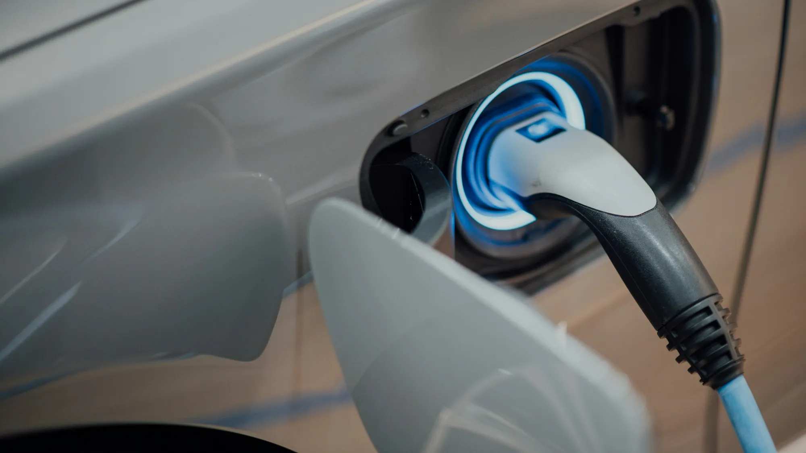

Pasa más de lo que parece: alguien llega a una electrolinera en carretera con la batería al 15 % y descubre que la manguera no le entra al carro. En Colombia no hay un solo estándar de carga, porque los eléctricos llegan de Estados Unidos, Europa, Corea y China, y cada mercado trae su enchufe.

## Los cinco conectores que va a encontrar

| Conector | Tipo de carga | De dónde viene | Dónde lo verá en Colombia |
|---|---|---|---|
| **Tipo 1 (J1772)** | Corriente alterna, lenta o semirrápida | Estados Unidos y Asia | Cargadores domésticos y electrolineras de 7,2 kW de Enel |
| **Tipo 2 (Mennekes)** | Corriente alterna | Europa | Cargadores domésticos y públicos de nivel 2 |
| **CCS1 (Combo 1)** | Corriente continua, carga rápida | Estados Unidos y Corea | Electrolineras rápidas |
| **CCS2 (Combo 2)** | Corriente continua, carga rápida | Europa | Electrolineras rápidas, cada vez más común |
| **GB/T** | Alterna y continua, con dos tomas distintas | China | Electrolineras rápidas de alta potencia |

El CCS es la versión "combo" de los Tipo 1 y Tipo 2: arriba tiene el conector de alterna y abajo dos pines grandes para corriente continua. Por eso un carro con toma CCS2 también recibe carga lenta con un cable Tipo 2.

## Por qué le importa

Un mismo modelo puede venir con conectores distintos según el país de donde se importe. Por ejemplo, el **Kia EV2** que se vende en Colombia usa toma **Tipo 1 y CCS1**, mientras que en Europa el mismo carro viene con Tipo 2 y CCS2. Muchos eléctricos chinos llegan con **GB/T**.

Eso tiene tres consecuencias prácticas:

1. **En casa**, el cargador de pared debe tener el conector de su carro, o usted necesitará un adaptador.
2. **En la calle**, no todas las electrolineras tienen todas las mangueras. En Bogotá hay estaciones con CCS2 de 30 kW, CCS1 de 30 kW y GB/T de 75 kW en el mismo punto, pero muchas otras solo ofrecen una opción.
3. **En carretera**, el riesgo es mayor, porque los puntos de carga rápida están más separados.

*Antes de un viaje, revise en la aplicación del operador qué conectores tiene cada estación. Foto: CHUTTERSNAP en Unsplash.*

## Lo que viene: la norma de interoperabilidad

El Ministerio de Minas y Energía propuso que todo operador de carga tenga **al menos un conector Tipo 2** en sus estaciones de nivel 2 y 3, y **al menos un CCS Combo 2** en las de nivel 3, que son las de carga rápida. Si la norma se adopta como está planteada, el estándar europeo quedaría como el mínimo común en las electrolineras públicas [VERIFICAR estado de la reglamentación].

Para quien compra hoy un carro con CCS1 o GB/T, eso no significa que se quede sin carga, pero sí que dependerá más de adaptadores o de estaciones que mantengan otras mangueras.

> Pregunta clave para el concesionario: qué toma trae la versión que se vende en Colombia, si incluye adaptadores y si la garantía los cubre.

## Preguntas frecuentes

### ¿Los adaptadores son seguros?

Los adaptadores certificados para carga en corriente alterna son de uso común. Para carga rápida en corriente continua hay menos opciones y conviene usar solo los que recomiende el fabricante del carro.

### ¿Cómo sé qué conector tiene mi carro?

Está en la ficha técnica y en la tapa del puerto de carga. Si son dos tomas separadas, probablemente es GB/T. Si arriba hay una toma redonda y abajo dos pines grandes, es CCS.

### ¿Qué conector usa Tesla en Colombia?

Tesla instala sus propios supercargadores. Confirme con la marca el tipo de toma de la versión colombiana y su compatibilidad con estaciones de otros operadores [VERIFICAR].

Revise el conector y la potencia de carga de cada modelo en el [comparador de Garash](/es/comparador/).

---

**Fuentes:** [La República: puntos de carga e interoperabilidad](https://www.larepublica.co/economia/solo-hay-un-punto-de-carga-por-cada-337-carros-electricos-en-total-hay-229-electrolineras-4398785) · [Revista Turbo: electrolineras en Bogotá](https://www.revistaturbo.com/?p=17223) · [El Carro Colombiano: Kia EV2 en Colombia](https://www.elcarrocolombiano.com/lanzamientos/kia-ev2-colombia-precio-caracteristicas-suv-electrico/) · [Blu Radio: electrolineras Voltex Terpel](https://www.bluradio.com/motor/lista-de-electrolineras-voltex-terpel-en-colombia-so35)
