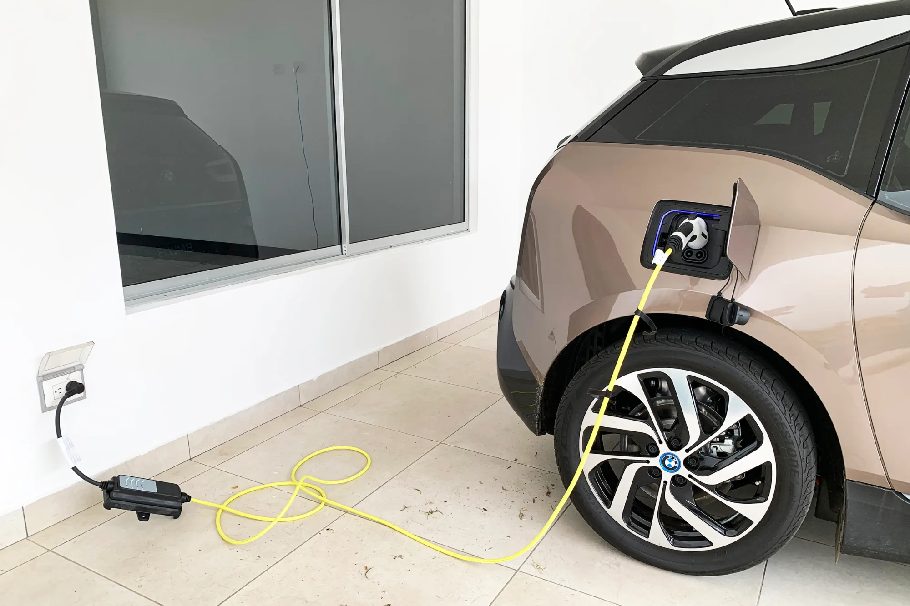

El precio de vitrina de un carro eléctrico es la cifra que menos dice sobre lo que va a costar. Para verlo completo, sumamos todo lo que paga durante cinco años quien compra un eléctrico de **$89,99 millones** en Bogotá, lo financia y lo usa 12.000 kilómetros al año. Es el precio del Kia EV2 o del nuevo BYD Dolphin en Colombia.

## Los supuestos

- Cuota inicial del **20 %** y crédito de **$71,99 millones a 60 meses** con una tasa verde de **12,5 % EA**, la más baja reportada en 2026.
- Carga casi siempre en casa, a **$864 por kWh**, la tarifa de Enel para estrato 4 en agosto de 2026, con un consumo de 16,5 kWh cada 100 km incluidas las pérdidas de carga.
- Seguro todo riesgo de alrededor del **2,07 % del valor del carro al año**, la oferta más barata para eléctricos de $90 a $120 millones según el estudio de Seguro Canguro de 2026.
- Impuesto vehicular de Bogotá: máximo 1 % del avalúo para eléctricos, con **60 % de descuento** durante cinco años para particulares nuevos.

## La cuenta

| Concepto | Cinco años |
|---|---|
| Cuota inicial | $18,0 millones |
| 60 cuotas de $1.595.473 | $95,7 millones |
| Energía en casa ($1,71 millones al año) | $8,6 millones |
| Seguro todo riesgo (unos $1,86 millones al año) | $9,3 millones |
| Impuesto vehicular (unos $360.000 al año) | $1,8 millones |
| Cargador de pared instalado | $3,0 millones |
| Matrícula y RUNT en Bogotá | $0,7 millones |
| Devolución del IVA | menos $4,3 millones |
| **Total** | **unos $132,8 millones** |

Cálculo propio. Repartido en 60 meses, el carro cuesta unos **$2,2 millones al mes**, no los $1,6 millones de la cuota.

Del total, unos **$23,7 millones son intereses** del crédito. Es el segundo rubro después del propio carro, y el único que se puede reducir mucho con decisiones de compra: más cuota inicial, menos plazo o abonos a capital. Las tres opciones están calculadas en [cuánta cuota inicial dar](/es/notas/cuota-inicial-carro-electrico-cuanto-dar/) y en [cuánto ahorra abonar a capital](/es/notas/abonar-a-capital-credito-carro-electrico-ley-1555/).

*Cargar en casa 12.000 km al año cuesta unos $1,71 millones con la tarifa de Enel para estrato 4. Foto: Mariordo (Mario Roberto Durán Ortiz), CC BY-SA 4.0, vía Wikimedia Commons.*

## Lo que la cuenta no incluye

**El SOAT y el mantenimiento.** Los dejamos fuera porque dependen mucho del modelo y del taller. El SOAT de un eléctrico tiene descuento en la prima, y el mantenimiento suele ser más barato que el de un carro de combustión porque no hay cambios de aceite ni de filtros de motor. Lo detallamos en [qué incluye el mantenimiento de un eléctrico](/es/notas/mantenimiento-carro-electrico-que-incluye/).

**Lo que vale el carro al final.** A los cinco años, el carro sigue siendo suyo y tiene un valor de reventa. Restarlo bajaría el costo real, pero los eléctricos usados se han devaluado rápido en Colombia por la guerra de precios de los nuevos, y no hay una cifra confiable para un modelo de 2026 a 2031.

**Los supuestos fijos.** Tratamos el seguro y el impuesto como si no bajaran, aunque ambos se calculan sobre un avalúo que cae cada año. Por eso esas dos filas son un techo, no un promedio.

## Contra un carro de gasolina

En energía, el mismo recorrido en un carro de gasolina que rinde 40 km por galón cuesta unos **$4,9 millones al año** con el galón a $16.331, el precio de Bogotá en octubre de 2026. En cinco años son cerca de **$16 millones más** que el eléctrico solo en combustible. A eso se suma el impuesto vehicular más alto y, para quien lo pagaba, el pico y placa solidario de **$70.294 por día**. La cuenta completa está en [eléctrico o gasolina: cuánto se ahorra](/es/notas/electrico-vs-gasolina-cuanto-se-ahorra-2026/).

> Si el eléctrico cuesta $15 millones más que su equivalente a gasolina, el ahorro en combustible de cinco años casi lo compensa. Si cuesta $30 millones más, no alcanza, y la decisión depende del pico y placa, el impuesto y lo que valga el carro al venderlo.

## Preguntas frecuentes

### ¿Cuánto cuesta al mes tener un carro eléctrico de $90 millones?

En nuestro cálculo, unos $2,2 millones al mes durante cinco años, con crédito, energía, seguro, impuesto y cargador, y descontando la devolución del IVA.

### ¿Qué es lo más caro después del carro?

Los intereses del crédito: unos $23,7 millones en cinco años con 20 % de cuota inicial y 12,5 % EA.

### ¿Cuánto cuesta cargar un eléctrico en casa al año?

Con 12.000 km al año y la tarifa de Enel para estrato 4, unos $1,71 millones. Lo explicamos en [cuánto cuesta cargar en casa](/es/notas/cuanto-cuesta-cargar-un-electrico-en-casa/).

---

**Fuentes:** [Enel Colombia, tarifas de agosto de 2026](https://www.enel.com.co/content/dam/enel-co/español/personas/1-17-1/2026/pliego%20tarifario%20digital%20_agosto_2026.pdf) · [La Nota Económica: estudio de Seguro Canguro sobre seguros de eléctricos](https://lanotaeconomica.com.co/movidas-empresarial/el-carro-nuevo-mas-cotizado-para-asegurar-en-colombia-en-2026-es-un-tesla-y-asegurar-un-electrico-ya-cuesta-lo-mismo-que-uno-a-gasolina/) · [Valora Analitik: descuentos de impuesto vehicular en Bogotá](https://www.valoraanalitik.com/carros-electricos-en-bogota-tendran-hasta-70-de-descuento-en-impuesto-vehicular/) · [Ley 1964 de 2019](https://www.alcaldiabogota.gov.co/sisjur/normas/Norma1.jsp?i=85510) · [Cambio: precio de la gasolina en octubre de 2026](https://cambiocolombia.com/economia/articulo/2026/10/gasolina-sube-de-precio-desde-este-1-de-octubre-como-quedo-el-galon-en-las-principales-ciudades-del-pais) · [Infobae: pico y placa solidario 2026](https://www.infobae.com/colombia/2026/05/07/conductores-podran-quedar-exentos-del-pico-y-placa-en-bogota-sin-pagar-asi-funciona-el-beneficio-para-2026/) · [Blu Radio: costo de instalar un cargador](https://www.bluradio.com/motor/cuanto-cuesta-cargar-un-carro-electrico-en-colombia-so35) · [Infobae: tarifas de tránsito de Bogotá en 2026](https://www.infobae.com/colombia/2026/01/06/suben-los-precios-de-licencias-de-conduccion-y-tramites-de-transito-en-2026-en-bogota-consulte-las-nuevas-tarifas/)
