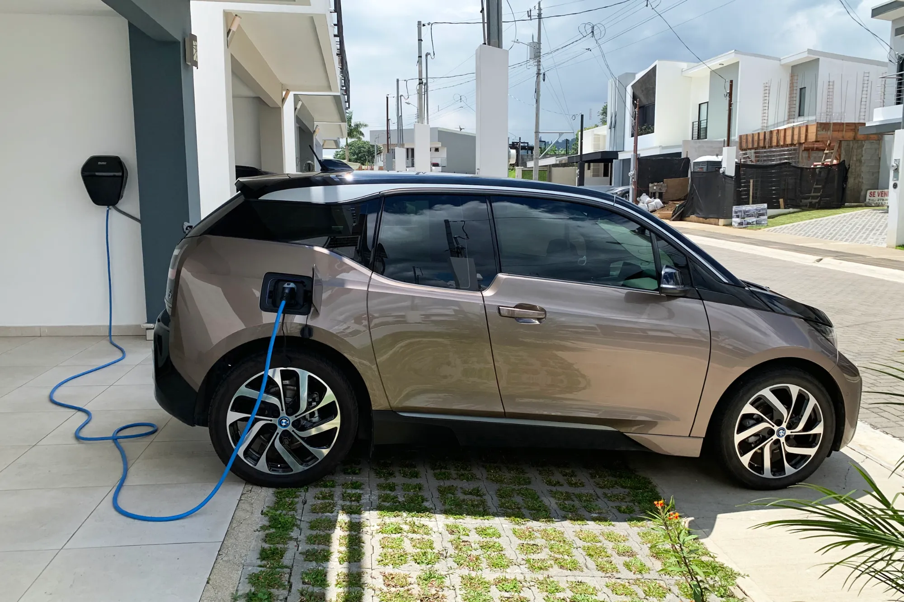

Una carga de carro eléctrico cuesta lo que valen los kWh que entran a la batería, y ese precio cambia mucho según dónde se enchufe. En Bogotá, con la tarifa de Enel de agosto de 2026, un kWh en casa de estrato 4 cuesta **$863,6**. En un supercargador de Tesla, **$1.300**. La misma carga sale un 50 % más cara en la calle.

## La fórmula

**Costo de la carga = kWh que necesita × precio del kWh**

Los kWh que necesita no son la capacidad total de la batería. Casi nadie carga de 0 % a 100 %. Una carga típica va del 10 % o 20 % al 80 %, que en una batería de 60 kWh son entre 36 y 42 kWh. A eso hay que sumarle las pérdidas: parte de la energía se va en calor en el cargador y en la batería, así que el contador de la casa registra algo más de lo que entra al carro.

## Cuánto cuesta en Colombia

Para una carga de 42 kWh, del 10 % al 80 % de una batería de 60 kWh:

| Dónde | Precio del kWh | Costo de la carga |
|---|---|---|
| Casa, estrato 4 en Bogotá (Enel, agosto de 2026) | $863,6 | Unos $36.300 |
| Supercargador de Tesla en Bogotá o Medellín | $1.300 | Unos $54.600 |

La tarifa de la casa cambia cada mes y depende del estrato: los estratos 1 a 3 tienen subsidio sobre una parte del consumo, y los 5 y 6 pagan una contribución adicional. La cuenta por estrato está en [cuánto cuesta cargar un eléctrico en casa](/es/notas/cuanto-cuesta-cargar-un-electrico-en-casa/).

No encontramos una tabla pública y actualizada con las tarifas de los demás operadores del país. Algunas redes, además, han tenido periodos de carga gratuita: en 2024, por ejemplo, Enel X no cobraba en sus puntos públicos. Consulte la tarifa en la aplicación del operador antes de conectar.

*Cargar en casa solo paga la energía. En Bogotá, estrato 4, el kWh costó $863,6 en agosto de 2026. Foto: Mariordo (Mario Roberto Durán Ortiz), CC BY-SA 4.0, vía Wikimedia Commons.*

## Cuánto cuesta en México y Chile

En **México**, la tarifa residencial de la CFE va de unos **1,8 a 3,5 pesos mexicanos por kWh**, según el consumo del hogar y si se paga la tarifa subsidiada o la de alto consumo. Con un promedio de 2,65 pesos, llenar la batería de 38,8 kWh de un BYD Dolphin Mini cuesta unos **103 pesos**. El punto a vigilar es la tarifa: si el carro sube mucho el consumo del hogar, la casa puede terminar en la tarifa DAC, de alto consumo, que es la más cara del rango.

En **Chile**, un ejecutivo de la marca Maxus citado por La Tercera usó como referencia **130 pesos chilenos por kWh en casa** y **250 en electrolinera**. Con esas cifras, la carga completa de una batería de 88,5 kWh cuesta unos 11.500 pesos en casa y 22.100 en la calle. El artículo no tiene fecha, así que conviene tomarlo como orden de magnitud y no como tarifa vigente.

## Por qué la electrolinera es más cara

El precio del kWh en una estación de carga rápida no paga solo la energía. También cubre el cargador, la conexión a la red y el espacio donde está instalado, y el operador recupera esa inversión kWh a kWh. En casa, en cambio, se paga solo la energía, porque el cargador ya es del dueño.

Por eso el ahorro de un eléctrico depende tanto de dónde se cargue. En Colombia, con carga en casa, el costo por kilómetro ronda los $130 para un carro que gasta 15 kWh cada 100 km. Con carga rápida en un supercargador, sube a unos $195.

> Si va a comprar un eléctrico sin poder cargar en casa, haga la cuenta con la tarifa de la electrolinera que tiene cerca, no con la de la casa. Esa es la cifra que va a pagar.

## Preguntas frecuentes

### ¿Cuánto cuesta cargar un carro eléctrico en Colombia?

En casa, en Bogotá estrato 4, unos $864 por kWh con la tarifa de agosto de 2026. Una carga del 10 % al 80 % de una batería de 60 kWh sale en unos $36.300. En un supercargador de Tesla, en unos $54.600.

### ¿Cuánto cuesta una carga completa?

Depende del tamaño de la batería. Multiplique los kWh de la batería por el precio del kWh y súmele un margen por las pérdidas de carga.

### ¿Es gratis cargar en los centros comerciales?

Algunos lo han ofrecido como promoción, pero no es una regla. Revise la aplicación del operador antes de ir.

---

**Fuentes:** [Enel Colombia: tarifas de agosto de 2026](https://www.enel.com.co/content/dam/enel-co/español/personas/1-17-1/2026/pliego%20tarifario%20digital%20_agosto_2026.pdf) · [Semana: supercargadores de Tesla en Colombia y su precio](https://www.semana.com/vehiculos/articulo/mapa-lista-de-ciudades-con-supercargadores-de-tesla-en-colombia-y-cuanto-cuesta-usarlos/202633/) · [Motorpasión México: cuánto cuesta cargar en México en 2026](https://www.motorpasion.com.mx/industria/cuanto-cuesta-cargar-auto-electrico-mexico-2026) · [La Tercera: carga en casa o en electrolinera en Chile](https://www.latercera.com/mtonline/noticia/cuanto-cuesta-recargar-un-auto-electrico-es-mas-barato-hacerlo-en-casa-o-en-una-electrolinera/VFLHTHA4YVFHZKRNBX3VL5GNAQ/) · [Noticias Caracol: carga gratuita en puntos públicos de Enel X, 2024](https://www.noticiascaracol.com/economia/cuanto-cuesta-cargar-los-carros-electricos-en-bogota-y-donde-puede-le-contamos-so35)
