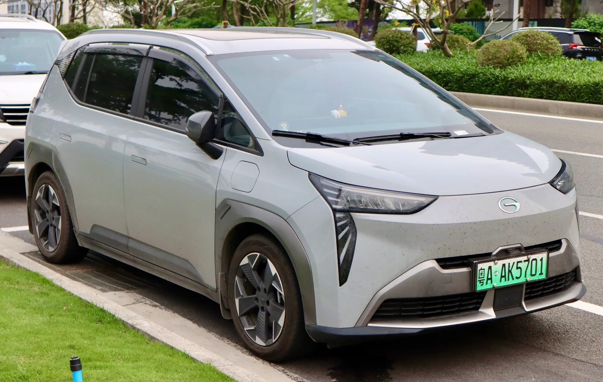

Un carro eléctrico tiene, en la práctica, dos garantías: una para la **batería y el sistema eléctrico**, que en casi todas las marcas dura **ocho años**, y otra para **el resto del carro**, que va de tres a ocho años según la marca. La segunda es la que más cambia, y la que más se olvida al comparar precios.

## Lo que publica cada marca

| Marca y modelo | Garantía del carro | Garantía de la batería | Mercado |
|---|---|---|---|
| Chery E5 | 8 años o 200.000 km | Incluida en la general | Colombia |
| GAC AION Y Plus | 8 años o 160.000 km | 8 años o 200.000 km | Colombia |
| Kia EV2 | 8 años o 160.000 km | Sin cifra separada en la fuente | Colombia |
| BYD (gama europea) | 6 años o 150.000 km | 8 años o 250.000 km | Europa |
| BYD Seagull | 6 años o 150.000 km | 8 años o 500.000 km | Colombia, prueba de 2024 |
| Chevrolet Spark EUV | 5 años o 100.000 km | 8 años o 160.000 km | Colombia |
| JAC E10X | 5 años o 100.000 km | 5 años o 100.000 km | Colombia |
| Tesla Model 3 y Model Y | 4 años o 80.000 km | 8 años y 160.000 o 192.000 km, según versión | México |
| Chevrolet Equinox EV | 3 años o 50.000 km | 8 años o 160.000 km | Colombia |

Cifras publicadas por cada marca o reportadas por la prensa especializada. Las condiciones pueden cambiar con el año modelo y el país, así que la que vale es la que aparece en el contrato de compra.

La tabla muestra dos extremos. Chery cubre todo el carro ocho años, igual que la batería. Chevrolet, en la Equinox EV, da ocho años a la batería pero solo tres al resto, lo que deja por fuera, desde el cuarto año, piezas como la suspensión, la pantalla o la electrónica de la cabina.

*En Colombia, la GAC AION Y Plus tiene ocho años de garantía para el carro y para la batería, con distinto tope de kilómetros. Foto: User3204, CC BY-SA 4.0, vía Wikimedia Commons.*

## Qué cubre la garantía de la batería, y qué no

La garantía de batería **no promete que la batería siga como nueva**. Promete que no baje de cierto porcentaje de su capacidad original. Tesla fija el mínimo en **70 % durante los ocho años**, y BYD también usa el 70 % en Europa. Si la capacidad cae por debajo de ese umbral dentro del plazo, la marca debe reparar o reemplazar la batería. Una batería que haya perdido el 20 % en seis años no da derecho a reclamar, porque sigue por encima del umbral.

El límite de kilómetros también importa. Ocho años o 160.000 km equivalen a 20.000 km al año. Un conductor de plataforma o un vendedor que recorre 40.000 km al año agota la garantía en cuatro. Para ese uso, los 250.000 km de BYD en Europa o los 200.000 km de GAC y Chery pesan más que los años.

## Lo que puede anularla

Cada marca fija sus condiciones en el manual de garantía, y vale la pena leerlo antes de firmar. La condición que más reclamos tumba es la de los mantenimientos: casi todos los contratos exigen hacerlos a tiempo y en la red autorizada, y un mantenimiento saltado puede bastar para que la marca niegue una reparación. Los daños por choque, inundación o modificaciones no autorizadas, entre ellas un cargador instalado sin las especificaciones del fabricante, suelen quedar por fuera.

Si compra usado, pregunte si la garantía pasa al nuevo dueño y con qué requisitos. El historial de mantenimientos registrado en el concesionario es lo primero que pedirán. Lo explicamos en [qué revisar al comprar un eléctrico usado](/es/notas/comprar-carro-electrico-usado-que-revisar/).

> La pregunta útil en el concesionario no es "cuántos años tiene de garantía", sino "qué cubre la garantía general, qué cubre la de batería y con qué porcentaje mínimo de capacidad".

## Preguntas frecuentes

### ¿Cuánto dura la garantía de un carro eléctrico?

La batería, casi siempre ocho años, con un tope que va de 100.000 a 500.000 km según la marca. El resto del carro, entre tres y ocho años.

### ¿Qué pasa si la batería se daña fuera de garantía?

El dueño paga el arreglo. En algunos casos no hay que cambiarla completa, sino reemplazar módulos. Los costos están en [cuánto cuesta cambiar la batería](/es/notas/bateria-carro-electrico-cuanto-cuesta-cambiarla-reventa/).

### ¿La garantía de batería cubre la de 12 voltios?

Normalmente no. La batería pequeña de 12 voltios, que alimenta luces y computadores, se trata como cualquier batería de carro. Es, además, la que más varados causa, como contamos en [esta nota](/es/notas/bateria-12-voltios-carro-electrico-varado/).

---

**Fuentes:** [Tesla México: garantía del vehículo](https://www.tesla.com/es_MX/support/vehicle-warranty) · [Electrive: BYD amplía la garantía de batería en Europa](https://www.electrive.com/es/2026/01/19/byd-amplia-la-garantia-de-las-baterias-a-250000-kilometros/) · [El Carro Colombiano: prueba del BYD Seagull](https://www.elcarrocolombiano.com/pruebas/byd-seagull-primer-contacto-en-colombia-test-drive-opiniones/) · [Chery Colombia: ficha técnica de la E5](https://www.chery.com.co/wp-content/uploads/2026/04/FICHATECNICA_E5_2026_v3.pdf) · [El Carro Colombiano: prueba de la GAC AION Y Plus](https://www.elcarrocolombiano.com/pruebas/gac-aion-y-plus-lo-manejamos-el-carro-electrico-que-si-cumplio-con-su-autonomia-video/) · [El Carro Colombiano: Kia EV2 en Colombia](https://www.elcarrocolombiano.com/lanzamientos/kia-ev2-colombia-precio-caracteristicas-suv-electrico/) · [Portafolio: Chevrolet Spark EUV](https://www.portafolio.co/negocios/vehiculo/el-viejo-spark-ahora-electrico-se-vuelve-a-instalar-en-el-pais-639650) · [El Carro Colombiano: Chevrolet Equinox EV](https://www.elcarrocolombiano.com/lanzamientos/chevrolet-equinox-ev-colombia-precio-datos-respuesta-americana-a-byd/) · [El Carro Colombiano: prueba del JAC E10X](https://www.elcarrocolombiano.com/pruebas/jac-e10x-electrico-autonomia-real-y-costos-de-uso-prueba-definitiva-auteco-video/)
