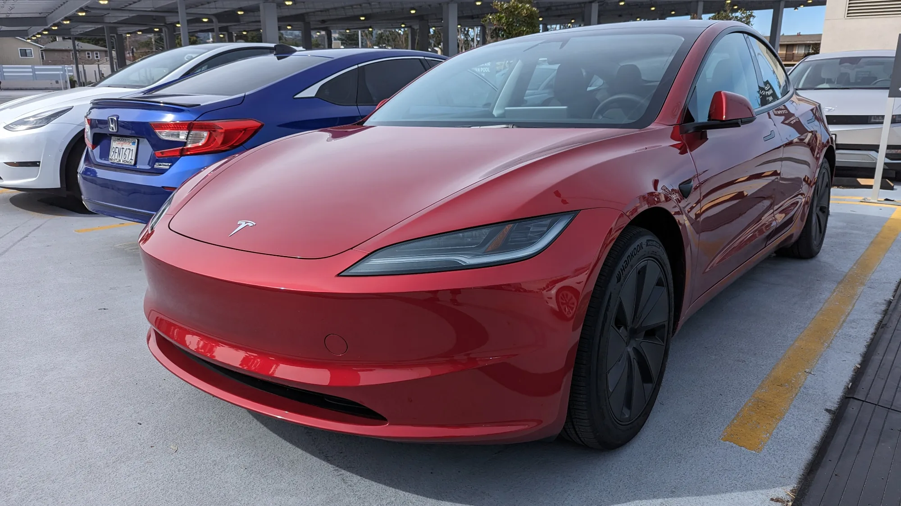

La respuesta corta: entre enero y septiembre de 2026 se matricularon **16.542 Tesla** en el país, según el boletín de Fenalco y la Andi con datos del RUNT. Si se suman los 28 que se registraron en 2025, el total supera los **16.500 carros** en menos de un año de operación oficial.

## Lo esencial

- **Llegada oficial:** 20 de noviembre de 2025.
- **Matrículas en 2025:** 28, la mayoría importaciones antes de las primeras entregas oficiales.
- **Matrículas de enero a septiembre de 2026:** 16.542.
- **Participación entre los eléctricos:** 41,6 %.
- **Participación en todo el mercado:** 6,7 %, sexta marca del país en el año.
- **Model Y:** 14.381 unidades en 2026. **Model 3:** 2.161.

## Mes a mes, lo que muestran las cifras

Tesla abrió sus primeras tiendas en Bogotá y Medellín a finales de 2025 y las entregas en volumen empezaron en el primer trimestre de 2026. La Superintendencia de Industria y Comercio informó que entre noviembre de 2025 y marzo de 2026 la marca recibió cerca de **24.000 pedidos**. La distancia entre esa cifra y las matrículas acumuladas a septiembre sugiere que no todos los pedidos se convirtieron en ventas, o que una parte de las entregas se demoró, como reconoció la propia SIC.

En **septiembre de 2026** matriculó 2.435 carros, el 7,2 % del mercado total, y fue la **quinta marca más vendida del país**, detrás de Kia, Toyota, Renault y Chevrolet. Ninguna de esas cuatro depende de un solo modelo como Tesla depende del Model Y. Ese mes, el **Model Y fue el carro más vendido de Colombia** entre todas las tecnologías, con 2.220 unidades.

| Dato | Cifra |
|---|---|
| Tesla matriculados en 2025 | 28 |
| Tesla matriculados de enero a septiembre de 2026 | 16.542 |
| Model Y en 2026 | 14.381 |
| Model 3 en 2026 | 2.161 |
| Tesla en septiembre de 2026 | 2.435 |
| Model Y en septiembre de 2026 | 2.220 |

*El Model 3 suma 2.161 matrículas en 2026, muy lejos del Model Y. Foto: Mliu92, CC BY-SA 4.0, recortada, vía Wikimedia Commons.*

## Dónde están los Tesla

El mercado eléctrico se concentra en tres ciudades. En lo corrido de 2026, **Bogotá** registró 20.707 eléctricos, **Medellín** 10.380 y **Cali** 3.246, según el mismo boletín. El boletín no desglosa por marca y ciudad, así que no hay una cifra oficial de cuántos Tesla circulan en cada una. Con sus primeras tiendas en Bogotá y Medellín, es probable que ahí esté la mayoría.

## Lo que no ha salido tan bien

El crecimiento tuvo problemas. La SIC informó en abril que más de **1.800 carros** que debían entregarse entre febrero y marzo seguían pendientes. Tesla también subió sus precios de entrada después del lanzamiento: el Model 3 quedó desde $114,9 millones y el Model Y desde $119,99 millones.

> Que una marca tenga cuatro de cada diez eléctricos del país es una fortaleza para Tesla, pero un riesgo para el mercado: cualquier cambio de precio o de importación de una sola empresa mueve todas las cifras del sector.

## Preguntas frecuentes

### ¿Cuántos Tesla se han vendido en Colombia?

16.542 entre enero y septiembre de 2026, más 28 matriculados en 2025.

### ¿Cuál es el Tesla más vendido en Colombia?

El Model Y, con 14.381 unidades en 2026. En septiembre fue el carro más vendido del país.

### ¿Qué participación tiene Tesla en el mercado?

41,6 % de los eléctricos y 6,7 % de todos los carros nuevos matriculados en 2026.

### ¿Cuántos pedidos recibió Tesla al llegar?

Cerca de 24.000 entre noviembre de 2025 y marzo de 2026, según la SIC.

Compare el Model Y con sus rivales en el [comparador de Mejor Eléctrico](/es/comparador/?a=tesla-model-y-rwd-2026-eu&b=chery-icar-03-2wd-2025-co).

---

**Fuentes:** [Infobae: eléctricos en Colombia de enero a septiembre de 2026](https://www.infobae.com/colombia/2026/10/10/crece-la-venta-de-vehiculos-electricos-en-colombia-cerca-de-40000-automotores-en-lo-corrido-del-2026/) · [ColombiNews: Tesla en septiembre de 2026](https://colombinews.com.co/tesla-se-posiciona-entre-las-cinco-marcas-mas-vendidas-en-colombia-en-septiembre-de-2026/) · [Semana: matrículas de Tesla en 2025](https://www.semana.com/vehiculos/articulo/cuantos-carros-vendio-tesla-en-colombia-durante-noviembre-la-cifra-dejo-algunas-dudas/202528/) · [La República: precios de Tesla en Colombia](https://www.larepublica.co/empresas/tesla-eleva-sus-precios-de-entrada-despues-de-su-lanzamiento-a-114-9-millones-4276858) · [Blu Radio: pedidos y entregas pendientes según la SIC](https://www.bluradio.com/motor/tesla-vendio-en-cuatro-meses-lo-que-todo-el-mercado-colombiano-matricula-en-un-mes-segun-la-sic-so35)
