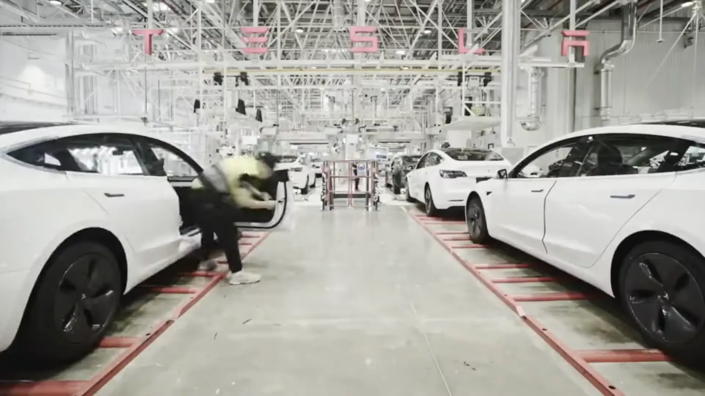

Tesla vende hoy entre 1,6 y 1,8 millones de carros al año en todo el mundo. En **2025 entregó 1.636.129**, según su reporte del cuarto trimestre, y entre enero y septiembre de **2026 lleva 1.324.681**, un 8,8 % más que en el mismo periodo del año anterior.

Para dimensionar la cifra: lo que Tesla entregó en el mundo entre enero y septiembre de 2026 equivale a unas 80 veces lo que matriculó en Colombia en el mismo periodo.

## Las entregas año por año

| Año | Entregas | Cambio frente al año anterior |
|---|---|---|
| 2015 | 50.658 | |
| 2016 | 76.285 | +51 % |
| 2017 | 103.181 | +35 % |
| 2018 | 245.240 | +138 % |
| 2019 | 367.500 | +50 % |
| 2020 | 499.550 | +36 % |
| 2021 | Cerca de 936.000 | +87 % |
| 2022 | Cerca de 1,31 millones | +40 % |
| 2023 | 1.808.581 | +38 % |
| 2024 | 1.789.226 | −1 % |
| 2025 | 1.636.129 | −8,6 % |
| 2026 (enero a septiembre) | 1.324.681 | +8,8 % frente al mismo periodo de 2025 |

Para 2021 y 2022 las recopilaciones públicas no coinciden en las últimas cifras, por eso aparecen redondeadas.

La curva tiene dos etapas claras. Hasta 2023 Tesla creció casi todos los años a doble dígito, empujada por la fábrica de Shanghái, que empezó a entregar a finales de 2019, y por las de Berlín y Texas, que abrieron en 2022. Desde 2024 la marca dejó de crecer: tenía la capacidad instalada, pero no una gama nueva que vender. El Model Y y el Model 3 siguen siendo casi todo lo que vende.

*La fábrica de Shanghái empezó a entregar a finales de 2019 y empujó el crecimiento de Tesla hasta 2023. Foto: China News Service, CC BY 3.0, vía Wikimedia Commons.*

## Por qué cayó en 2024 y 2025

La caída de 2025 tiene varias causas, y no todas son de Tesla. En Estados Unidos, el crédito tributario federal de 7.500 dólares para eléctricos terminó el 30 de septiembre de 2025. Eso adelantó compras al tercer trimestre y dejó un cuarto trimestre flojo: **418.227 entregas**, un 16 % menos que un año antes.

La competencia también apretó. **BYD cerró 2025 con 2,26 millones de ventas** y pasó a Tesla como el mayor fabricante de eléctricos del mundo, aunque en esa cifra la prensa no siempre separa los eléctricos puros de los híbridos enchufables. La imagen de Elon Musk también pesó: su papel político y su apoyo al partido alemán AfD provocaron protestas contra la marca, como las de "Tesla Takedown".

## Lo que va de 2026

El año arrancó débil, con **358.023 entregas** en el primer trimestre, y se recuperó después: **480.126** en el segundo y **486.532** en el tercero. Si el cuarto trimestre repite el ritmo del tercero, Tesla cerraría 2026 con algo más de 1,8 millones de carros. Superaría a 2025 y quedaría prácticamente empatado con su récord de 2023.

Parte del crecimiento viene de mercados nuevos. Colombia, donde Tesla abrió tiendas en noviembre de 2025, sumó 16.542 matrículas entre enero y septiembre de 2026. Es poco frente al total mundial, pero convierte al país en uno de los mercados que más rápido creció para la marca. El detalle está en [cuántos Tesla se han vendido en Colombia](/es/notas/cuantos-tesla-se-han-vendido-en-colombia/).

## Entregas y producción no son lo mismo

Tesla reporta dos cifras cada trimestre. Las **entregas** son carros que llegaron a manos del cliente; la **producción**, los que salieron de las fábricas. En 2025 produjo 1.654.667 carros y entregó 1.636.129, así que quedaron cerca de 18.500 en inventario. Cuando la producción supera por mucho a las entregas, suele venir una ronda de descuentos para mover el inventario, como pasó en la guerra de precios de 2023.

## Preguntas frecuentes

### ¿Cuántos Tesla se venden al año?

Entre 1,6 y 1,8 millones en los últimos tres años completos. El récord es 2023, con 1.808.581 entregas.

### ¿Cuántos Tesla se vendieron en 2025?

1.636.129, un 8,6 % menos que en 2024.

### ¿Cuál es el Tesla más vendido?

El Model Y. Junto con el Model 3 suma el 98 % de las entregas del tercer trimestre de 2026; el Cybertruck, el Model S y el Model X se reparten el resto.

---

**Fuentes:** [Electrek: entregas del cuarto trimestre y del año 2025](https://electrek.co/2026/01/02/tesla-tsla-releases-q4-delivery-results/) · [CBT News: segunda caída anual seguida](https://www.cbtnews.com/tesla-posts-second-consecutive-annual-delivery-decline-in-2025/) · [Not a Tesla App: entregas del segundo trimestre de 2026](https://www.notateslaapp.com/news/4389/tesla-smashes-q2-2026-delivery-estimates) · [Electrek: entregas del tercer trimestre de 2026](https://electrek.co/2026/10/02/tesla-q3-2026-deliveries-486532/) · [Tridens Technology: recopilación de ventas por año](https://tridenstechnology.com/tesla-sales-statistics)
