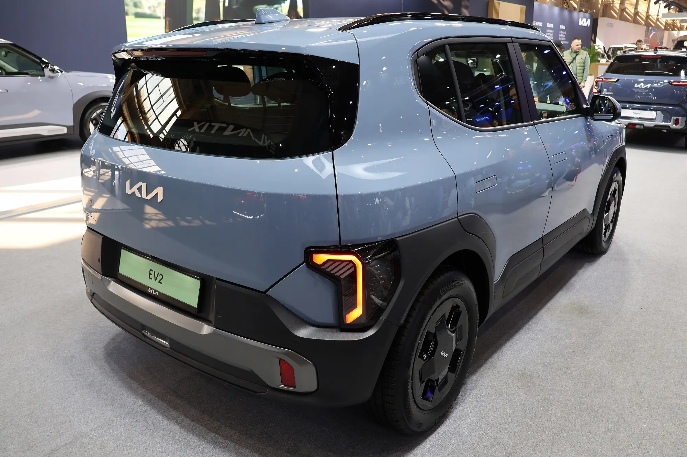

La cuota inicial es la decisión que más mueve el costo de un crédito de carro, después de la tasa. Cada peso que se paga de contado es un peso sobre el que no se cobran intereses durante años. Para mostrarlo, hicimos la cuenta con un eléctrico de **$89,99 millones**, el precio del Kia EV2 o del nuevo BYD Dolphin en Colombia, financiado a **60 meses** con una tasa verde de **12,5 % efectivo anual**, la más baja reportada en 2026.

## Cuánto cambia según la cuota inicial

| Cuota inicial | Monto de contado | Monto financiado | Cuota mensual | Intereses totales |
|---|---|---|---|---|
| 10 % | $8.999.000 | $80.991.000 | $1.794.907 | $26,7 millones |
| 20 % | $17.998.000 | $71.992.000 | $1.595.473 | $23,7 millones |
| 30 % | $26.997.000 | $62.993.000 | $1.396.039 | $20,8 millones |
| 50 % | $44.995.000 | $44.995.000 | $997.171 | $14,8 millones |

Cálculo propio, sin seguros ni otros cargos.

Pasar de 10 % a 30 % de cuota inicial baja la cuota en unos **$400.000 al mes** y ahorra cerca de **$6 millones** en intereses. Con el 50 %, el ahorro frente al 10 % sube a casi $12 millones.

## El plazo pesa tanto como la cuota inicial

Con una cuota inicial del 20 %, estos son los números según el plazo:

| Plazo | Cuota mensual | Intereses totales |
|---|---|---|
| 36 meses | $2.385.540 | $13,9 millones |
| 48 meses | $1.890.044 | $18,7 millones |
| 60 meses | $1.595.473 | $23,7 millones |
| 72 meses | $1.401.336 | $28,9 millones |
| 84 meses | $1.264.562 | $34,2 millones |

Alargar el crédito de 60 a 84 meses baja la cuota en unos $330.000, pero suma más de $10 millones en intereses. Y en un eléctrico hay un riesgo adicional: el carro se devalúa rápido, y con un plazo largo es posible deber más de lo que vale el carro durante los primeros años. Lo explicamos en [nuevo o usado](/es/notas/carro-electrico-nuevo-o-usado-que-conviene/).

*Con el 20 % de cuota inicial, un carro de este precio queda en unos $1,6 millones al mes a 60 meses y 12,5 % EA, sin seguros. Foto: Peżot, CC BY-SA 4.0, vía Wikimedia Commons.*

## Cuánto dar: una regla práctica

No hay un porcentaje correcto para todos, pero hay tres límites útiles:

**No se quede sin colchón.** Dar todo el ahorro como cuota inicial y quedarse sin fondo de emergencia es un error frecuente. La cuota del carro sigue llegando aunque haya un imprevisto.

**Mire las condiciones de las ofertas.** Algunas tasas especiales exigen un mínimo. La financiación al 0 % de Tesla, por ejemplo, pide pagar el 50 % de contado. La explicamos en [esta nota](/es/notas/tesla-financiacion-0-por-ciento-colombia/).

**Considere la devolución del IVA.** Si compra un eléctrico nuevo con certificado de la UPME, puede pedir a la DIAN que le devuelva el IVA pagado: en un carro de $89,99 millones, unos $4,3 millones. Esa plata llega meses después de la compra y sirve para un abono a capital, que reduce los intereses de todo el crédito. La cuenta está en [cuánto ahorra abonar a capital](/es/notas/abonar-a-capital-credito-carro-electrico-ley-1555/).

> Si duda entre más cuota inicial o un plazo más corto, haga las dos cuentas. En nuestro ejemplo, bajar de 60 a 48 meses ahorra unos $5 millones en intereses, más que subir la cuota inicial del 20 % al 30 %, que ahorra unos $3 millones. A cambio, la cuota mensual sube casi $300.000.

## Preguntas frecuentes

### ¿Cuánta cuota inicial piden para un carro eléctrico?

Depende del banco y de la oferta. Hay créditos con iniciales desde el 10 %, y ofertas especiales que piden más, como el 50 % de la financiación al 0 % de Tesla.

### ¿Cuánto queda la cuota de un carro de $90 millones?

Con 20 % de cuota inicial, 60 meses y 12,5 % EA, unos $1,6 millones al mes, sin seguros.

### ¿Conviene un plazo de 84 meses?

Baja la cuota, pero en nuestro cálculo suma más de $10 millones en intereses frente a 60 meses. Solo conviene si la cuota a 60 meses no cabe en el presupuesto.

---

**Fuentes:** [La República: tasas de crédito para eléctricos en 2026](https://www.larepublica.co/finanzas/los-beneficios-tributarios-y-financieros-por-adquirir-un-carro-electrico-o-uno-hibrido-4387951) · [Portafolio: financiación al 0 % de Tesla](https://www.portafolio.co/negocios/vehiculo/tesla-ofrece-financiacion-al-0-de-interes-en-colombia-para-model-3-y-model-y-asi-puede-acceder-505120) · [Portafolio: plazo y proceso de la devolución del IVA](https://www.portafolio.co/negocios/vehiculo/este-es-el-plazo-y-el-proceso-para-que-le-devuelvan-el-iva-si-compro-un-carro-hibrido-o-electrico-503819)
