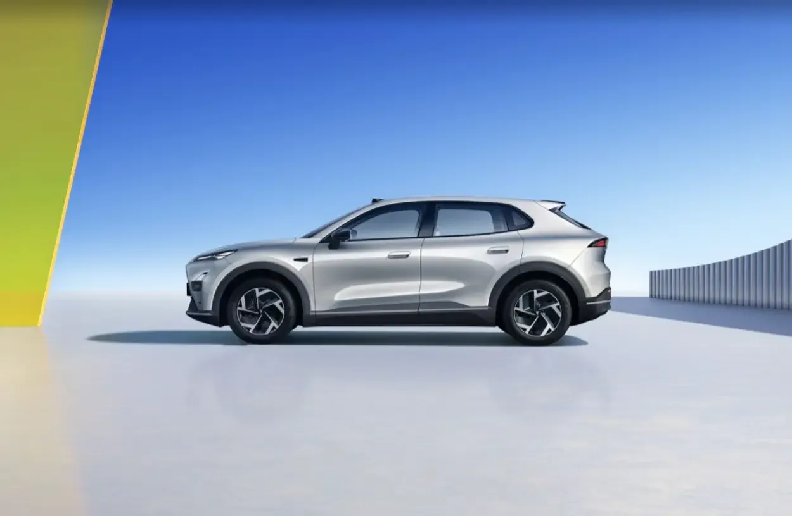
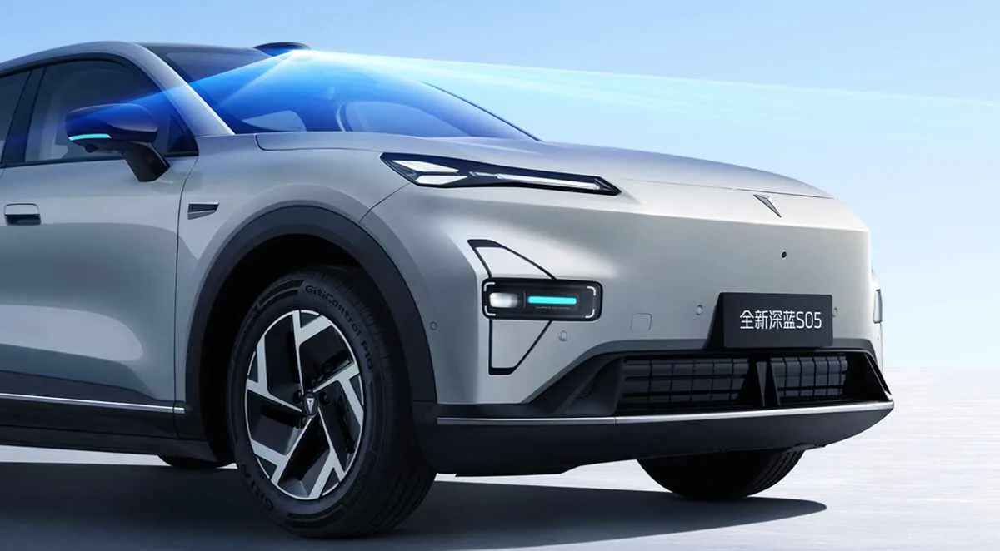
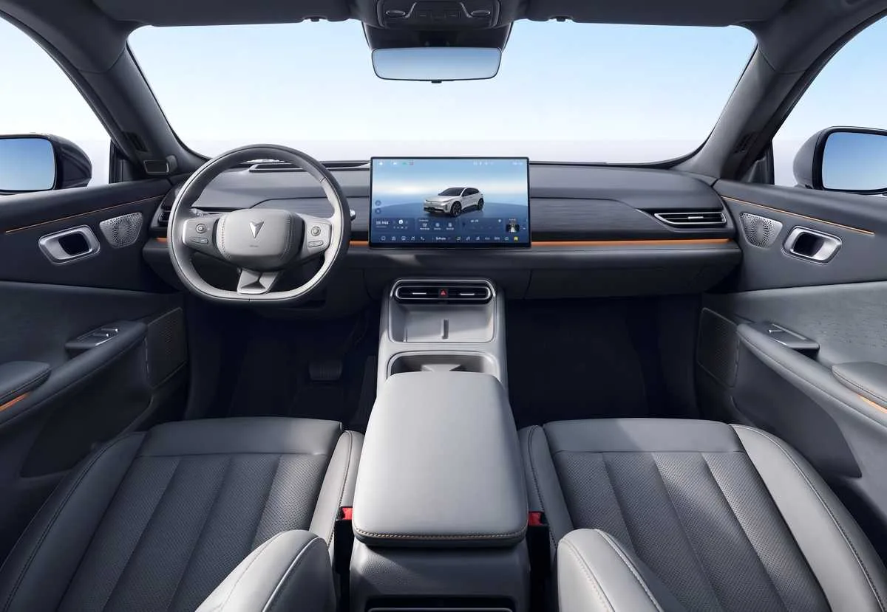
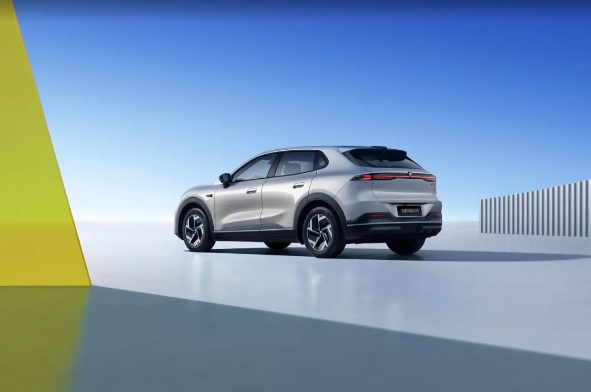

El Deepal S05 es el carro más vendido de la marca y uno de los eléctricos chinos que más rápido se ha expandido fuera de su país. Con apenas un par de años en el mercado, acaba de recibir su primera actualización importante: estrena **sensor LiDAR**, sube su autonomía hasta **620 km** y rediseña la cabina, sin tocar la fórmula que lo hizo popular.

La preventa abrió el 30 de julio de 2026 y el lanzamiento oficial en China fue el 6 de agosto. Esto es todo lo que se sabe del modelo, y lo que todavía falta por confirmar para Colombia y América Latina.

## Qué cambia en el Deepal S05 2027

Es una actualización, no una nueva generación. La plataforma y las proporciones se mantienen, pero Deepal reforzó los puntos que más pesan al comprar un eléctrico:

- **Conducción asistida:** llega el sensor LiDAR, hasta ahora reservado a modelos más costosos.
- **Autonomía:** dos baterías, con 520 y 620 km según el ciclo chino CLTC.
- **Carga:** todas las versiones pasan del 30 al 80 % en 15 minutos o menos.
- **Diseño:** frente con líneas más limpias, nuevos faros y rines de 18 pulgadas.
- **Cabina:** tablero rediseñado, pantalla giratoria de 15,6 pulgadas y más espacios para guardar cosas.

*De perfil mantiene las proporciones del modelo anterior: 4,62 metros de largo y rines de 18 pulgadas. Foto: Deepal.*

Por fuera conserva la parrilla cerrada y las puertas sin marco. Cambian los faros, el parachoques y las manijas, que ahora son mecánicas y semiocultas. Se ofrece en cuatro colores: blanco, plata, negro y gris.

## Qué es el LiDAR y para qué sirve en el S05

El LiDAR es un sensor que mide distancias con pulsos de luz láser y arma un mapa tridimensional de lo que rodea al carro. Frente a una cámara, tiene una ventaja clara: no depende de la luz ambiente, así que detecta obstáculos de noche o a contraluz con mucha más precisión.

En el S05 va montado sobre el parabrisas y forma parte de un conjunto de 27 sensores:

- 1 LiDAR
- 3 radares de onda milimétrica
- 12 sensores ultrasónicos
- 11 cámaras de alta definición, dos de ellas frontales de 8 megapíxeles

*El LiDAR va sobre el parabrisas y explora lo que hay delante del carro. Foto: Deepal.*

Toda esa información la procesan dos chips Horizon J6M, con 256 TOPS de capacidad de cómputo. El resultado, según la marca, son más de 90 funciones de asistencia para ciudad, autopista y parqueo.

Conviene tener claro el alcance: es conducción **asistida**, no autónoma. El conductor sigue siendo responsable y debe mantener la atención en la vía. Además, estas funciones están calibradas para las vías y los mapas de China, y no hay garantía de que lleguen iguales a otros mercados.

## Autonomía, batería y carga

La versión eléctrica mantiene un motor trasero de 272 hp, que la lleva de 0 a 100 km/h en 6,28 segundos. Las baterías son de CATL, con química de litio-ferrofosfato (LFP):

| Batería | Capacidad | Autonomía CLTC |
|---|---|---|
| Estándar | 56,12 kWh | 520 km |
| Extendida | 68,82 kWh | 620 km |

Dos precisiones para leer bien esas cifras:

1. **El ciclo CLTC es optimista.** Es la medición oficial china y suele dar resultados más altos que la europea WLTP. Como referencia, el S05 que ya se vende en Europa homologa 485 km WLTP con la batería grande.
2. **La carga rápida es de 30 a 80 %.** Deepal anuncia 15 minutos para ese tramo con carga 3C, pero eso exige un cargador de corriente continua de alta potencia. En un cargador doméstico los tiempos son muy distintos.

## También habrá versión de rango extendido

El S05 seguirá ofreciendo una variante eléctrica de rango extendido (EREV): las ruedas siempre las mueve un motor eléctrico, y un motor de gasolina de 1,5 litros funciona solo como generador para recargar la batería en marcha.

Aquí los datos publicados no coinciden del todo. La batería es de unos 28,4 kWh, pero el rango en modo eléctrico aparece como 190 km en unas fuentes y 215 km en otras, y la autonomía total va de cerca de 1.100 a 1.310 km. La diferencia probablemente se debe al ciclo de medición usado, y habrá que esperar la ficha oficial de cada mercado.

Es un dato relevante para Colombia, donde esta mecánica es la que más se vende del modelo.

## Interior: pantalla giratoria y más espacio

La cabina es el otro gran cambio. El tablero adopta una distribución más limpia, con salidas de aire a la vista y una iluminación ambiental de 256 colores.

*La cabina estrena tablero, salidas de aire a la vista y una pantalla central que gira hacia el conductor o el pasajero. Foto: Deepal.*

- **Pantalla central** de 15,6 pulgadas y resolución 2,5K, que gira 15 grados hacia el conductor o el pasajero.
- **Proyección en el parabrisas** (AR-HUD) equivalente a 50 pulgadas, con navegación en realidad aumentada.
- **Sistema Deepal OS 4.2**, sobre un chip automotriz de 3 nanómetros.
- **37 compartimentos** repartidos por la cabina.
- **Baúl de 492 litros** con doble piso, más un baúl delantero de 159 litros en la versión eléctrica.
- **Sonido opcional** de 18 parlantes y 1.280 vatios.

## Precio y versiones en China

La gama tiene cinco versiones, que combinan batería y equipamiento:

- 520 Smart
- 520 Premium
- 620 Premium
- 520 Premium LiDAR
- 620 Premium LiDAR

*La parte trasera conserva la tira de luces de lado a lado. Foto: Deepal.*

El precio de lanzamiento va de **115.900 a 144.900 yuanes**, unos **16.900 a 21.300 dólares**. Es una tarifa promocional por tiempo limitado y aplica solo para China.

No sirve como referencia directa para otros países: al precio chino hay que sumarle transporte, aranceles, impuestos y el margen del importador. El LiDAR, además, solo viene en las dos versiones más equipadas.

## Ficha técnica del Deepal S05 eléctrico

| Dato | Valor |
|---|---|
| Largo | 4.620 mm |
| Ancho | 1.900 mm |
| Alto | 1.600 mm |
| Distancia entre ejes | 2.880 mm |
| Motor | Eléctrico, trasero |
| Potencia | 272 hp |
| 0 a 100 km/h | 6,28 segundos |
| Baterías | 56,12 o 68,82 kWh (LFP, CATL) |
| Autonomía CLTC | 520 o 620 km |
| Carga rápida | 30 a 80 % en 15 minutos |
| Baúl | 492 litros, más 159 litros adelante |
| Rines | 18 pulgadas |

## Cuándo llega a Colombia y América Latina

Por ahora no hay fecha ni precio confirmados. Todo lo anunciado corresponde al mercado chino.

Lo que sí se sabe es que el S05 es un modelo global. Llegó a Europa a finales de 2025 y al Reino Unido en marzo de 2026, y en China vendió 64.716 unidades en el primer semestre de 2026, un 56 % más que un año antes. Casi la mitad de los Deepal que se venden en su país son un S05.

En Colombia el modelo actual ya está a la venta y es el más importante de la marca. Solo en julio de 2026 sumó 215 matrículas: 159 de la versión de rango extendido y 56 de la eléctrica.

Para Europa, los medios especializados calculan que la actualización llegará en 2027. Es razonable esperar un calendario parecido para América Latina, pero la marca no lo ha confirmado.

> Si está pensando en comprar un S05 hoy, la pregunta clave para el concesionario es cuándo llega la actualización y si las versiones con LiDAR harán parte de la oferta local.

## Preguntas frecuentes

### ¿Cuánta autonomía tiene el Deepal S05 con LiDAR?

Hasta 620 km según el ciclo chino CLTC, con la batería de 68,82 kWh. Con la batería de 56,12 kWh son 520 km. En el ciclo europeo WLTP las cifras serán más bajas.

### ¿Cuánto cuesta el Deepal S05 2027?

En China, entre 115.900 y 144.900 yuanes, unos 16.900 a 21.300 dólares, como precio promocional de lanzamiento. No hay precio anunciado para Colombia.

### ¿Todas las versiones traen LiDAR?

No. De las cinco versiones, solo dos lo incluyen: 520 Premium LiDAR y 620 Premium LiDAR.

### ¿El Deepal S05 se maneja solo?

No. Sus sistemas son de conducción asistida: ayudan al conductor, pero no lo reemplazan.

---

**Fuentes:** [Car News China](https://carnewschina.com/2026/08/07/refreshed-deepal-s05-with-lidar-launched-in-china-starting-from-16900-usd/), [Forococheseléctricos](https://forococheselectricos.com/noticias/nuevo-deepal-s05-lidar-diseno-620-km-autonomia-20260722-41625.html) y [El Carro Colombiano](https://www.elcarrocolombiano.com/autos-del-mundo/deepal-s05-2027-nueva-actualizacion-tecnologia-lidar-autonomia/).
