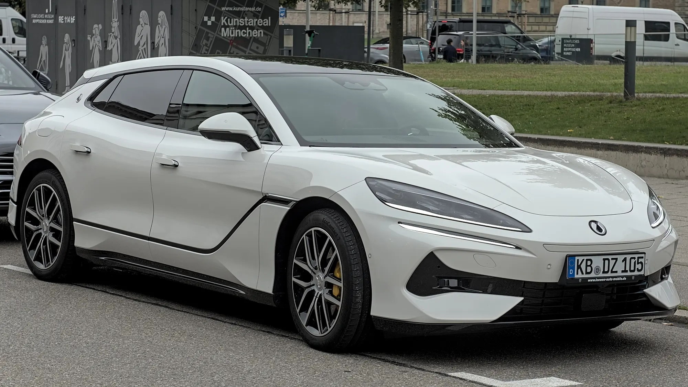

BYD, la segunda marca de eléctricos más vendida de Colombia, prepara la llegada de su marca de lujo, **Denza**. La importará **Motorysa**, el mismo grupo que distribuye BYD en el país. La cuenta oficial de Denza Colombia en redes sociales se abrió el 28 de septiembre de 2026, y la marca aparece en el listado de las que debutarían alrededor del Salón del Automóvil de Bogotá, en noviembre.

## Lo esencial

- **Importador:** Motorysa.
- **Fecha de llegada:** sin confirmar; se espera alrededor del Salón de noviembre.
- **Modelos:** no confirmados. El Z9 GT es el más mencionado.
- **Precios:** no anunciados.
- **Rivales esperados:** Zeekr, Voyah, Smart, Xpeng y Avatr, además de las marcas premium alemanas.

## Los candidatos

Denza no ha dicho qué modelos traerá. Esta es su gama global:

| Modelo | Tipo | Dato destacado |
|---|---|---|
| Z9 GT | Shooting brake eléctrico o híbrido enchufable | En Europa anuncia 600 km WLTP y 0 a 100 km/h en 2,7 segundos |
| N8 / N8L | SUV grande | Hasta 1.003 km CLTC en el N8 |
| N9 | SUV de seis puestos | Híbrido enchufable con tres motores eléctricos |
| D9 | Van de lujo de siete puestos | Versión eléctrica de hasta 520 km WLTP |
| B5 y B8 | SUV con chasis de largueros | Híbridos enchufables de más de 1.000 km NEDC |

Ojo con las cifras de autonomía: las de ciclo **CLTC** y **NEDC** son más optimistas que las **WLTP**. Lo explicamos en nuestra [nota sobre cómo leer la autonomía](/es/notas/autonomia-electricos-cltc-nedc-wltp-como-leerla/).

*El Z9 GT tiene una carrocería tipo familiar deportivo, poco común entre los eléctricos. Foto: Alexander-93, CC BY-SA 4.0, recortada, vía Wikimedia Commons.*

## Por qué BYD trae una marca de lujo

En Colombia, BYD compite sobre todo por precio con modelos como el Yuan Up, el Seagull y el Dolphin. Pero el segmento alto del mercado eléctrico creció con la llegada de Tesla, y ahí BYD tiene menos presencia. Denza le permite entrar a ese segmento sin cambiar la imagen de marca de precio accesible que tiene BYD.

Con Denza, BYD repite en Colombia lo que hizo en China: una marca separada para competir en el segmento de lujo, sin el nombre BYD en la parrilla.

## Preguntas frecuentes

### ¿Qué es Denza?

Es la marca de lujo de BYD. Nació en 2010 como empresa conjunta con Mercedes-Benz y hoy es de BYD.

### ¿Cuándo llega Denza a Colombia?

No hay fecha confirmada. Se espera alrededor del Salón del Automóvil de Bogotá, en noviembre de 2026.

### ¿Qué modelos traerá?

No están confirmados. El Z9 GT es el más mencionado.

### ¿Quién la importa?

Motorysa, el mismo distribuidor de BYD en Colombia.

Mientras llega, compare los BYD que ya se venden en el país en el [comparador de Mejor Eléctrico](/es/comparador/?a=byd-seal-82-5-kwh-awd-excellence-2026-eu&b=byd-sealion-7-82-5-kwh-awd-design-2026-eu).

---

**Fuentes:** [El Carro Colombiano: Denza en Colombia](https://www.elcarrocolombiano.com/industria/denza-marca-premium-byd-colombia-modelos-lanzamiento/) · [El Carro Colombiano: marcas nuevas del Salón 2026](https://www.elcarrocolombiano.com/lanzamientos/carros-nuevas-marcas-vienen-colombia-salon-del-automovil-bogota-2026/)
