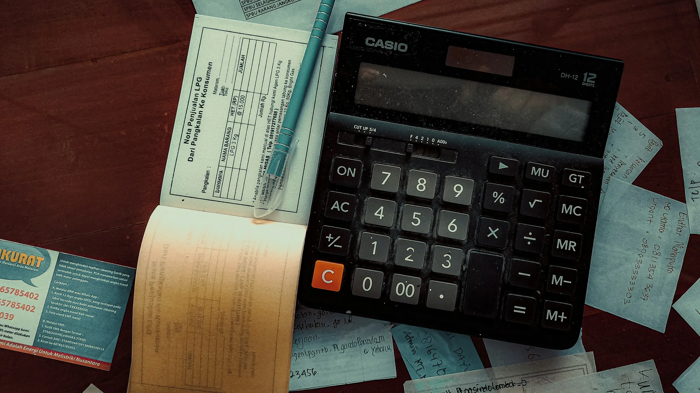

En un carro de $100 millones, el IVA del 5 % que se paga en la factura es de unos **$4,76 millones**. La Ley 1715 de 2014 permite recuperarlo, y la DIAN lo confirmó para personas naturales en su **Concepto 000673 del 16 de enero de 2026**. El problema no es el derecho, es el trámite: hay pocas citas, reglas estrictas para enviar los archivos y poca tolerancia a los errores.

## Antes de empezar: el certificado de la UPME

Todo arranca con el certificado de la Unidad de Planeación Minero Energética (UPME), que acredita que el carro es una medida de gestión eficiente de la energía. Sin él, la DIAN rechaza la solicitud. Las solicitudes a la UPME crecieron tanto en 2026 que la entidad tuvo que acelerar sus tiempos, así que conviene pedirlo apenas tenga la factura.

## Los documentos

Según la DIAN y los contadores que han acompañado el trámite, el paquete básico es este. Confirme la lista vigente con la DIAN antes de la cita:

1. **Formulario 010** de solicitud de devolución o compensación.
2. **Certificado de la UPME** del vehículo.
3. **Relación de facturas** de la compra del carro.
4. **Declaración juramentada** en la que conste, entre otras cosas, que el IVA que pide no se usó como mayor valor del costo, como deducción en renta ni como impuesto descontable.
5. Copia del RUT actualizado y documento de identidad.

*El valor a pedir es el IVA que aparece en la factura del carro, no un porcentaje del precio total. Foto: FIN en Unsplash.*

## El paso a paso

1. **Pida la cita** en el sistema de agendamiento de la DIAN, en el trámite de solicitud de devolución por vehículos eléctricos o híbridos de su seccional. Debe ser la seccional de su domicilio fiscal: una cita en otra ciudad no le sirve.
2. **Prepare los PDF por separado**, numerados en orden y con nombres claros.
3. **Envíe todo en un solo correo**, desde el correo registrado en el RUT, al buzón que indique la DIAN para su seccional y su trámite, **en la fecha y la hora exactas de la cita**.
4. **Guarde la respuesta automática** y el número de radicado.

En Bogotá, durante 2026, la DIAN cambió varias veces el canal: suspendió la videoatención para este trámite, deshabilitó buzones generales y pasó a recibir los documentos solo por correo y solo a la hora de una cita. Revise siempre las instrucciones que llegan con la confirmación de la cita.

## Los errores que más frenan la solicitud

- **Enviar fuera de la hora de la cita.** La DIAN devuelve los correos que llegan antes o después, aunque sean del mismo día.
- **Usar un correo distinto al del RUT.** Algunos buzones rechazan remitentes que no reconocen.
- **Mandar todo en un solo PDF** o en varios correos.
- **Buscar citas a cualquier hora.** La DIAN informó que libera cupos semanales en momentos aleatorios del día. Hay que revisar varias veces.

> Si la cita no aparece o un correo rebota, deje constancia: una PQR con capturas de pantalla le sirve como prueba si después necesita pedir una revisión.

## Preguntas frecuentes

### ¿Cuánto me devuelven?

El IVA que pagó en la compra del carro y que aparece en la factura. Si el carro costó $100 millones con IVA incluido, son unos $4,76 millones.

### ¿Cuánto tarda la DIAN en devolver el dinero?

El plazo legal de las devoluciones depende del tipo de solicitud y de que la DIAN no pida información adicional. Cuente con varias semanas después del radicado.

### ¿Puedo hacerlo yo o necesito contador?

Puede hacerlo usted. Un contador ayuda sobre todo con la declaración juramentada y con la relación entre la devolución y la deducción en renta.

### ¿Aplica si compré un híbrido?

Según la DIAN, sí, para híbridos HEV y PHEV con certificado de la UPME.

Para saber cuánto vale además la deducción en renta, lea [nuestra cuenta con los topes de la DIAN](/es/notas/deduccion-renta-carro-electrico-ley-1715/).

*Esta nota es informativa y no reemplaza la asesoría de un contador.*

---

**Fuentes:** [DIAN, Concepto 000673 de 2026](https://normograma.dian.gov.co/dian/compilacion/docs/oficio_dian_0673_2026.htm) · [INCP: cómo solicitar la devolución del IVA](https://incp.org.co/publicaciones/infoincp-publicaciones/impuestos/2026/02/como-solicitar-la-devolucion-del-iva-en-la-compra-de-vehiculos-electricos-e-hibridos/) · [Portafolio: la UPME acelera los certificados](https://www.portafolio.co/negocios/vehiculo/solicitudes-para-certificados-de-vehiculos-electricos-e-hibridos-crecen-16-800-upme-acelera-este-proceso-493805) · [DIAN, agendamiento de citas](https://agendamiento.dian.gov.co)
