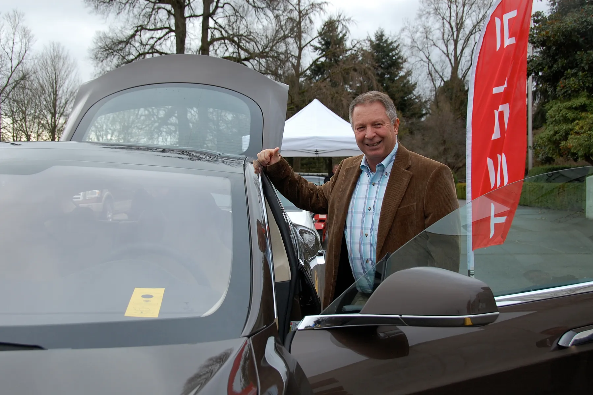

Manejar un carro eléctrico antes de comprarlo es más importante que con uno de gasolina. La aceleración, el freno regenerativo y la forma de cargar cambian la experiencia, y una ficha técnica no lo muestra. En Colombia hay cuatro caminos para hacerlo, y no todos sirven igual.

## 1. El concesionario, con cita previa

Las marcas que venden eléctricos en el país ofrecen prueba de manejo en sus vitrinas, y varias permiten pedirla desde su página web. Es el camino más directo, con un límite: la ruta la define el asesor, y conviene pedir que incluya una subida y un tramo de vía rápida.

**BYD** tiene además **centros de prueba de manejo** en Bogotá, Cali y Medellín, cuatro en total según la información que la marca entregó para su BYD Fest de 2026. En esos centros la prueba es el objetivo principal, no un paso dentro de la venta.

## 2. Tesla, con reserva en línea

Tesla no vende por concesionarios. Desde su llegada, el 20 de noviembre de 2025, la prueba de manejo se agenda en su página web, y la marca tiene tienda en el **centro comercial Andino**, en Bogotá, y otra en Medellín. Al agendar, confirme qué versión estará disponible, porque no siempre es la que usted compraría.

*Una jornada de pruebas de manejo de eléctricos en Oregón, Estados Unidos. Las ferias permiten probar varios modelos el mismo día. Foto: Oregon Department of Transportation, CC BY 2.0, vía Wikimedia Commons.*

## 3. Ferias y eventos de marca

Las ferias son la manera de probar varios modelos el mismo día. El **BYD Fest 2026** se hizo entre el 30 de julio y el 11 de agosto en 26 vitrinas del país, con un espacio central en el Parque de la 93, en Bogotá, y pruebas de manejo en sus centros. El **Salón Internacional del Automóvil de Bogotá** vuelve a Corferias a mediados de noviembre de 2026, con más de 15 marcas nuevas o que regresan al país, casi todas con eléctricos. En la edición de 2025 el Salón tuvo una zona de pruebas de manejo al aire libre, y cada prueba se programaba directamente con la marca. Si la de 2026 repite el esquema, conviene pedir la cita apenas llegue.

## 4. Conocidos y dueños

Un dueño le puede mostrar lo que el concesionario no: cuánto le dura la carga en su rutina, cuánto paga de energía al mes y cómo le ha ido en el taller. Los grupos de dueños de cada modelo en redes sociales son la forma más rápida de encontrar a alguien dispuesto a dar una vuelta o a responder preguntas.

## Qué revisar en la prueba

Una prueba de 20 minutos alcanza si se planea. Pida estas cosas al asesor:

1. **Una subida.** En ciudades como Bogotá, Medellín o Manizales, una pendiente muestra cuánto empuja el motor y cuánto baja la autonomía en el tablero.
2. **Los modos de regeneración.** Pruebe el más fuerte, que frena el carro al soltar el acelerador. A algunas personas les encanta y a otras las marea.
3. **La versión exacta.** Si va a comprar la versión de entrada, pruebe esa. Las asistencias, el tamaño de la batería y hasta las llantas cambian entre versiones.
4. **El puerto y el cable de carga.** Pregunte qué conector usa, qué cable viene incluido y cuánto tarda en cargar en casa.
5. **La cámara y los sensores de noche**, si va a manejar mucho en la noche.

> Antes de la prueba, revise la ficha del carro en el [comparador](/es/comparador/) para llegar con preguntas concretas: autonomía con ciclo, potencia de carga y equipo de seguridad de la versión.

## Preguntas frecuentes

### ¿La prueba de manejo de un eléctrico cuesta?

Normalmente no tiene costo. Lo usual es que pidan la licencia de conducción vigente y una cita previa.

### ¿Puedo hacer una prueba más larga?

Algunas marcas ofrecen pruebas extendidas en campañas específicas, pero no es la norma. Pregunte en el concesionario si tienen esa opción.

### ¿Dónde puedo probar varios eléctricos el mismo día?

En el Salón del Automóvil de Bogotá o en eventos de marca como el BYD Fest, que reúnen varios modelos en un mismo lugar.

---

**Fuentes:** [Autocosmos: BYD Fest 2026 en 26 vitrinas](https://noticias.autocosmos.com.co/2026/08/01/byd-fest-2026-exhibira-sus-vehiculos-electricos-e-hibridos-enchufables-en-26-vitrinas-de-colombia) · [CarroYa: cómo probar un Tesla en Colombia](https://www.carroya.com/noticias/noticias-y-lanzamientos/tesla-llego-colombia-conoce-como-puedes-ser-uno-de-los-primeros-en-manejarlo) · [Xataka Colombia: tiendas de Tesla en Bogotá y Medellín](https://www.xataka.com.co/vehiculos/oficial-tesla-llego-a-colombia-esto-todo-que-debes-saber-sus-nuevas-tiendas-bogota-medellin-modelos-disponibles-precios) · [El Espectador: pruebas de manejo en el Salón del Automóvil 2025](https://www.elespectador.com/punto-de-encuentro/conduzca-sus-suenos-en-el-salon-del-automovil-2025-del-14-al-23-de-noviembre/) · [El Carro Colombiano: marcas nuevas para el Salón 2026](https://www.elcarrocolombiano.com/lanzamientos/carros-nuevas-marcas-vienen-colombia-salon-del-automovil-bogota-2026/)
