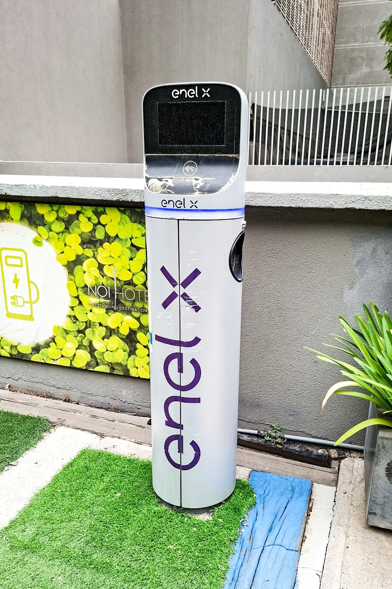

Brasil es, de lejos, el país con más electrolineras de Latinoamérica: **25.429 estaciones de carga públicas** a mitad de 2026, según la Organización Latinoamericana y Caribeña de Energía (Olade). Le siguen México y Chile. Colombia, el tercer mercado de carros eléctricos de la región por ventas, tiene una red mucho más pequeña: unas **229 estaciones públicas con cerca de 520 puntos de carga**, según el Ministerio de Minas y Energía.

## Estaciones públicas por país

| País | Estaciones de carga públicas | Fuente y fecha |
|---|---|---|
| Brasil | 25.429 | Olade, mitad de 2026 |
| México | 3.212 | Olade, 2025 |
| Chile | 1.133 | Olade, 2025 |
| Colombia | 229 estaciones, con cerca de 520 puntos | Ministerio de Minas, 2026 |
| Uruguay | 202 | Olade, 2025 |

Las cifras no son del todo comparables. Una **estación** es un lugar, y un **punto de carga** es cada conector que puede atender un carro al mismo tiempo. Una estación de Tesla con ocho conectores cuenta como una estación y ocho puntos. Algunos países reportan una cosa y otros la otra, y las fechas de corte tampoco coinciden.

## El problema no es el número, es la proporción

Lo que importa es cuántos carros comparten cada estación. Con las ventas de carros electrificados de 2025, que incluyen eléctricos e híbridos enchufables, la diferencia entre países es grande:

| País | Electrificados vendidos en 2025 | Estaciones públicas | Vendidos por estación |
|---|---|---|---|
| Brasil | 278.462 | 14.827 (2025) | Unos 19 |
| México | 147.110 | 3.212 | Unos 46 |
| Chile | 37.544 | 1.133 | Unos 33 |
| Colombia | 87.677 | 300 (2025) | Unos 292 |
| Uruguay | 20.585 | 202 | Unos 102 |

Cálculo propio con las ventas que publicó Bloomberg Línea y las estaciones de Olade para 2025. Es una aproximación: compara ventas de un año con la red disponible. Para Colombia, Olade contó 300 estaciones y el Ministerio de Minas 229; la diferencia viene de cómo se define y se cuenta una estación.

Colombia vende muchos más carros electrificados por cada estación que cualquier otro país de la tabla, y la brecha se abrió porque las ventas crecieron más rápido que la red: en 2025 subieron un 69 %. Las consecuencias se ven en las filas de algunas electrolineras de Bogotá, como contamos en [el déficit de puntos de carga en Colombia](/es/notas/electrolineras-colombia-deficit-puntos-de-carga-2026/).

*Chile tenía 1.133 estaciones de carga públicas en 2025, según Olade. Foto: Carlos Figueroa Rojas, CC BY-SA 4.0, vía Wikimedia Commons.*

## México, el que más rápido creció

Según Olade, México pasó de **2.046 a 4.802 puntos de carga** en un solo trimestre de 2026. La Electro Movilidad Asociación, que reúne a varias marcas, contaba en junio de 2026 **60.934 posiciones de carga** entre públicas y privadas, un 55 % más que un año antes, pero **56.279 de ellas eran privadas**, en casas y empresas. La red pública mexicana crece, pero la mayor parte de la carga sigue pasando en el garaje.

## Brasil: más estaciones porque hay más carros

Brasil concentra más de la mitad de los carros eléctricos de la región: más de 580.000 a mitad de 2026, según Olade. Un parque así de grande le da a cada estación pública una base amplia de clientes potenciales, algo que en los mercados pequeños todavía no existe. En la región en total ya circulan más de un millón de carros eléctricos e híbridos enchufables.

> Para quien compra un eléctrico en un país con poca red pública, la pregunta clave es si puede cargar en casa o en el trabajo. Si no puede, la red cercana decide si la compra tiene sentido.

## Preguntas frecuentes

### ¿Cuántas electrolineras hay en Colombia?

Unas 229 estaciones de carga públicas con cerca de 520 puntos, según el Ministerio de Minas y Energía. Cuatro de cada diez están en Bogotá.

### ¿Qué país de Latinoamérica tiene más electrolineras?

Brasil, con 25.429 estaciones públicas a mitad de 2026.

### ¿Cuántos carros eléctricos hay en Latinoamérica?

Más de un millón de carros eléctricos e híbridos enchufables a junio de 2026, según Olade.

---

**Fuentes:** [Forbes Perú: Latinoamérica supera el millón de eléctricos, datos de Olade](https://forbes.pe/negocios/2026-09-22/latinoamerica-supera-el-millon-de-vehiculos-electricos-con-mas-de-la-mitad-en-brasil/) · [Bloomberg Línea: ventas y estaciones de carga por país](https://www.bloomberglinea.com/2026/02/11/los-paises-lideres-en-ventas-de-autos-electricos-y-estaciones-de-carga-en-latinoamerica/) · [UnoTV: barómetro de electromovilidad de México](https://www.unotv.com/negocios/mexico-rompe-record-en-ventas-de-autos-electricos-en-el-primer-semestre-de-2026/) · [Minuto60: 520 puntos en 229 estaciones en Colombia](https://minuto60.com/vida-moderna/esta-preparada-colombia-boom-los-vehiculos-electricos/13487)
