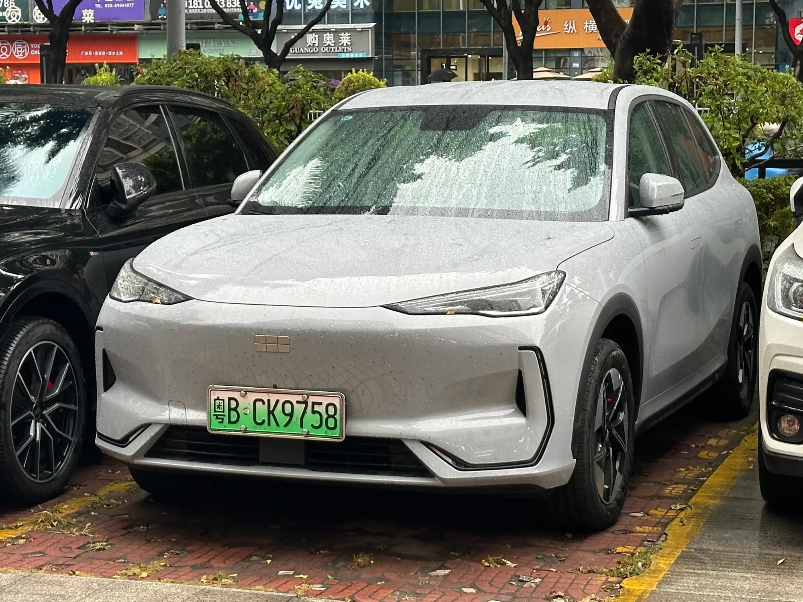

La **Geely EX5 Max** es la versión más equipada del SUV eléctrico de Geely, que en China se llama Galaxy E5. Comparte la mecánica con la versión Pro y agrega el paquete completo de asistencias y de comodidad. La gran diferencia frente a la **EX5 SE**, la más barata, está en la batería: 60,2 kWh contra 49,5 kWh, y 80 km más de autonomía WLTP.

## Ficha técnica de la EX5 Max

| Dato | EX5 Max |
|---|---|
| Motor | 215 hp (160 kW) y 320 Nm, tracción delantera |
| 0 a 100 km/h | 6,9 s según El Carro Colombiano; la ficha de Geely dice 6,1 s |
| Velocidad máxima | 175 km/h |
| Batería | 60,2 kWh, LFP |
| Autonomía | 425 km WLTP, 490 km NEDC |
| Carga rápida | Hasta 110 kW, del 30 % al 80 % en 20 minutos |
| Largo, ancho y alto | 4.615, 1.901 y 1.670 mm |
| Distancia entre ejes | 2.750 mm |
| Baúl | 461 L, hasta 1.877 L con la segunda fila abatida |
| Altura libre al piso | 173 mm sin carga |
| Airbags | 6 |

Datos de la ficha técnica de Geely Colombia y de El Carro Colombiano. La ficha publica cifras de autonomía y consumo con dos valores, probablemente por el tamaño de los rines, sin decir cuál corresponde a cada versión; aquí se usan las cifras más bajas.

## El equipo que suma la Max

Según la información publicada para Colombia, la Max trae **frenado autónomo de emergencia, crucero adaptativo, asistente de mantenimiento de carril, monitor de punto ciego y cámara de 360 grados**. En comodidad suma **techo panorámico, asientos delanteros ventilados, cargador inalámbrico de celular y V2L**, la función que permite usar el carro como fuente de energía para aparatos externos.

En Uruguay, donde se vende la misma versión, la prensa especializada detalla además un sistema de sonido Flyme de 16 parlantes con altavoces en los apoyacabezas, una pantalla proyectada en el parabrisas (head-up display) y una pantalla central de 15,4 pulgadas. Conviene confirmar en el concesionario si la versión colombiana trae exactamente lo mismo.

*La Max agrega a la SE crucero adaptativo, monitor de punto ciego, techo panorámico y V2L, entre otros. En la foto, la Galaxy E5 china. Foto: JustAnotherCarDesigner, CC0, vía Wikimedia Commons.*

## Max frente a SE

| Dato | EX5 SE | EX5 Max |
|---|---|---|
| Batería | 49,5 kWh | 60,2 kWh |
| Autonomía WLTP | 345 km | 425 km |
| Frenado autónomo y asistente de carril | Sí | Sí |
| Crucero adaptativo y punto ciego | Sin confirmar en las fuentes | Sí |
| Techo panorámico | Sí | Sí |
| Asientos ventilados | Sin dato en las fuentes | Sí |
| Precio de entrada | $92,9 millones, solo en línea | No publicado en las fuentes consultadas |

La SE ya trae lo esencial en seguridad: frenado autónomo, asistente de carril y cámara de 360 grados, el mismo tipo de equipo que puntuó en la prueba de Euro NCAP. Por eso la decisión entre las dos pasa más por la autonomía y la comodidad que por la seguridad básica.

## Para quién es la Max

Para quien viaja seguido por carretera, los 80 km adicionales de autonomía WLTP y la carga a 110 kW justifican la diferencia. El crucero adaptativo, además, reduce el cansancio en trayectos largos. Para quien maneja casi siempre en ciudad, la SE cubre lo necesario por menos dinero.

La EX5 tiene cinco estrellas en Euro NCAP, con una salvedad sobre soldaduras que se soltaron en la prueba frontal, como contamos en [su nota de seguridad](/es/notas/geely-ex5-euro-ncap-5-estrellas/). Y si está dudando entre la EX5 y el Kia EV3, la comparación está en [esta nota](/es/notas/geely-ex5-vs-kia-ev3-comparativa/).

## Preguntas frecuentes

### ¿Qué trae la Geely EX5 Max?

Batería de 60,2 kWh, 425 km WLTP, carga a 110 kW, frenado autónomo, crucero adaptativo, asistente de carril, punto ciego, cámara de 360 grados, techo panorámico, asientos ventilados, cargador inalámbrico y V2L.

### ¿Cuánta autonomía tiene la Geely EX5 Max?

425 km WLTP y 490 km NEDC, según la información publicada en Colombia.

### ¿La Geely EX5 Max tiene V2L?

Sí. Permite conectar aparatos externos a la batería del carro.

---

**Fuentes:** [Geely Colombia: ficha técnica de la EX5](https://geely.com.co/wp-content/uploads/2026/03/EX5_Bajav4.pdf) · [El Carro Colombiano: Geely EX5 en Colombia](https://www.elcarrocolombiano.com/lanzamientos/geely-ex5-colombia-precios-datos-suv-electrica-mas-completa-por-su-precio/) · [El Carro Colombiano: Geely EX5 SE](https://www.elcarrocolombiano.com/novedades/geely-ex5-se-suv-electrica-barata-precio-colombia/) · [Portafolio: Geely EX5 SE](https://www.portafolio.co/negocios/vehiculo/nueva-suv-electrica-llega-a-colombia-este-es-el-precio-de-lanzamiento-y-las-caracteristicas-de-la-geely-ex5-se-497330) · [Autoblog Uruguay: prueba de la EX5 Max](https://www.autoblog.com.uy/2025/07/prueba-geely-ex5-max-6022-kwh.html)
