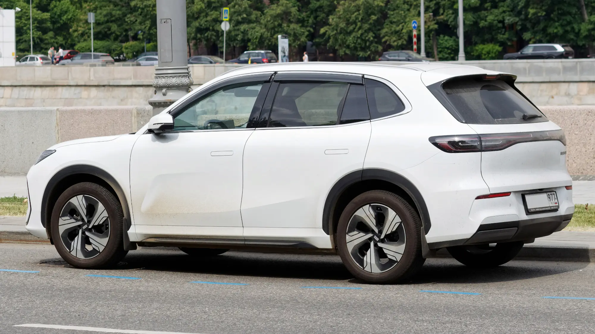

Geely lanzó en julio de 2026 en Colombia la **EX5 SE** (Special Edition), un SUV eléctrico mediano con un precio de **$92.990.000** para las **primeras 200 unidades**, vendidas exclusivamente en la página web de Geely Colombia. Es un SUV de tamaño familiar con potencia de sobra y una calificación de seguridad alta, en el rango de precio donde compiten la Chery E5, la MG S5 y el BYD Yuan Up.

## Lo esencial

- **Precio:** $92.990.000 para las primeras 200 unidades, solo en línea [VERIFICAR precio actual tras la preventa].
- **Batería:** 49,52 kWh.
- **Autonomía:** 345 km WLTP, 410 km NEDC.
- **Motor:** 215 hp (160 kW) y 320 Nm.
- **Seguridad:** cinco estrellas en Euro NCAP y ANCAP.

## Una venta distinta

Con la EX5 SE, Geely es una de las primeras marcas chinas en copiar la estrategia de Tesla: **venta directa por internet**, a precio fijo y con cupos limitados. La ventaja para el comprador es la transparencia del precio. La desventaja es que hay que confirmar con cuidado dónde se entrega el carro, dónde se hacen los mantenimientos y cómo funciona la garantía.

## Seguridad y tecnología

La EX5 trae un equipamiento completo para su precio:

- **Seis airbags**, control de estabilidad, ABS y EBD.
- **Frenado autónomo de emergencia**, asistente de mantenimiento de carril y **cámara 360°**.
- **Monitor de presión de llantas**.
- Pantalla táctil de **15,4 pulgadas** y panel digital de 10,2 pulgadas, con sistema Flyme Auto, **Apple CarPlay y Android Auto**.
- Cargador inalámbrico para el celular y **actualizaciones remotas** del software.

Las **cinco estrellas en Euro NCAP y ANCAP** son una de sus cartas fuertes, porque pocos eléctricos de su precio en Colombia tienen una calificación así.

*De lado se ven los 2.750 mm de distancia entre ejes, que explican el buen espacio trasero. Foto: Retired electrician, dominio público (CC0), vía Wikimedia Commons.*

## Ficha técnica

| Dato | Valor |
|---|---|
| Versión | EX5 SE (Special Edition) |
| Potencia | 215 hp (160 kW) |
| Torque | 320 Nm |
| Batería | 49,52 kWh |
| Autonomía | 345 km WLTP / 410 km NEDC |
| Distancia entre ejes | 2.750 mm |
| Baúl | 461 litros; 1.877 con los asientos abatidos |
| Pantalla central | 15,4 pulgadas |
| Panel de instrumentos | 10,2 pulgadas |
| Seguridad | Cinco estrellas Euro NCAP y ANCAP |

Geely no publicó en el lanzamiento la potencia de carga rápida, los tiempos de carga ni las condiciones de garantía. Son los primeros datos que conviene pedir antes de comprar.

## Cómo se compara

Frente a la **Chery E5**, la EX5 SE cuesta unos $13 millones más, tiene más potencia (215 hp frente a 208) y un baúl más grande (461 litros frente a 442), con una autonomía WLTP casi igual (345 km frente a 350). La diferencia está en la seguridad: la EX5 incluye asistencias avanzadas y cámara 360° desde esta versión.

> Antes de comprar en línea, confirme por escrito la red de talleres en su ciudad, el plazo de entrega y la garantía de la batería.

## Preguntas frecuentes

### ¿Cuánto cuesta la Geely EX5 en Colombia?

La EX5 SE se lanzó en $92.990.000 para las primeras 200 unidades vendidas en la página web de la marca.

### ¿Cuánta autonomía tiene?

345 km en ciclo WLTP y 410 km en ciclo NEDC.

### ¿Dónde se compra?

En la página web oficial de Geely Colombia, durante el lanzamiento.

Compárela con la Chery E5 en el [comparador de Garash](/es/comparador/).

---

**Fuentes:** [Portafolio: la Geely EX5 SE llega a Colombia](https://www.portafolio.co/negocios/vehiculo/nueva-suv-electrica-llega-a-colombia-este-es-el-precio-de-lanzamiento-y-las-caracteristicas-de-la-geely-ex5-se-497330) · [El Carro Colombiano: Chery E5](https://www.elcarrocolombiano.com/resenas/chery-e5-primer-contacto-suv-electrica-precio-colombia/)
