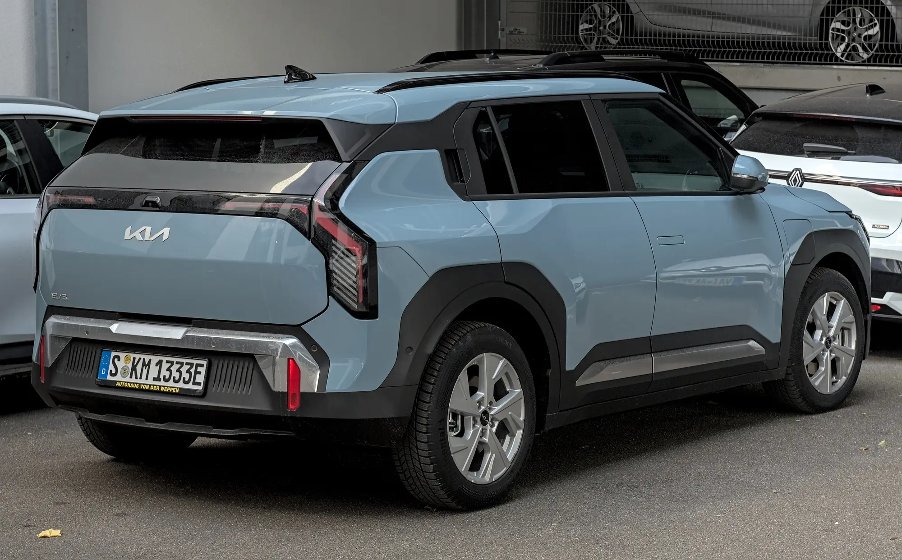

La **Geely EX5** y el **Kia EV3** son dos SUV eléctricos que se cruzan en las búsquedas, pero juegan en ligas de precio distintas en Colombia. La EX5 es más grande y más barata. El EV3 es más compacto, tiene la versión con más autonomía y la red de concesionarios de Kia, a cambio de un precio que arrancó en $164,99 millones. La comparación cifra por cifra muestra dónde está la diferencia.

## Frente a frente

| Dato | Geely EX5 | Kia EV3 |
|---|---|---|
| Versiones en Colombia | SE, Pro y Max | Light y Light+ |
| Precio de entrada | $92,9 millones (SE) | $164,99 millones (lanzamiento, abril de 2025) |
| Potencia y torque | 215 hp y 320 Nm | 201 hp y 283 Nm |
| 0 a 100 km/h | 6,9 s (Pro y Max) | 7,5 s |
| Batería | 49,5 kWh (SE) o 60,2 kWh (Pro y Max) | 58,3 kWh (Light) o 81,4 kWh (Light+) |
| Autonomía WLTP | 345 km (SE) y 425 km (Pro y Max) | Hasta 605 km (Light+) |
| Carga rápida | 110 kW, del 30 % al 80 % en 20 min (Pro y Max) | Del 10 % al 80 % en unos 31 min |
| Largo | 4.615 mm | 4.300 mm |
| Baúl | 461 L | 460 L |
| V2L | Sí en la Max; 3,3 kW en la versión neozelandesa | 3,6 kW en la versión neozelandesa |
| Euro NCAP | 5 estrellas, 86 % en adultos | 4 estrellas de serie, 5 con paquete; 83 % en adultos |

Datos de las marcas en Colombia, de las pruebas de El Carro Colombiano y Valora Analitik, y de Euro NCAP. El V2L sale de la base de datos EV Database de Nueva Zelanda y puede variar por versión.

*El Kia EV3 Light+ homologa 605 km WLTP, unos 180 km más que la EX5 Pro o Max. Foto: Alexander Migl, CC BY-SA 4.0, vía Wikimedia Commons.*

## Dónde gana cada uno

**Autonomía: Kia EV3.** El EV3 Light+, con 81,4 kWh, homologa 605 km WLTP, unos 180 km más que la EX5 Pro o Max. Es la diferencia más grande de la tabla y la razón principal para pagar más por el Kia, sobre todo para quien viaja seguido por carretera.

**Precio: Geely EX5.** Con la EX5 SE en $92,9 millones, la diferencia frente al precio de lanzamiento del EV3 supera los $70 millones. Incluso las versiones Pro y Max de la Geely quedan muy por debajo.

**Espacio: empate en el baúl, la EX5 en el resto.** Los dos tienen unos 460 litros de baúl, pero la EX5 es 31,5 cm más larga. Para saber cuánto de eso se traduce en espacio atrás, vale sentarse en la segunda fila de los dos en la prueba de manejo.

**Seguridad: la EX5 en estrellas, con una salvedad.** La EX5 tiene cinco estrellas en Euro NCAP, aunque la prueba registró soldaduras que se soltaron en el choque frontal, como explicamos en [su nota](/es/notas/geely-ex5-euro-ncap-5-estrellas/). El EV3 se queda en cuatro estrellas con el equipo de serie europeo y llega a cinco solo con el paquete de asistencias, según [su prueba](/es/notas/kia-ev3-euro-ncap-4-o-5-estrellas/). En los choques, el EV3 sacó 83 % en adultos y la EX5, 86 %.

**Carga rápida: depende del punto de partida.** La EX5 declara 20 minutos del 30 % al 80 % y el EV3 31 minutos del 10 % al 80 %. Como el punto de partida es distinto, las dos cifras no se pueden comparar directamente.

## Cuál elegir

La **Geely EX5** es la compra racional para una familia que maneja sobre todo en ciudad y quiere el máximo espacio por el menor precio. El **Kia EV3 Light+** se justifica para quien hace viajes largos con frecuencia y valora la red de concesionarios de Kia. Si el presupuesto está más cerca de la EX5, el rival natural del EV3 dentro de Kia es el [EV2](/es/notas/kia-ev2-colombia-precio-autonomia-ficha/).

> Antes de decidir, compárelos lado a lado en el [comparador](/es/comparador/), con cifras del mismo ciclo de autonomía.

## Preguntas frecuentes

### ¿Qué es mejor, la Geely EX5 o el Kia EV3?

Depende del uso. La EX5 gana en precio y tamaño; el EV3 Light+ gana en autonomía, con 605 km WLTP frente a 425 km.

### ¿Cuál es más seguro?

En Euro NCAP, la EX5 tiene cinco estrellas y el EV3 cuatro con su equipo de serie, o cinco con el paquete de asistencias.

### ¿Cuál tiene más baúl?

Casi igual: 461 litros la EX5 y 460 el EV3.

---

**Fuentes:** [Portafolio: Geely EX5 SE](https://www.portafolio.co/negocios/vehiculo/nueva-suv-electrica-llega-a-colombia-este-es-el-precio-de-lanzamiento-y-las-caracteristicas-de-la-geely-ex5-se-497330) · [Geely Colombia: ficha técnica de la EX5](https://geely.com.co/wp-content/uploads/2026/03/EX5_Bajav4.pdf) · [El Carro Colombiano: Geely EX5 en Colombia](https://www.elcarrocolombiano.com/lanzamientos/geely-ex5-colombia-precios-datos-suv-electrica-mas-completa-por-su-precio/) · [Valora Analitik: Kia EV3 en Colombia](https://www.valoraanalitik.com/kia-presento-en-colombia-el-electrico-ev3/) · [EV Database: Kia EV3 Long Range](https://ev-database.org/car/3638/Kia-EV3-Long-Range) · [EVDB Nueva Zelanda: potencias de V2L](https://evdb.nz/v2l) · [Euro NCAP: ficha de la prueba de la Geely EX5](https://cdn.euroncap.com/media/86298/euroncap-2025-geely-ex5-datasheet.pdf) · [Euro NCAP: Kia EV3](https://www.euroncap.com/en/results/kia/ev3/54845)
