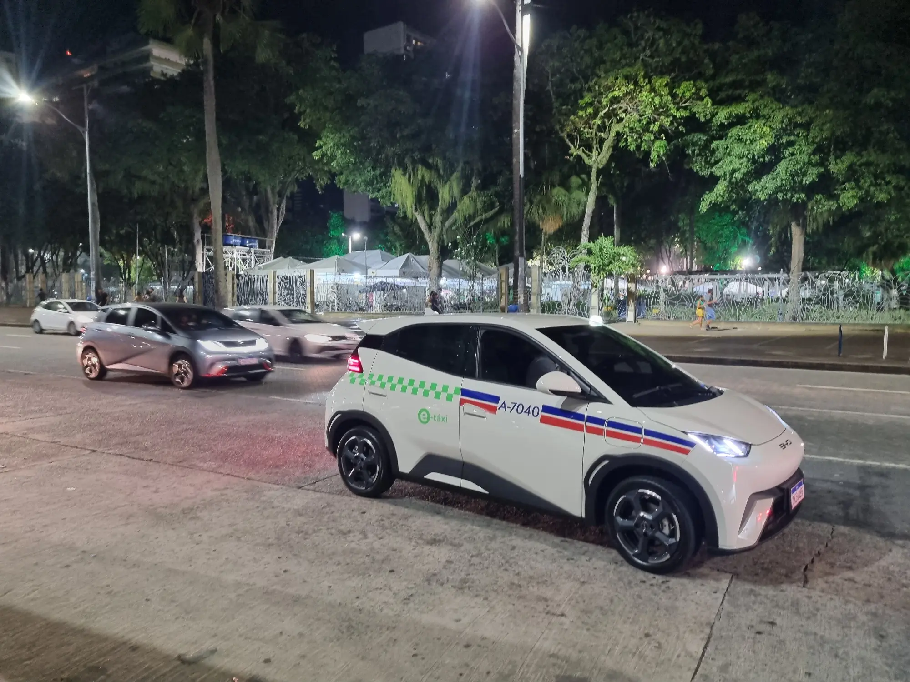

El hatchback es la puerta de entrada al carro eléctrico en Latinoamérica. Es el formato más barato, el más fácil de parquear y, con una batería pequeña, el que menos tarda en cargar en casa. En 2026 un modelo domina la categoría en casi toda la región: el **BYD Dolphin Mini**, que en Colombia se vende como **Seagull**.

## El Dolphin Mini, el carro que mueve el mercado

En **Brasil**, según Fenabrave, el Dolphin Mini fue el modelo más vendido del comercio minorista en junio de 2026, con **5.143 unidades**, por encima de cualquier carro de gasolina. Detrás quedaron otros dos eléctricos: el BYD Dolphin, con 4.827, y el Geely EX2, con 4.363.

En **Argentina** se lleva más de la mitad del mercado eléctrico: **495 de los eléctricos matriculados en septiembre de 2026**, el 57,2 % del total, con precios desde 23.990 dólares. En **México**, BYD vendió casi cuatro de cada diez híbridos y eléctricos del primer semestre de 2026, y el Dolphin Mini es su hatchback de entrada.

En Brasil, además, el Dolphin Mini se ensambla localmente desde 2025, en la planta de BYD en Camaçari. El carro número 100.000 que salió de esa fábrica, en julio de 2026, fue justamente un Dolphin Mini.

*Un BYD Dolphin usado como taxi en Salvador, Brasil. El Dolphin fue el segundo carro más vendido del comercio minorista brasileño en junio de 2026. Foto: BrasileiroMedio, dominio público (CC0), vía Wikimedia Commons.*

## Los hatchbacks eléctricos que se venden en Colombia

| Modelo y versión | Batería | Autonomía publicada | Baúl |
|---|---|---|---|
| BYD Seagull GL 300 | 30,1 kWh | 300 km NEDC | 230 L |
| BYD Seagull GS 400 | 38 kWh | 380 km NEDC | 230 L |
| Renault Kwid E-Tech Techno | 26,8 kWh | 298 km en ciclo urbano | 290 L |
| JMEV 3 | 30,2 kWh | 302 km NEDC | 250 L |
| JAC E10X | 31,4 kWh | Publicada sin ciclo | 140 L |

Cifras de las fichas oficiales de cada marca en Colombia. El nuevo BYD Dolphin, más grande y de $89,99 millones, tiene [nota propia](/es/notas/nuevo-byd-dolphin-colombia-precio-equipo/).

La tabla deja ver la gran debilidad del formato: **el baúl**. Con 140 a 290 litros, estos carros sirven para la ciudad y para un viaje con poco equipaje, no para una familia que viaja con bebé y maletas grandes. El Kwid es el más largo de baúl de los pequeños, y el E10X el más corto.

## Lo que cambia entre ellos

**La carga rápida.** El Kwid E-Tech carga en corriente continua hasta 30 kW, y los Seagull entre 30 y 40 kW. Son potencias bajas, aunque con baterías tan pequeñas el tiempo no se dispara: Renault declara 45 minutos del 20 % al 80 % para el Kwid.

**La seguridad.** La versión europea del Seagull, el Dolphin Surf, sacó cinco estrellas en Euro NCAP, pero la colombiana no trae el mismo equipo de asistencias. El caso del Kwid es el opuesto: su gemelo europeo, el Dacia Spring, sacó una estrella. Lo explicamos en las notas del [Seagull](/es/notas/byd-seagull-dolphin-surf-euro-ncap-5-estrellas/) y del [Kwid](/es/notas/renault-kwid-e-tech-dacia-spring-euro-ncap-1-estrella/).

**El conector.** El JAC E10X usa el conector chino GB/T, mientras que los demás usan CCS2, el más común en las electrolineras colombianas. Antes de comprar, vale revisar qué conector tienen los cargadores que usaría. Está explicado en [la guía de conectores](/es/notas/conectores-carga-electricos-colombia-tipo-1-tipo-2-ccs-gbt/).

## Preguntas frecuentes

### ¿Cuál es el hatchback eléctrico más vendido de Latinoamérica?

El BYD Dolphin Mini. Lidera en Brasil y Argentina, y en Colombia se vende con el nombre de Seagull.

### ¿El Seagull y el Dolphin Mini son el mismo carro?

Sí. BYD lo llama Seagull en China y Colombia, Dolphin Mini en México, Brasil, Chile y Argentina, y Dolphin Surf en Europa. Las baterías y el equipo cambian según el país.

### ¿Un hatchback eléctrico sirve para viajar por carretera?

Sirve para trayectos cortos entre ciudades. Con autonomías de 300 km o menos en ciclos optimistas, un viaje largo exige planear paradas de carga.

---

**Fuentes:** [Webmotors: los eléctricos más vendidos en Brasil en junio de 2026](https://www.webmotors.com.br/wm1/noticias/3-carros-eletricos-dominam-vendas-varejo) · [Autotest: el Dolphin Mini en Argentina, septiembre de 2026](https://autotest.com.ar/noticias/byd-dolphin-mini-cuanto-cuesta-y-que-ofrece-el-auto-electrico-mas-vendido-en-septiembre-2026/) · [El CEO: BYD vende 4 de cada 10 electrificados en México](https://elceo.com/negocios/byd-vende-4-de-cada-10-autos-hibridos-y-electricos-en-mexico/) · [InvestNews: 100.000 carros en Camaçari](https://investnews.com.br/negocios/byd-chega-a-100-mil-carros-em-camacari-mas-ainda-depende-de-kits-chineses-o-que-falta/) · [BYD Colombia: ficha del Seagull](https://bydauto.com.co/7ff4ca2d229ddd4fd33205ed1f468676.pdf) · [Renault Colombia: Kwid E-Tech](https://cdn-prensa.renault.com.co/wp-content/uploads/2025/10/17152750/EL-KWID-E-TECH-EVOLUCIONA-CON-DISENO-MODERNO-TECNOLOGIA-AVANZADA-Y-SEGURIDAD-SUPERIOR.pdf) · [JMEV Colombia: ficha del JMEV 3](https://jmev.com.co/wp-content/uploads/2026/02/Ficha_Tecnica_JMEV3_2_compressed.pdf) · [El Carro Colombiano: JAC E10X](https://www.elcarrocolombiano.com/lanzamientos/jac-e10x-carro-electrico-barato-para-colombia-precio-y-caracteristicas/)
