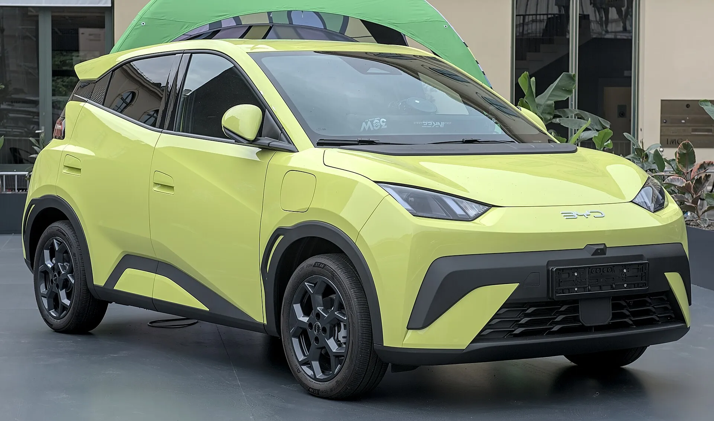

En varios de los mercados grandes de Latinoamérica, la mayoría de los compradores que dejan la gasolina elige un **híbrido**, no un eléctrico. En México, entre enero y septiembre de 2026 se vendieron 99.147 híbridos convencionales frente a 21.794 eléctricos puros. En Chile, en el primer semestre, 20.344 híbridos no enchufables frente a 9.978 enchufables. Colombia es la excepción: los eléctricos crecieron más de 220 % en 2026 y ya son uno de cada seis carros nuevos. La pregunta de cuál conviene depende de cómo se usa el carro y de dónde se vive.

## Los tipos de híbrido

**Híbrido convencional (HEV):** tiene motor de gasolina y uno eléctrico con una batería pequeña que se recarga sola, frenando y con el motor. No se enchufa. Gasta menos gasolina que un carro convencional, sobre todo en ciudad.

**Híbrido enchufable (PHEV):** tiene una batería más grande que se carga en un enchufe y le permite recorrer decenas de kilómetros solo con electricidad. Cuando se agota, funciona como un híbrido.

**Microhíbrido o mild hybrid:** tiene un sistema eléctrico pequeño que ayuda al motor, pero casi nunca mueve el carro solo con electricidad. Es el que menos ahorra.

Y el **rango extendido**, que siempre se mueve con el motor eléctrico, está explicado en [esta nota](/es/notas/que-es-un-carro-electrico-de-rango-extendido/).

## Frente a frente

| Aspecto | Híbrido convencional | Eléctrico |
|---|---|---|
| Necesita enchufe | No | Sí |
| Viajes largos | Sin planear paradas | Hay que planear la carga |
| Costo por kilómetro | Menor que gasolina, mayor que eléctrico | El más bajo, con carga en casa |
| Mantenimiento | Como un carro de gasolina, con aceite y filtros | Sin aceite de motor; más gasto en llantas |
| Precio de compra | Suele ser menor que el de un eléctrico equivalente | Mayor, aunque la diferencia se acortó en 2026 |

## Los beneficios en Colombia

| Beneficio | Eléctrico | Híbrido |
|---|---|---|
| Pico y placa en Bogotá | Exento por ley nacional | Exento hasta el 31 de diciembre de 2027, por decreto distrital |
| Descuento en el impuesto vehicular de Bogotá | 60 % durante cinco años | 40 % |
| Devolución del IVA y deducción en renta | Sí, con certificado de la UPME | Sí para HEV y PHEV con certificado de la UPME |
| IVA | 5 % | En discusión en las reformas tributarias recientes; confirme la tarifa vigente al comprar |

La diferencia que más pesa en Bogotá es el **pico y placa**. La exención de los eléctricos sale de una ley nacional y no depende de la ciudad. La de los híbridos es una decisión del Distrito con fecha de vencimiento, y en el Día sin carro de febrero de 2026 los híbridos no pudieron circular y los eléctricos sí. Lo explicamos en [esta nota](/es/notas/pico-y-placa-bogota-hibridos-electricos-2028/).

*En Bogotá, la exención de pico y placa de los eléctricos sale de una ley nacional; la de los híbridos depende del Distrito. Foto: Alexander Migl, CC BY-SA 4.0, vía Wikimedia Commons.*

## Cuándo conviene cada uno

**El eléctrico conviene** si tiene dónde cargar en casa o en el trabajo, maneja sobre todo en ciudad y quiere el menor costo por kilómetro. En Bogotá, con la tarifa de Enel de agosto de 2026, el kilómetro de un eléctrico que gasta 15 kWh cada 100 km cuesta unos $130. La comparación con gasolina está en [cuánto se ahorra](/es/notas/electrico-vs-gasolina-cuanto-se-ahorra-2026/).

**El híbrido conviene** si no tiene dónde cargar, viaja seguido por carretera a zonas sin electrolineras o vive en un país con poca red de carga pública. También para quien quiere bajar el consumo sin cambiar sus hábitos.

**El híbrido enchufable** queda en el medio: hace la ciudad en modo eléctrico si se carga a diario, y viaja sin depender de la red. Pero si no se enchufa, carga el peso de una batería grande sin aprovecharla.

> La pregunta que decide no es cuál tecnología es mejor, sino si tiene un enchufe donde parquea. Con enchufe, el eléctrico suele ganar. Sin enchufe, el híbrido es la opción más realista.

## Preguntas frecuentes

### ¿Qué es mejor, un híbrido o un eléctrico?

Depende de si puede cargar en casa. Con carga en casa, el eléctrico gasta menos por kilómetro y tiene beneficios más amplios en Colombia. Sin dónde cargar, el híbrido es más práctico.

### ¿Los híbridos tienen pico y placa en Bogotá?

Están exentos hasta el 31 de diciembre de 2027. Desde 2028, depende de lo que decida la Alcaldía.

### ¿Un híbrido convencional se enchufa?

No. Su batería se carga sola con el motor y el frenado. Solo los híbridos enchufables se conectan a la red.

---

**Fuentes:** [Líder Empresarial: electrificados en México a septiembre de 2026](https://www.liderempresarial.com/guanajuato-vehiculos-electrificados-ventas-tercer-trimestre-2026/) · [El Mostrador: ventas en Chile a junio de 2026](https://www.elmostrador.cl/agenda-pais/movilidad/2026/08/03/electromovilidad-acelera-en-chile-ventas-se-duplican-pero-desafio-para-cumplir-meta-2030-sigue/) · [Portafolio: exención de pico y placa hasta 2027](https://www.portafolio.co/economia/regiones/pico-y-placa-en-bogota-hibridos-y-electricos-tendran-exencion-hasta-503940) · [Valora Analitik: descuentos de impuesto vehicular en Bogotá](https://www.valoraanalitik.com/carros-electricos-en-bogota-tendran-hasta-70-de-descuento-en-impuesto-vehicular/) · [DIAN, Concepto 000673 de 2026](https://normograma.dian.gov.co/dian/compilacion/docs/oficio_dian_0673_2026.htm) · [Valora Analitik: el IVA de los híbridos en la reforma tributaria](https://www.valoraanalitik.com/gobierno-petro-redefine-iva-para-carros-hibridos-en-reforma-tributaria/) · [Enel Colombia: tarifas de agosto de 2026](https://www.enel.com.co/content/dam/enel-co/español/personas/1-17-1/2026/pliego%20tarifario%20digital%20_agosto_2026.pdf)
