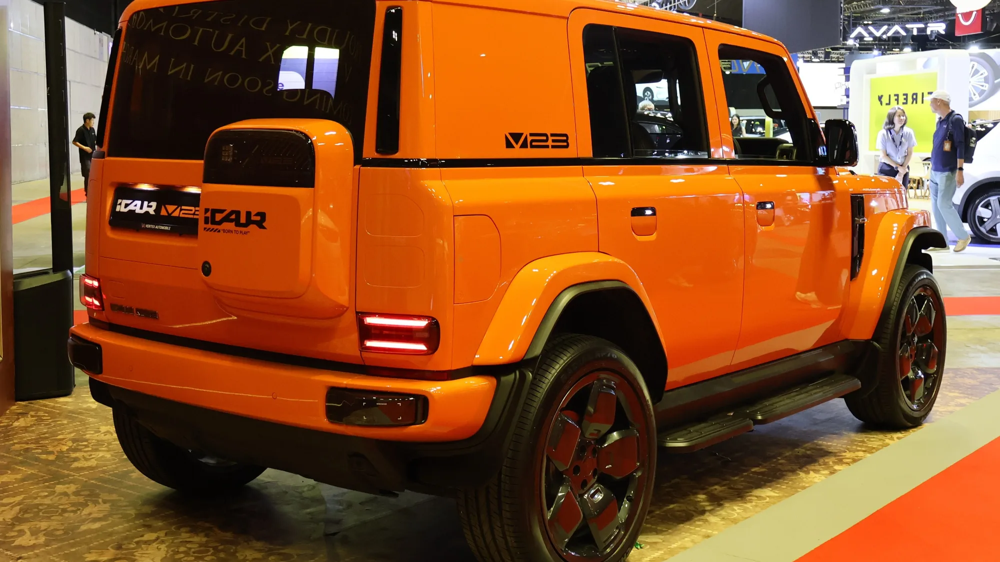

**iCAUR**, otra de las marcas nuevas del **Grupo Chery**, abrió reservas en Colombia en septiembre de 2026. Su primer modelo eléctrico es la **V23**, un campero de líneas cuadradas que recuerda a los todoterreno clásicos, con precio de entrada por debajo de los $100 millones. Colombia fue además el país elegido para el lanzamiento regional de la marca. La importa **Grupo Vardí**.

## Lo esencial

- **V23 4x2:** $94.990.000.
- **V23 4x4:** $110.990.000.
- **Batería:** CATL, de 59,93 kWh en la 4x2 y de 81,8 kWh en la 4x4.
- **Autonomía WLTP:** 295 km en la 4x2 y 355 km en la 4x4.
- **Airbags:** 4 en ambas versiones.
- **Garantía de batería y sistema eléctrico:** 8 años o 200.000 km.
- **Reserva:** $1.000.000 en línea; primeras entregas en noviembre de 2026.

## Las dos versiones

| | V23 4x2 | V23 4x4 |
|---|---|---|
| Precio | $94.990.000 | $110.990.000 |
| Tracción | Trasera | Integral, con un motor por eje |
| Potencia | 134 hp | 208 hp |
| Batería | 59,93 kWh, LFP | 81,8 kWh, NMC |
| Autonomía NEDC / WLTP | 350 / 295 km | 420 / 355 km |
| Carga rápida, 20 % a 80 % | 26 min, hasta 85 kW | 26 min, hasta 104 kW |
| Conector | Tipo 2 y CCS2 | Tipo 2 y CCS2 |

Las dos cifras de autonomía muestran bien la diferencia entre ciclos: la WLTP queda unos 55 a 65 km por debajo de la NEDC. Para un carro de forma cuadrada como este, con mucha resistencia al aire, la WLTP es la referencia a usar.

*De atrás también se nota la forma cuadrada, inspirada en los camperos tradicionales. Foto: S5A-0043, CC BY 4.0, recortada, vía Wikimedia Commons.*

## La V27, de rango extendido

iCAUR también lanzó la **V27**, de tamaño mayor, con precios de $133.990.000 (4x2) y $148.990.000 (4x4). No es un eléctrico puro: es de **rango extendido**, con un motor de gasolina que genera electricidad para la batería.

## El punto débil: la seguridad

Es donde la V23 queda por debajo de rivales de precio parecido:

- Solo **cuatro airbags** (dos frontales y dos laterales), sin airbags de cortina.
- **Ninguna versión trae frenado autónomo de emergencia, mantenimiento de carril ni crucero adaptativo.**
- La 4x4 agrega cámara 540°, alerta de colisión frontal, punto ciego y alerta de tráfico cruzado. Son alertas: avisan, pero no frenan ni corrigen.

Por un precio similar, el **Kia EV2** ($89,99 millones), el **nuevo BYD Dolphin** ($89,99 millones) o la **Arcfox T1** ($99,99 millones) traen frenado autónomo de serie.

La V23 se compra por estilo y por la tracción 4x4 de la versión tope, no por seguridad activa. Si va a usarla sobre todo en ciudad, compare primero el equipo de asistencias.

## Preguntas frecuentes

### ¿Cuánto cuesta la iCAUR V23 en Colombia?

$94.990.000 la 4x2 y $110.990.000 la 4x4, según los precios de lanzamiento. Algunos medios publicaron $95.990.000 para la 4x2 antes del evento oficial, así que confirme el precio vigente en la página de la marca.

### ¿Tiene frenado autónomo?

No. Ninguna de las dos versiones lo trae.

### ¿Qué autonomía tiene?

295 km WLTP la 4x2 y 355 km WLTP la 4x4.

### ¿Quién importa iCAUR?

Grupo Vardí.

Compare la V23 con otros SUV eléctricos en el [comparador de Mejor Eléctrico](/es/comparador/?a=chery-icar-03-allroad-iwd-2025-co&b=kia-ev2-air-2026-co).

---

**Fuentes:** [El Carro Colombiano: iCAUR V23 en Colombia](https://www.elcarrocolombiano.com/lanzamientos/icaur-v23-colombia-precio-versiones-datos-campero-electrico/) · [Revista Autosmás: lanzamiento regional en Colombia](https://revistaautosmas.com/2026/09/18/colombiaescenario-del-lanzamiento-regional-de-icaur-con-los-v23-y-v27/) · [Enter.co: precios y reservas](https://www.enter.co/chips-bits/gadgets/icaur-llega-a-colombia-con-suv-electricos-desde-94-990-000-precios-y-como-reservar/)
