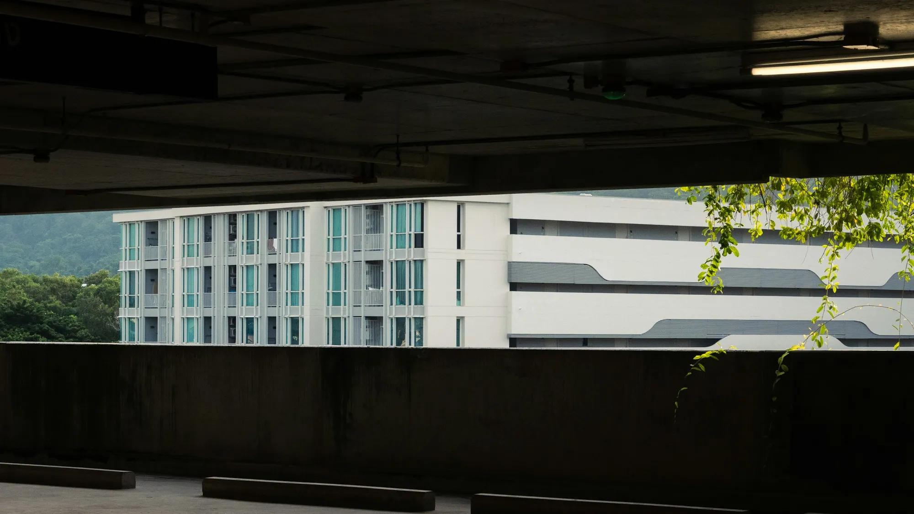

Es el problema número uno de quien vive en apartamento y quiere un eléctrico: el carro ya está pagado, pero la administración dice que no se puede instalar el cargador. En los grupos de dueños de eléctricos se repiten las mismas historias de asambleas que niegan la solicitud. La ley no da una respuesta de sí o no: da un procedimiento.

## Primero: ¿de quién es su parqueadero?

Todo depende de cómo figure en la escritura y en el reglamento de propiedad horizontal:

| Tipo de parqueadero | Quién decide | Qué puede hacer el conjunto |
|---|---|---|
| **Bien privado** (tiene matrícula inmobiliaria propia) | El propietario, cumpliendo el reglamento | Regular la instalación, pero no prohibirla |
| **Bien común de uso exclusivo** | La asamblea, si la obra modifica zonas comunes | Aprobar o negar según las mayorías del reglamento |

Abogados consultados por la prensa económica coinciden en que un conjunto **no puede prohibir** un cargador en un parqueadero privado, aunque sí puede exigir condiciones de seguridad, diseño eléctrico y pólizas.

## Cuando hay que pasar por la asamblea

El Ministerio de Vivienda explicó en un concepto jurídico que cualquier reforma en zonas comunes, como canalizaciones o cableado que atraviese el conjunto, se rige por la **Ley 675 de 2001**. Para esas obras se necesita la aprobación de la asamblea con **al menos el 70 % de los coeficientes de propiedad**.

Si la asamblea decide en su contra y usted considera que la decisión viola la ley o el reglamento, el artículo 49 de esa misma ley permite **impugnarla ante un juez** dentro de los dos meses siguientes.

*Muchos edificios construidos antes de 2019 no tienen acometida para cargadores, y la obra cruza zonas comunes. Foto: set.sj en Unsplash.*

## Edificios nuevos: la Ley 1964 sí obliga

El artículo 10 de la **Ley 1964 de 2019** exige que los edificios residenciales y comerciales cuya licencia de construcción se haya radicado después de que entró en vigencia la ley tengan una **acometida eléctrica para la carga** de vehículos. El constructor debe dejar la infraestructura lista.

Para edificios más antiguos no hay esa obligación, y la ley tampoco obliga al conjunto a pagar los cargadores. El costo de la obra y de la energía lo asume quien instala.

## Cómo presentar la solicitud

1. **Revise el reglamento** y la escritura para saber si el parqueadero es privado o común.
2. **Pida un diseño eléctrico** firmado por un electricista con matrícula profesional. Debe decir de dónde sale la energía, por dónde va el cable y cuál es la carga máxima.
3. **Proponga un medidor independiente** o un sistema que cobre el consumo a su cuenta. La Ley 1964 pide que el acceso a la carga permita que sea el propietario quien asuma el costo.
4. **Radique la solicitud por escrito** ante la administración, con el diseño, la ficha técnica del cargador y la póliza si el reglamento la exige.
5. **Si toca zonas comunes**, pida que el tema entre al orden del día de la próxima asamblea.

> Un punto a favor en la asamblea: proponga que la canalización quede preparada para que otros vecinos se conecten después. Convierte su solicitud en una mejora para el edificio.

## Preguntas frecuentes

### ¿Puedo conectar el carro a la toma del parqueadero?

Solo si esa toma está conectada a su propio contador. Usar una toma de zona común sin autorización es cargarle su consumo a la copropiedad.

### ¿Cuánto cuesta la instalación en un conjunto?

Enel calculaba alrededor de $3 millones para un cargador doméstico, pero en edificios el valor sube si hay que llevar cableado desde lejos del contador [VERIFICAR con una cotización].

### ¿Necesito licencia de construcción?

Depende de la obra. El Ministerio de Vivienda señala que una reparación menor no la requiere, pero una modificación significativa del edificio puede necesitar licencia de modificación.

Revise cuánto tarda en cargar cada modelo en el [comparador de Garash](/es/comparador/).

*Esta nota es informativa y no reemplaza la asesoría de un abogado.*

---

**Fuentes:** [Ministerio de Vivienda: instalación de cargadores en propiedad horizontal](https://www.minvivienda.gov.co/sites/default/files/conceptos_juridicos/instalacion-cargador-vehiculos-electricos-en-ph.pdf) · [Asuntos Legales: ABC para instalar un cargador en el conjunto](https://www.asuntoslegales.com.co/consumidor/abc-para-instalar-cargador-vehicular-en-su-conjunto-4380717) · [RCN Radio: qué dice la ley de propiedad horizontal](https://newsroom.rcnradio.com/colombia/como-pedir-la-instalacion-de-un-cargador-para-carro-electrico-en-un-conjunto-residencial-en-colombia-esto-dice-la-ley) · [Vivienda.com.co: mayoría del 70 %](https://vivienda.com.co/cargadores-electricos-en-propiedad-horizontal/) · [Ley 1964 de 2019](https://www.alcaldiabogota.gov.co/sisjur/normas/Norma1.jsp?i=85510)
