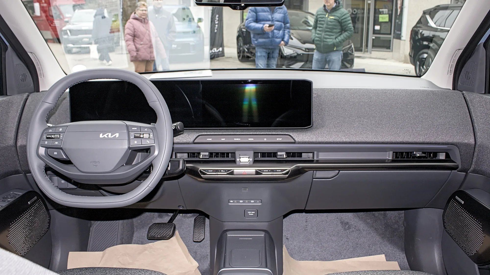

Kia puso a la venta en Colombia, en junio de 2026, el **EV2**, su SUV eléctrico más pequeño y, por ahora, el más barato de la marca en el país. Llega en una sola versión, **Air**, por **$89.990.000** [VERIFICAR precio vigente], para competir en el segmento donde están la Chery E5, el BYD Yuan Up y varios SUV urbanos chinos.

## Lo esencial

- **Precio:** $89.990.000, versión Air.
- **Batería:** LFP de 42,2 kWh.
- **Autonomía:** 312 km en ciclo WLTP.
- **Motor:** 145 hp y 250 Nm, tracción delantera.
- **Carga rápida:** del 10 % al 80 % en 29 minutos.
- **Garantía:** 8 años o 160.000 km.

## Autonomía y carga

Los 312 km del EV2 están medidos en **WLTP**, el ciclo más realista de los que publican las marcas. Eso importa al compararlo: un rival que anuncie 400 km en ciclo NEDC o CLTC puede rendir lo mismo o menos en la vida real. Lo explicamos en nuestra [nota sobre ciclos de autonomía](/es/notas/autonomia-electricos-cltc-nedc-wltp-como-leerla/).

En carga, el EV2 acepta hasta **11 kW en corriente alterna**, con lo que se carga completo en unas **4,1 horas** en un cargador de pared adecuado. En carga rápida se anuncia hasta 350 kW de compatibilidad y **29 minutos del 10 % al 80 %**.

Un detalle clave para Colombia: la versión local usa **conector Tipo 1 y CCS1**, el estándar estadounidense, no el Tipo 2 y CCS2 que la norma de interoperabilidad propone como mínimo en electrolineras. Conviene revisar qué estaciones tiene cerca.

*El tablero del EV2 une el panel de instrumentos y la pantalla central de 12,3 pulgadas. Foto: Alexander Migl, CC BY-SA 4.0, recortada, vía Wikimedia Commons.*

## Equipamiento y seguridad

Para su precio, el EV2 viene bien dotado en asistencias a la conducción:

- **Siete airbags**, control de estabilidad y de tracción, Isofix.
- **Frenado autónomo de emergencia**, alerta de colisión frontal, mantenimiento y seguimiento de carril y control crucero adaptativo.
- Pantalla de 12,3 pulgadas con **Android Auto y Apple CarPlay inalámbricos**, cargador inalámbrico, climatizador bizona y acceso sin llave.

Lo que no trae: **sensor de punto ciego ni cámara 360°**.

## Ficha técnica

| Dato | Valor |
|---|---|
| Largo | 4,06 m |
| Ancho | 1,80 m |
| Alto | 1,57 m |
| Distancia entre ejes | 2,56 m |
| Altura libre al piso | 14,6 cm |
| Peso | 1.625 kg |
| Potencia | 145 hp |
| Torque | 250 Nm |
| 0 a 100 km/h | 8,7 segundos |
| Velocidad máxima | 161 km/h |
| Batería | 42,2 kWh, LFP |
| Autonomía WLTP | 312 km |
| Carga AC | Hasta 11 kW, 4,1 horas |
| Carga DC | 10 % a 80 % en 29 minutos |
| Conector | Tipo 1 y CCS1 |
| Baúl | 362 litros; 1.201 con los asientos abatidos; 15 litros adelante |
| Garantía | 8 años o 160.000 km |

## Frente a sus rivales

Frente a la **Chery E5**, que arranca en $79,9 millones, el EV2 es más pequeño, más caro y tiene menos autonomía, pero ofrece asistencias a la conducción desde la versión única y el respaldo de una red de concesionarios amplia. La E5 de entrada no trae asistencias avanzadas.

> Para quién tiene sentido: un comprador urbano que valora la marca, la red de servicio y la seguridad activa más que el tamaño o la autonomía.

## Preguntas frecuentes

### ¿Cuánto cuesta el Kia EV2 en Colombia?

$89.990.000 en su versión Air, la única disponible al lanzamiento.

### ¿Cuánta autonomía tiene?

312 km según el ciclo WLTP.

### ¿Cuánto tarda en cargar?

Unas 4,1 horas en un cargador de 11 kW, y 29 minutos del 10 % al 80 % en carga rápida.

### ¿Tiene beneficios tributarios?

Como eléctrico, paga IVA del 5 % y puede acceder a la devolución del IVA y a la deducción en renta con el certificado de la UPME.

Compárelo con la Chery E5 o el BYD Yuan Up en el [comparador de Garash](/es/comparador/).

---

**Fuentes:** [El Carro Colombiano: Kia EV2 en Colombia](https://www.elcarrocolombiano.com/lanzamientos/kia-ev2-colombia-precio-caracteristicas-suv-electrico/) · [El Carro Colombiano: Chery E5](https://www.elcarrocolombiano.com/resenas/chery-e5-primer-contacto-suv-electrica-precio-colombia/)
