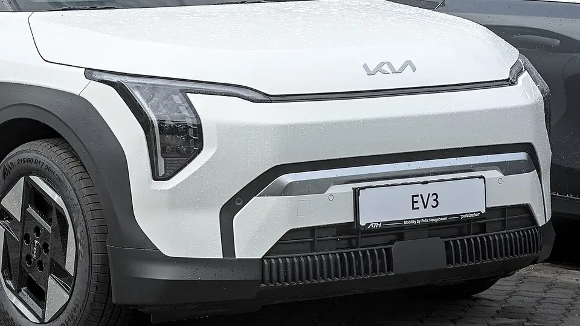

Muchas notas dicen que el **Kia EV3** tiene cinco estrellas de **Euro NCAP**. Es cierto solo a medias. La calificación publicada el 21 de mayo de 2025 tiene dos resultados: **cuatro estrellas con el equipo de serie** y **cinco estrellas con el paquete opcional de asistencias**, que Kia llama DriveWise. La diferencia está en un solo puntaje.

## Lo esencial

- **Calificación:** 4 estrellas de serie, 5 con el paquete de asistencias.
- **Versión evaluada:** 150 kW, batería de 58,3 kWh, tracción delantera, 1.790 kg. La calificación cubre también la batería de 81,4 kWh.
- **Protección de adultos:** 83 %.
- **Protección de niños:** 84 %.
- **Usuarios vulnerables:** 77 %.
- **Asistencias, con equipo de serie:** 67 %.

## Por qué se quedó en cuatro estrellas

Euro NCAP exige un mínimo en cada una de sus cuatro áreas para dar cinco estrellas. En asistencias a la conducción, el piso es **70 %**. El EV3 con equipo de serie sacó **67 %**, así que perdió la quinta estrella aunque le fue bien en los choques.

El punto más flojo fue el **frenado autónomo frente a otros carros**: 5,3 de 9, calificado como adecuado. Con el paquete opcional, Euro NCAP registró mejor respuesta en cruces y frente a ciclistas que vienen por detrás, y eso le alcanzó para la quinta estrella.

*El EV3 se fabrica sobre una variante de la plataforma eléctrica de Kia y Hyundai. Foto: Alexander Migl, CC BY-SA 4.0, recortada, vía Wikimedia Commons.*

## Los choques

| Prueba | Resultado |
|---|---|
| Frontal contra barrera móvil | Habitáculo estable, pero las cargas en el fémur superaron el límite y la cabeza del conductor pudo tocar el timón |
| Frontal contra muro | Buena protección del conductor y del pasajero trasero |
| Lateral contra otro vehículo | Puntaje máximo |
| Lateral contra poste | Protección del pecho marginal |
| Latigazo cervical | Bueno adelante, marginal atrás |

El detalle del airbag es el que más llama la atención: Euro NCAP anotó que **el airbag del conductor no tuvo presión suficiente** y que la cabeza pudo hacer contacto con el timón, así que bajó esa calificación a adecuada.

## Niños y peatones

En los choques con maniquíes de niños sacó **23,6 de 24**, y todas las sillas probadas se instalaron bien. Lo que le resta puntos es que **no trae de serie el detector de niños olvidados** en la cabina.

Con los peatones, la protección de la cabeza fue entre adecuada y marginal en la mayor parte del capó, y mala en los parales del parabrisas. El frenado autónomo para peatones fue adecuado (5,4 de 9) y para ciclistas, bueno (7,5 de 8).

## Lo que hay que preguntar en Colombia

Kia vende el EV3 en Colombia en las versiones **Light**, con batería de 58,3 kWh, y **Light+**, con la de 81,4 kWh. Ambas traen seis airbags. En el lanzamiento, Kia mencionó alerta de colisión frontal, asistente de mantenimiento de carril, alerta de cambio de carril y alerta de fatiga, pero no detalló si incluye el mismo frenado autónomo del paquete europeo.

> Antes de comprar, pida en el concesionario la lista de asistencias de la versión y compárela con el paquete DriveWise europeo. De eso depende si su EV3 se parece más al de cuatro o al de cinco estrellas.

## Preguntas frecuentes

### ¿El Kia EV3 tiene cinco estrellas en Euro NCAP?

Solo con el paquete opcional de asistencias. Con equipo de serie tiene cuatro estrellas.

### ¿Por qué perdió la quinta estrella?

Porque sacó 67 % en asistencias a la conducción y el mínimo para cinco estrellas es 70 %.

### ¿Es inseguro en un choque?

No. En protección de adultos sacó 83 % y en niños 84 %, ambos por encima del mínimo para cinco estrellas. La diferencia está en los sistemas que ayudan a evitar el choque.

Compare el EV3 con otros SUV eléctricos en el [comparador de Mejor Eléctrico](/es/comparador/?a=kia-ev3-long-range-2026-eu&b=volvo-ex30-p5-2026-eu).

---

**Fuentes:** [Euro NCAP: Kia EV3, calificación de 2025](https://www.euroncap.com/en/results/kia/ev3/54845) · [Euro NCAP: ficha técnica de la prueba del EV3](https://cdn.euroncap.com/media/87655/euroncap-2025-kia-ev3-datasheet.pdf) · [Xataka Colombia: Kia EV3 en Colombia](https://www.xataka.com.co/vehiculos/esta-colombia-vehiculo-electrico-kia-ev3-suv-que-puede-llegar-605-km-autonomia-caracteristicas-precio)
