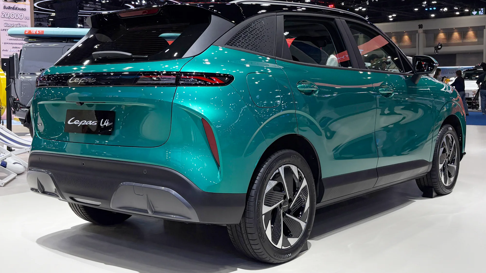

El **Grupo Chery**, que ya vende en Colombia la Chery E5, los iCar y la Tiggo, suma otra marca: **Lepas**. Según El Carro Colombiano, llegará en el **cuarto trimestre de 2026**, alrededor del Salón del Automóvil de Bogotá. El importador todavía no se ha anunciado.

## Lo esencial

- **Grupo:** Chery. Lepas se presentó en octubre de 2024 y salió a la venta en el mundo en abril de 2025.
- **Llegada a Colombia:** cuarto trimestre de 2026.
- **Importador:** por anunciar.
- **Modelos:** L4 (eléctrica), L6 (eléctrica o híbrida enchufable) y L8 (híbrida enchufable).
- **Precios:** no anunciados.

## Los modelos

| Modelo | Tipo | Potencia | Batería | Autonomía |
|---|---|---|---|---|
| L4 EV | SUV urbana eléctrica, 4,42 m | 215 hp | 67 kWh LFP | Hasta 450 km WLTP |
| L6 EV | SUV eléctrica | 242 hp | 67,1 kWh LFP | Hasta 450 km WLTP |
| L6 híbrida enchufable | SUV | 279 hp combinados | Sin dato | Unos 90 km eléctricos y más de 1.100 km en total |
| L8 | SUV híbrida enchufable, 4,69 m | 279 hp combinados | Sin dato | Más de 1.300 km en total |

Que la autonomía de las eléctricas esté en ciclo **WLTP** es un buen dato: es más realista que los ciclos NEDC o CLTC que publican muchas marcas chinas.

*La L4 se fabrica sobre la plataforma LEX del Grupo Chery. Foto: Andra Febrian, CC BY 4.0, recortada, vía Wikimedia Commons.*

## ¿Por qué tantas marcas de Chery?

Lepas no es la única. Alrededor del Salón también se esperan **iCAUR** (ya a la venta desde septiembre), **Jaecoo**, **Omoda** y **Soueast**, todas del Grupo Chery. Lepas se ubica en un escalón que el grupo llama semipremium, por encima de Chery, mientras iCAUR apunta a los camperos de estilo aventurero.

La estrategia le funciona a Chery en Colombia: entre enero y septiembre de 2026 vendió **2.518 eléctricos**, **527,9 % más** que un año antes, y es la tercera marca de eléctricos del país.

Para el comprador, la pregunta clave con estas submarcas es quién da el servicio. Si comparten talleres y repuestos con Chery, el riesgo es menor que con una marca totalmente independiente.

## Preguntas frecuentes

### ¿Qué es Lepas?

Una marca del Grupo Chery de SUV eléctricas e híbridas enchufables, lanzada en 2025.

### ¿Cuándo llega a Colombia?

En el cuarto trimestre de 2026, alrededor del Salón del Automóvil de Bogotá.

### ¿Cuánto costará?

Los precios para Colombia no se han anunciado.

Compare con las Chery que ya se venden en el país en el [comparador de Mejor Eléctrico](/es/comparador/?a=chery-e5-luxury-2026-co&b=chery-icar-03-allroad-iwd-2025-co).

---

**Fuentes:** [El Carro Colombiano: Lepas llega a Colombia](https://www.elcarrocolombiano.com/industria/lepas-nueva-marca-suv-electricos-hibridos-llegada-colombia/) · [El Carro Colombiano: marcas nuevas del Salón 2026](https://www.elcarrocolombiano.com/lanzamientos/carros-nuevas-marcas-vienen-colombia-salon-del-automovil-bogota-2026/) · [Infobae: eléctricos de enero a septiembre de 2026](https://www.infobae.com/colombia/2026/10/10/crece-la-venta-de-vehiculos-electricos-en-colombia-cerca-de-40000-automotores-en-lo-corrido-del-2026/)
