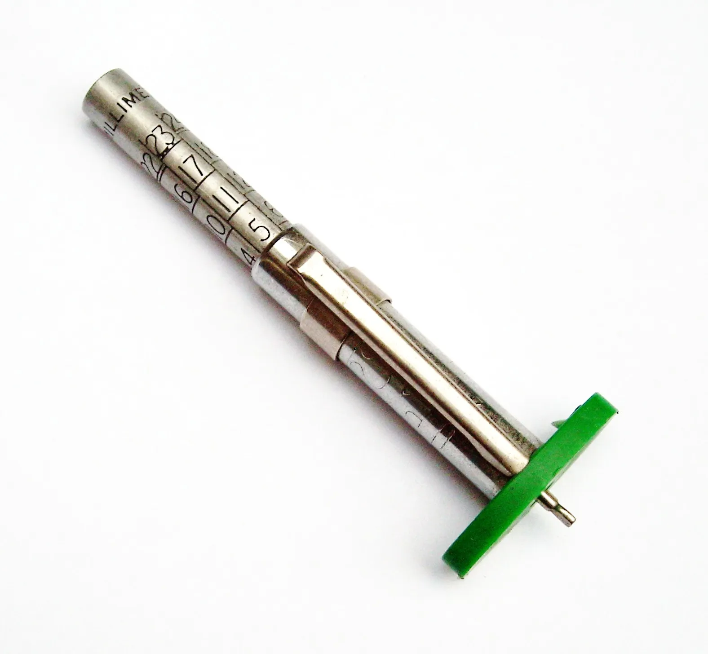

Un carro eléctrico se ahorra los cambios de aceite, pero no las llantas. Al contrario: según Michelin, citado por la revista británica Move Electric, un eléctrico puede gastar las llantas **hasta un 20 % más rápido** que uno de gasolina o diésel. En el presupuesto de mantenimiento, las llantas son uno de los pocos gastos que suben con un eléctrico.

## Por qué se gastan más

**El peso.** La batería hace que un eléctrico pese bastante más que un carro de combustión equivalente. Move Electric pone como referencia un familiar de gasolina de unos 1.400 kg frente a unos 2.000 kg de su equivalente eléctrico. Según la firma Emissions Analytics, el desgaste de las llantas sube alrededor de un **20 % por cada 450 kg** adicionales.

**El torque instantáneo.** Un motor eléctrico entrega toda su fuerza desde que se pisa el acelerador. Las llantas trabajan más para no patinar en cada arranque, sobre todo si el conductor acelera fuerte.

**Las curvas y el frenado.** Más masa significa más fuerza lateral en las curvas y más carga al frenar, aunque buena parte del frenado lo haga el motor con el [freno regenerativo](/es/notas/freno-regenerativo-como-funciona/).

*Un medidor de labrado permite revisar el desgaste en casa. Foto: Simon Speed, CC0, vía Wikimedia Commons.*

## Qué tienen de distinto las llantas para eléctricos

Casi todas las marcas grandes venden ya llantas específicas para eléctricos. Están pensadas con tres objetivos: menor resistencia a la rodadura, para gastar menos batería; flancos más fuertes, para soportar el peso; y menos ruido, porque en un carro sin motor de combustión el ruido de las llantas se oye más. Continental, Michelin y Pirelli aseguran que sus llantas para eléctricos prácticamente eliminan la diferencia de desgaste del 20 %, aunque esas comparaciones suelen hacerse contra llantas estándar y no contra las mejores del mercado.

Suelen costar más. Por eso, al cambiarlas, conviene comparar dos cosas: el precio de la llanta y lo que dura. Una llanta más barata que dura la mitad termina saliendo más cara, y una llanta de baja resistencia puede ahorrar algo de autonomía.

## Cómo hacerlas durar más

La mayor parte del desgaste extra depende del pie derecho y del mantenimiento:

1. **Acelere y frene con suavidad.** Los arranques fuertes, que en un eléctrico son muy tentadores, son los que más gastan.
2. **Use el modo Eco**, que suaviza la respuesta del acelerador.
3. **Anticipe las frenadas** y deje que la regeneración haga el trabajo.
4. **Revise la presión** cada mes, con la cifra que indica el fabricante para el peso del carro.
5. **Haga alineación y balanceo** con la frecuencia del manual, y rote las llantas si el fabricante lo recomienda.

> Al comprar un eléctrico usado, revise las llantas con cuidado. Un carro con pocos kilómetros y llantas muy gastadas cuenta cómo lo manejaba el dueño anterior.

## Preguntas frecuentes

### ¿Los carros eléctricos gastan más llantas?

Sí. Michelin reconoce que pueden gastarlas hasta un 20 % más rápido, por el peso y el torque instantáneo.

### ¿Hay que usar llantas especiales en un eléctrico?

No es obligatorio, pero las llantas para eléctricos están hechas para soportar más peso, rodar con menos resistencia y hacer menos ruido. Respete siempre la medida y el índice de carga que indica el fabricante.

### ¿Cuánto duran las llantas de un carro eléctrico?

Depende del carro, la llanta y la forma de manejar. Lo útil es comparar con el mismo tipo de llanta: en un eléctrico, espere algo menos de duración que en un carro de gasolina equivalente.

---

**Fuentes:** [Move Electric: ¿los eléctricos gastan más llantas?](https://www.moveelectric.com/e-cars/do-electric-cars-wear-out-tyres-faster)
