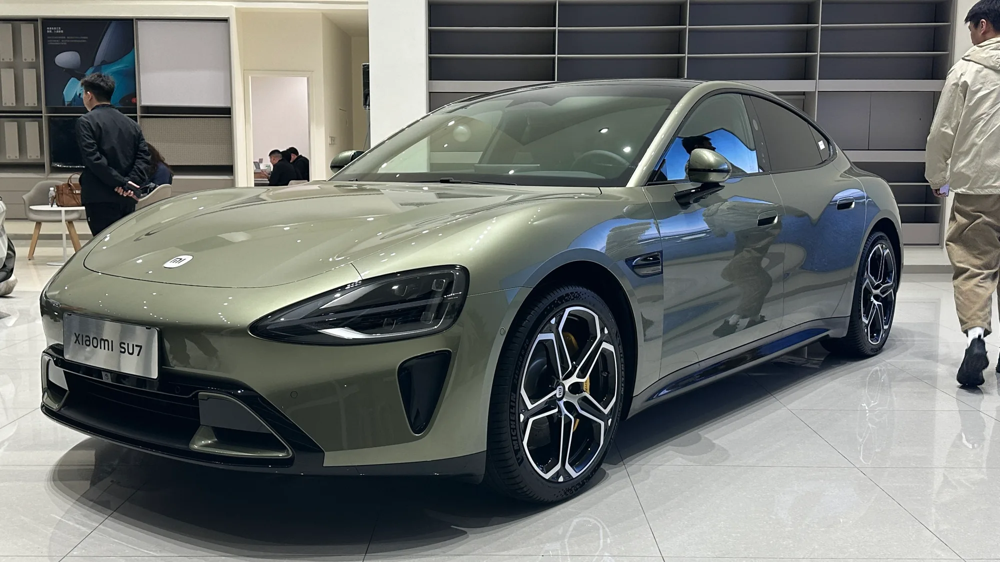

Las **manijas ocultas** o al ras de la carrocería se volvieron un sello de los carros eléctricos, desde Tesla hasta muchas marcas chinas. Se ven limpias y mejoran un poco la aerodinámica. El problema es lo que pasa cuando el carro se queda sin electricidad, por ejemplo después de un choque: hay casos de personas que no pudieron salir y de rescatistas que no pudieron abrir.

## Lo esencial

- **Desde el 1 de enero de 2027**, los carros que se vendan en China deberán tener apertura mecánica por dentro y por fuera.
- **Por fuera**, la manija debe dejar espacio para meter la mano y accionar la apertura desde cualquier ángulo.
- **Por dentro**, la apertura debe ser visible desde el puesto del ocupante.
- **En agosto de 2026**, China ordenó revisar más de **4 millones** de carros por este riesgo, entre ellos casi **3 millones de Tesla**.

## Por qué China tomó la decisión

El Ministerio de Industria y Tecnología de la Información de China citó dos problemas: la dificultad para usar algunas manijas exteriores y, sobre todo, la **imposibilidad de abrir las puertas después de un choque** cuando falla el sistema eléctrico.

El caso que más pesó fue un accidente en marzo de 2025 de un sedán Xiaomi en el que murieron tres personas y en el que, según reportes, los rescatistas tuvieron problemas para abrir las puertas. En Estados Unidos, la agencia de seguridad vial NHTSA investiga reportes de dueños de Tesla que tuvieron que romper vidrios para entrar a su carro, y una investigación de Bloomberg documentó 140 casos de personas atrapadas en vehículos de la marca.

*El Xiaomi SU7, uno de los modelos con manijas ocultas que entraron en el llamado a revisión de agosto. Foto: JustAnotherCarDesigner, dominio público (CC0), vía Wikimedia Commons.*

## El llamado a revisión de agosto

El 22 de agosto de 2026, la Administración Estatal de Regulación del Mercado de China anunció el llamado a revisión. Estas fueron las marcas con cifras:

| Marca | Carros afectados |
|---|---|
| Tesla (Model 3, Model Y, Model S y Model X) | Unos 2,98 millones |
| Xiaomi | Más de 390.000 |
| Leapmotor | Más de 370.000 |
| Geely y Xpeng | Algunos modelos, sin cifra publicada |

Tesla corregirá el riesgo con **actualizaciones de software**, según el aviso del regulador.

## ¿Y en Colombia?

Colombia no tiene una norma sobre manijas, y los carros vendidos aquí no entran en el llamado a revisión chino. Pero muchos de los eléctricos que se venden en el país vienen de China, incluidos los Tesla de la fábrica de Shanghái, así que el cambio de diseño que exige la norma china podría llegar también a los modelos que se importen desde 2027, si las marcas no fabrican versiones distintas para exportar.

> Si su carro tiene manijas eléctricas, busque en el manual dónde está la apertura mecánica de emergencia de cada puerta, incluidas las traseras, y enséñesela a quienes viajan con usted.

## Preguntas frecuentes

### ¿Por qué China prohíbe las manijas ocultas?

Porque pueden impedir abrir las puertas después de un choque si falla el sistema eléctrico.

### ¿Desde cuándo aplica?

Desde el 1 de enero de 2027, para los carros que se vendan en China.

### ¿Los Tesla de Colombia están en el llamado a revisión?

No. El llamado a revisión es para los carros vendidos en China.

### ¿Cómo abro un Tesla sin electricidad?

Las puertas delanteras tienen una palanca mecánica de emergencia. Consulte el manual de su modelo para ubicarla, porque en algunas puertas traseras está escondida.

Compare los eléctricos que se venden en Colombia en el [comparador de Mejor Eléctrico](/es/comparador/).

---

**Fuentes:** [El Carro Colombiano: China prohíbe las manijas ocultas desde 2027](https://www.elcarrocolombiano.com/industria/china-prohibe-manijas-ocultas-normativa-seguridad-2027/) · [Contexto Tucumán: llamado a revisión de agosto de 2026](https://www.contextotucuman.com/nota/410052/tesla-retira-casi-tres-millones-de-unidades-de-china-por-una-falla-que-genera-riesgos-de-seguridad.html) · [Motor1: la norma china](https://es.motor1.com/news/786251/china-prohibe-manetas-escondidas-carroceriia/)
