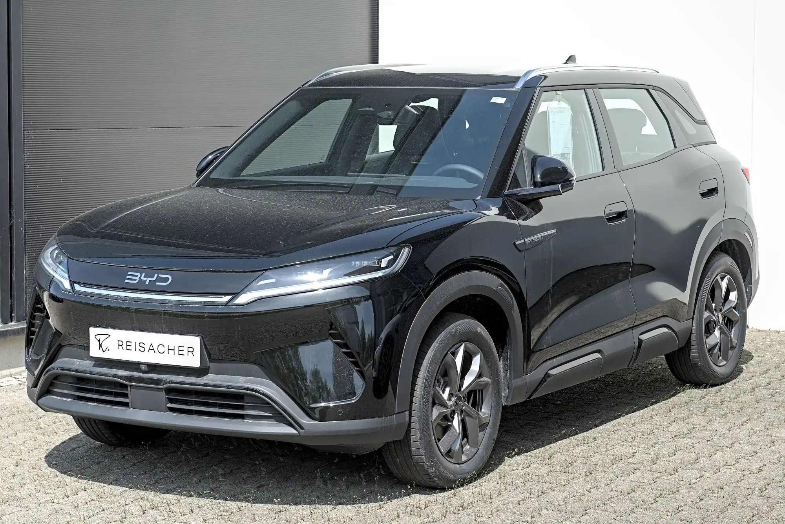

El carro eléctrico más vendido de Colombia en 2026 es el **Tesla Model Y**: en septiembre se llevó el 37,7 % de las matrículas de eléctricos y fue el carro más vendido del país entre todas las tecnologías. Eso lo convierte en la elección más popular, no necesariamente en la mejor para cada comprador. Un carro que se usa 30 km al día en Bogotá no necesita lo mismo que uno que viaja cada mes a la costa.

## Los más vendidos, como punto de partida

| Puesto en septiembre de 2026 | Modelo | Matrículas |
|---|---|---|
| 1 | Tesla Model Y | 2.220 |
| 2 | Chery E5 | 483 |
| 3 | BYD Yuan Up | 409 |
| 4 | MG S5 | 324 |
| 5 | Tesla Model 3 | 215 |

Según el boletín de Fenalco y la Andi con datos del RUNT, publicado por Portafolio. Cuatro de los cinco son SUV, el formato que prefiere hoy el comprador colombiano.

## Perfil 1: ciudad, poco presupuesto y carga en casa

Si el carro va a moverse dentro de la ciudad y se carga en el garaje, la autonomía deja de ser el problema. Lo que pesa es el precio, el tamaño y el costo del seguro. Aquí encajan los hatchbacks y SUV pequeños: el **BYD Seagull**, el **Renault Kwid E-Tech**, el **JMEV 3** o el **Kia EV2**, que cuesta $89,99 millones y trae frenado autónomo y asistente de carril de serie. Las diferencias entre ellos están en [nuestra guía de hatchbacks eléctricos](/es/notas/hatchback-electrico-latinoamerica-2026/).

El punto a revisar es la seguridad: varios de los más baratos llegan a Colombia con menos asistencias que sus versiones europeas.

*El BYD Atto 2 europeo es el Yuan Up que se vende en Colombia, tercer eléctrico más vendido del país en septiembre de 2026. Foto: Alexander Migl, CC BY-SA 4.0, vía Wikimedia Commons.*

## Perfil 2: familia, con presupuesto medio

Para cuatro o cinco personas con equipaje, el mercado colombiano se concentra en SUV compactos chinos de $80 a $100 millones. La **Chery E5** arranca en $79,99 millones, aunque su versión de entrada no trae asistencias. La **Geely EX5 SE**, de $92,9 millones, y la **MG S5 EV**, de $94,99 millones, tienen cinco estrellas en Euro NCAP. El nuevo **BYD Dolphin**, de $89,99 millones, es la alternativa para quien no necesita un SUV.

Aquí conviene comparar la versión exacta. Entre la versión de entrada y la tope de una misma SUV pueden cambiar las asistencias, el techo panorámico y hasta la batería.

## Perfil 3: carretera frecuente

Para quien viaja seguido entre ciudades, lo que más importa es la autonomía WLTP y la potencia de carga rápida, porque definen cuántas paradas hay que hacer y cuánto duran. En este perfil el **Tesla Model Y** y el **Model 3** tienen una ventaja que no aparece en la ficha: Tesla abrió sus propios supercargadores en Bogotá y Medellín. La **Chevrolet Equinox EV**, con 552 km WLTP publicados, es la de mayor autonomía entre las que tienen cifra WLTP en Colombia.

La geografía colombiana cambia la cuenta: una ruta con subidas largas, como Bogotá a Medellín, gasta más que la misma distancia en plano. Lo explicamos en [autonomía real en Colombia](/es/notas/autonomia-real-carro-electrico-colombia-montana-autopista/).

## Perfil 4: sin parqueadero propio

Si no puede cargar en casa ni en el trabajo, la pregunta no es qué carro comprar, sino dónde va a cargarlo. Colombia tenía cerca de 520 puntos de carga públicos para más de 77.000 eléctricos a mediados de 2026, y cuatro de cada diez electrolineras están en Bogotá. Antes de elegir modelo, mire qué electrolineras tiene cerca y en qué horarios se llenan. En este perfil, un híbrido enchufable o un [rango extendido](/es/notas/que-es-un-carro-electrico-de-rango-extendido/) puede ser una mejor decisión que un eléctrico puro.

> Las cuatro preguntas que deciden: cuántos kilómetros hace a la semana, dónde va a cargar, cuántas personas lleva y cuánto puede pagar de cuota. Con esas cuatro respuestas, la lista se reduce a dos o tres modelos.

## Preguntas frecuentes

### ¿Cuál es el carro eléctrico más vendido en Colombia?

El Tesla Model Y, con 2.220 matrículas en septiembre de 2026 y 14.381 entre enero y septiembre.

### ¿Cuál es el carro eléctrico más barato en Colombia?

Los más baratos son microcarros y hatchbacks pequeños. A finales de 2025, Portafolio ubicaba al Bestune Xiaoma entre los más económicos, en unos $47 millones. Los precios de esta franja cambian con frecuencia por las promociones, así que compare la cotización del día y la versión exacta.

### ¿Conviene esperar a que bajen los precios?

La guerra de precios de 2025 y 2026 bajó varios modelos, y no hay forma de saber si seguirán bajando. Lo analizamos en [el efecto Tesla](/es/notas/guerra-de-precios-carros-electricos-efecto-tesla/).

---

**Fuentes:** [Portafolio: eléctricos más vendidos en septiembre de 2026](https://www.portafolio.co/negocios/vehiculo/tesla-domina-los-electricos-mas-vendidos-en-colombia-concentro-41-3-de-las-matriculas-durante-septiembre-504120) · [Semana: supercargadores de Tesla en Colombia](https://www.semana.com/vehiculos/articulo/mapa-lista-de-ciudades-con-supercargadores-de-tesla-en-colombia-y-cuanto-cuesta-usarlos/202633/) · [El Carro Colombiano: Kia EV2 en Colombia](https://www.elcarrocolombiano.com/lanzamientos/kia-ev2-colombia-precio-caracteristicas-suv-electrico/) · [Portafolio: la MG S5 EV en Colombia](https://www.portafolio.co/negocios/vehiculo/la-s5-ev-de-la-marca-mg-entro-a-romper-precios-en-el-mercado-489053) · [Portafolio: Geely EX5 SE](https://www.portafolio.co/negocios/vehiculo/nueva-suv-electrica-llega-a-colombia-este-es-el-precio-de-lanzamiento-y-las-caracteristicas-de-la-geely-ex5-se-497330) · [El Carro Colombiano: Chevrolet Equinox EV](https://www.elcarrocolombiano.com/lanzamientos/chevrolet-equinox-ev-colombia-precio-datos-respuesta-americana-a-byd/) · [Portafolio: el Bestune Xiaoma, entre los más baratos](https://www.portafolio.co/negocios/vehiculo/el-carro-electrico-mas-barato-de-colombia-cuesta-apenas-45-millones-cual-es-483497) · [Minuto60: 520 puntos de carga en 229 estaciones](https://minuto60.com/vida-moderna/esta-preparada-colombia-boom-los-vehiculos-electricos/13487) · [La República: puntos de carga en Colombia](https://www.larepublica.co/economia/solo-hay-un-punto-de-carga-por-cada-337-carros-electricos-en-total-hay-229-electrolineras-4398785)
