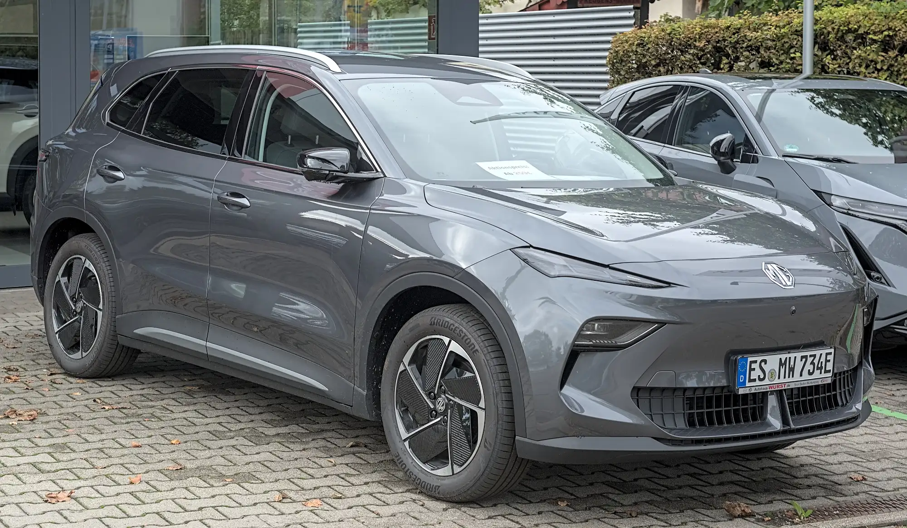

La pregunta "cuál es el mejor SUV eléctrico" tiene una respuesta distinta según qué se pese más. Si es la seguridad comprobada, el **Tesla Model Y** fue el SUV pequeño mejor calificado por Euro NCAP en 2025. Si es el precio, en Colombia hay SUV chinos con cinco estrellas europeas por menos de $95 millones. Y si es la autonomía, la diferencia entre modelos es más pequeña de lo que muestran las fichas, porque casi nunca se mide con el mismo ciclo.

## Los SUV eléctricos con mejores credenciales

| SUV | Euro NCAP | Adultos | Precio de entrada en Colombia |
|---|---|---|---|
| Tesla Model Y | 5 estrellas, mejor SUV pequeño de 2025 | 91 % | Desde $119,99 millones |
| MG S5 EV | 5 estrellas | 90 % | Desde $94,99 millones |
| Volvo EX30 | 5 estrellas | 88 % | Lanzado en 2024 desde $179,99 millones |
| Geely EX5 | 5 estrellas | 86 % | SE desde $92,9 millones |
| Kia EV3 | 4 estrellas de serie, 5 con el paquete de asistencias | 83 % | Versiones Light y Light+ |

Calificaciones de Euro NCAP; precios publicados en Colombia según la prensa especializada. Cada modelo tiene su nota con el detalle de la prueba.

El **smart #5** y el **Polestar 3** ganaron en 2025 las categorías de SUV grande y de ejecutivo en Euro NCAP. Sirven como referencia de lo mejor que se puede pedir en seguridad, pero antes de buscarlos conviene confirmar si la marca tiene importador oficial en su país.

*La MG S5 EV tiene cinco estrellas en Euro NCAP y se vende en Colombia desde $94,99 millones. Foto: Alexander Migl, CC BY-SA 4.0, vía Wikimedia Commons.*

## El mejor según el perfil

**Para quien prioriza la seguridad: Tesla Model Y.** Tiene el puntaje de asistencias más alto de su grupo en Euro NCAP, 92 %, y es el eléctrico más vendido de Colombia, lo que asegura repuestos y talleres. Su contra es el precio, que Tesla subió poco después del lanzamiento en Colombia.

**Para quien busca el mejor precio con cinco estrellas: MG S5 EV o Geely EX5.** Las dos tienen cinco estrellas en Euro NCAP y se venden por menos de $95 millones en sus versiones de entrada. Hay dos letras pequeñas. La EX5 tuvo soldaduras que se soltaron en el choque frontal de la prueba, como contamos en [su nota](/es/notas/geely-ex5-euro-ncap-5-estrellas/). Y la S5 EV tuvo en 2026 un llamado a revisión mundial por riesgo de incendio en el ventilador del radiador, explicado en [esta nota](/es/notas/mg-s5-ev-problemas-reportados/).

**Para la ciudad: Volvo EX30 o Kia EV3.** Son los más compactos de la lista y los más fáciles de parquear. El EX30 es el más caro por tamaño. El EV3 obliga a revisar si la versión que vende el concesionario trae el paquete de asistencias que le da la quinta estrella en Euro NCAP.

**Para viajar: la autonomía con el mismo ciclo.** Para comparar dos SUV en carretera, use solo cifras WLTP. La Geely EX5 Pro, por ejemplo, homologa 490 km NEDC y 425 km WLTP: es el mismo carro, medido con dos ciclos.

## Lo que la ficha no dice

Un SUV eléctrico pesa más que uno de gasolina de tamaño parecido, por la batería. En Colombia, la Chery E5 declara 1.735 kilos en vacío y la Chevrolet Equinox EV, 2.322. Ese peso se nota en el desgaste de las llantas y en la suspensión, así que vale preguntar el precio de un juego de llantas antes de comprar.

> El mejor SUV eléctrico es el que tiene autonomía WLTP suficiente para su recorrido semanal, una red de servicio cerca de su casa y cinco estrellas en la versión exacta que va a comprar.

## Preguntas frecuentes

### ¿Cuál es el SUV eléctrico más seguro?

Entre los SUV pequeños probados por Euro NCAP en 2025, el Tesla Model Y. Entre los grandes, el smart #5.

### ¿Cuál es el SUV eléctrico más barato con cinco estrellas en Colombia?

La Geely EX5 SE, desde $92,9 millones, seguida de la MG S5 EV, desde $94,99 millones. Las dos tienen cinco estrellas en Euro NCAP, con las salvedades de cada prueba.

### ¿Un SUV eléctrico gasta más energía que un hatchback?

Sí. Pesa más y tiene más área frontal, así que necesita más energía por kilómetro, sobre todo en carretera.

---

**Fuentes:** [Euro NCAP: ganadores Best in Class de 2025](https://www.euroncap.com/articles/euro-ncap-names-best-in-class-cars-tested-in-2025) · [Carwow: puntajes de los carros más seguros de 2025](https://www.carwow.co.uk/news/10124/euro-ncap-safest-cars-2025) · [Euro NCAP: ficha de la prueba de la MG S5 EV](https://cdn.euroncap.com/media/87623/euroncap-2025-mg-mgs5-ev-datasheet.pdf) · [Euro NCAP: ficha de la prueba del Volvo EX30](https://cdn.euroncap.com/media/85377/euroncap-2024-volvo-ex30-datasheet.pdf) · [Euro NCAP: ficha de la prueba de la Geely EX5](https://cdn.euroncap.com/media/86298/euroncap-2025-geely-ex5-datasheet.pdf) · [Euro NCAP: Kia EV3](https://www.euroncap.com/en/results/kia/ev3/54845) · [Portafolio: la MG S5 EV en Colombia](https://www.portafolio.co/negocios/vehiculo/la-s5-ev-de-la-marca-mg-entro-a-romper-precios-en-el-mercado-489053) · [Xataka Colombia: Kia EV3 en Colombia](https://www.xataka.com.co/vehiculos/esta-colombia-vehiculo-electrico-kia-ev3-suv-que-puede-llegar-605-km-autonomia-caracteristicas-precio) · [Valora Analitik: Volvo EX30 en Colombia](https://www.valoraanalitik.com/volvo-ex-30-precios-caracteristicas-colombia-cuanto-vale/) · [Electrive: llamado a revisión de la MG S5 EV](https://www.electrive.com/es/2026/07/20/mg-retira-del-mercado-el-s5-ev-debido-a-un-posible-riesgo-de-incendio/)
