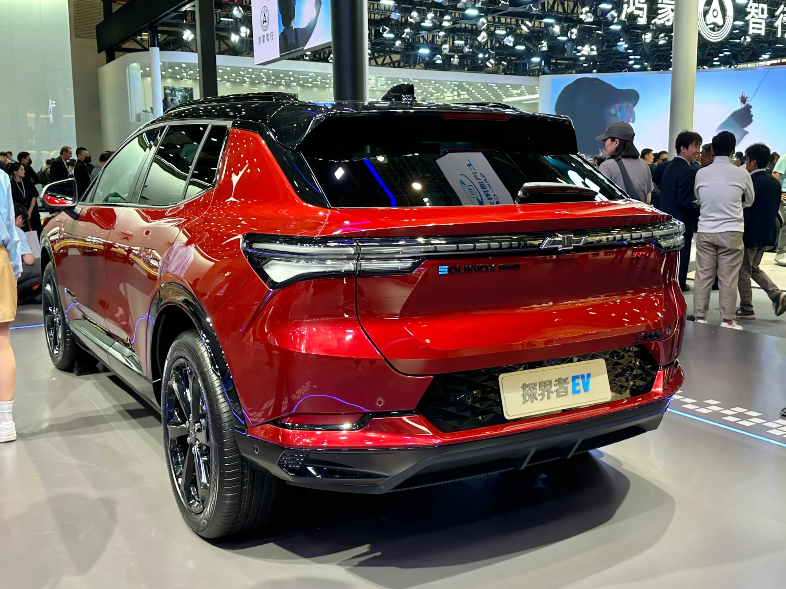

México vendió **146.183 carros electrificados** entre enero y septiembre de 2026, un 45,1 % más que en el mismo periodo de 2025, según la Asociación Mexicana de la Industria Automotriz (AMIA) con datos del INEGI. Dos de cada tres son híbridos convencionales, que no se enchufan. Los **eléctricos puros** fueron **21.794**, con un crecimiento del 41,8 %, y los **híbridos enchufables**, **25.242**, más del triple que un año antes.

## Las cifras por tecnología

| Tecnología | Enero a septiembre de 2026 | Crecimiento frente a 2025 |
|---|---|---|
| Híbridos convencionales | 99.147 | +27,8 % |
| Híbridos enchufables | 25.242 | +223,7 % |
| Eléctricos puros | 21.794 | +41,8 % |
| Total electrificados | 146.183 | +45,1 % |

AMIA con datos del INEGI.

La tabla muestra la gran diferencia con Colombia. En el mercado colombiano, los eléctricos puros crecieron 221,7 % entre enero y septiembre, empujados por Tesla y por beneficios como el IVA del 5 %. En México, el comprador que se pasa a un carro enchufable elige con más frecuencia un **híbrido enchufable**, que puede viajar sin depender de la red de carga.

## Por qué las cifras no siempre cuadran

Las estadísticas mexicanas de eléctricos dependen de quién reporta. La Electro Movilidad Asociación (EMA), que agrupa a varias marcas, contó **22.236 eléctricos puros solo en el primer semestre de 2026**, más de lo que la AMIA registra en nueve meses. La explicación más probable es que no todas las marcas reportan a los mismos registros. Al leer una cifra de ventas en México, conviene fijarse en la fuente.

*General Motors vendió 157 Equinox eléctricas en México en el primer semestre de 2026. Foto: JustAnotherCarDesigner, dominio público (CC0), vía Wikimedia Commons.*

## BYD, la marca dominante

Entre enero y junio de 2026, **BYD vendió 33.969 carros** entre híbridos, enchufables y eléctricos, el **35,7 %** del total del segmento, según cálculos de la Asociación Mexicana de Distribuidores de Automotores (AMDA) publicados por El CEO. Su hatchback de entrada es el Dolphin Mini, el mismo que en Colombia se llama Seagull.

Las demás marcas quedan lejos. En el mismo semestre, MG vendió 2.499 unidades de estas tecnologías y Kia 2.212, casi todas de la Sportage híbrida. Changan vendió 475, y 351 fueron la Deepal S07 de [rango extendido](/es/notas/que-es-un-carro-electrico-de-rango-extendido/). General Motors vendió 157 Chevrolet Equinox eléctricas, el mismo modelo que en Colombia tiene una de las autonomías WLTP más altas del mercado.

## Dónde se venden

La **Ciudad de México** concentró 34.054 electrificados entre enero y septiembre, el 23,3 % del total nacional. Le siguen el Estado de México, Nuevo León y Jalisco. La concentración se parece a la de Colombia, donde Bogotá y Medellín reúnen la mayoría de los eléctricos.

## La carga, en su mayoría en casa

La EMA contó en junio de 2026 **60.934 posiciones de carga**, un 55 % más que un año antes, pero **56.279 eran privadas**, en casas y empresas. La red pública, aunque creció rápido en 2026, sigue siendo una fracción pequeña. Cargar en casa cuesta entre unos 1,8 y 3,5 pesos mexicanos por kWh según la tarifa de la CFE, como explicamos en [cuánto cuesta una carga](/es/notas/cuanto-cuesta-una-carga-de-carro-electrico-latinoamerica/).

## Preguntas frecuentes

### ¿Cuántos carros eléctricos se venden en México?

21.794 eléctricos puros entre enero y septiembre de 2026, según la AMIA. La EMA, con otro universo de marcas, cuenta más.

### ¿Cuál es la marca de carros eléctricos más vendida en México?

BYD, con el 35,7 % de los híbridos, enchufables y eléctricos vendidos en el primer semestre de 2026.

### ¿Qué se vende más en México, eléctricos o híbridos enchufables?

En 2026, los híbridos enchufables: 25.242 frente a 21.794 eléctricos puros entre enero y septiembre.

---

**Fuentes:** [Líder Empresarial: electrificados en México a septiembre de 2026, datos de la AMIA](https://www.liderempresarial.com/guanajuato-vehiculos-electrificados-ventas-tercer-trimestre-2026/) · [UnoTV: barómetro de electromovilidad de la EMA](https://www.unotv.com/negocios/mexico-rompe-record-en-ventas-de-autos-electricos-en-el-primer-semestre-de-2026/) · [El CEO: BYD vende 4 de cada 10 electrificados en México](https://elceo.com/negocios/byd-vende-4-de-cada-10-autos-hibridos-y-electricos-en-mexico/) · [Portafolio: eléctricos en Colombia en septiembre de 2026](https://www.portafolio.co/negocios/vehiculo/tesla-domina-los-electricos-mas-vendidos-en-colombia-concentro-41-3-de-las-matriculas-durante-septiembre-504120) · [Motorpasión México: costo de cargar en 2026](https://www.motorpasion.com.mx/industria/cuanto-cuesta-cargar-auto-electrico-mexico-2026)
