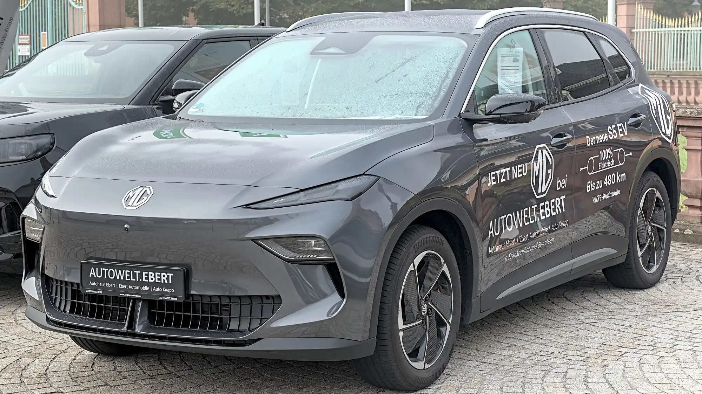

La **MG S5 EV** llegó a Colombia en 2026 con uno de los precios más agresivos entre los SUV eléctricos, desde $94,99 millones. Un precio bajo suele generar la pregunta de en qué se ahorró la marca. En seguridad, la respuesta de **Euro NCAP** es que no mucho: le dio **cinco estrellas** en mayo de 2025, con **90 % en protección de adultos**.

## Lo esencial

- **Calificación:** 5 estrellas, publicada en mayo de 2025.
- **Versión evaluada:** MG S5 EV de un motor, con tracción en dos ruedas, 1.725 kg.
- **Protección de adultos:** 90 %.
- **Protección de niños:** 82 %.
- **Usuarios vulnerables:** 82 %.
- **Asistencias a la conducción:** 78 %.

## Los choques

| Prueba | Resultado |
|---|---|
| Frontal contra barrera móvil | Habitáculo estable, buena protección de rodillas y piernas. Estructuras del tablero del lado del conductor representan riesgo para algunos ocupantes |
| Frontal contra muro | Buena o adecuada para el conductor y el pasajero trasero |
| Lateral contra otro vehículo | Puntaje máximo |
| Lateral contra poste | Al menos adecuada en todas las zonas del cuerpo |
| Latigazo cervical | Bueno adelante y atrás |

Euro NCAP también la calificó como **poco agresiva con el otro carro** en un choque frontal. El reparo está en el tablero: algunas estructuras del lado del conductor podrían golpear las rodillas de ocupantes de otra talla, y por eso perdió puntos.

*La MG S5 EV llegó a Colombia importada por Los Autos. Foto: Alexander-93, CC BY-SA 4.0, recortada, vía Wikimedia Commons.*

## Niños y peatones

En niños, la protección fue buena para el maniquí de 6 años y buena o adecuada para el de 10 en el choque frontal, y buena para ambos en el lateral. Lo que le restó puntos es que **no trae detector de niños olvidados**.

Con peatones y ciclistas, el frenado autónomo funcionó muy bien: 8 de 9 con peatones, 8 de 8 con ciclistas y 6 de 6 con motociclistas. Los golpes de cabeza fueron buenos o adecuados en el capó y malos en los parales y bordes del parabrisas, como en la mayoría de los carros.

## Asistencias

| Asistencia | Puntaje |
|---|---|
| Frenado autónomo frente a carros | 7,6 de 9 |
| Mantenimiento de carril | 3 de 3 |
| Mantenimiento de carril frente a motos | 0,5 de 3 |
| Monitor del conductor | 0,9 de 2 |

El monitor del conductor tiene cámara y detecta somnolencia, microsueño y sueño, pero no recibió la puntuación completa. Y el asistente de carril casi no reacciona cuando el riesgo es una moto, un dato que pesa en ciudades colombianas con tantas motos.

## La S5 en Colombia

En Colombia se vende en dos versiones: **Comfort**, desde $94.990.000, y **Deluxe**, desde $104.990.000. Ambas traen seis airbags y control de estabilidad. El paquete de asistencias MG Pilot incluye frenado autónomo, crucero adaptativo, mantenimiento de carril, punto ciego, alerta de tráfico cruzado trasero y cámara 360°, aunque parte de ese equipo depende de la versión.

> Antes de elegir la Comfort por precio, revise qué asistencias del paquete MG Pilot trae. Son las que le dieron a la S5 buena parte de su puntaje en Euro NCAP.

## Preguntas frecuentes

### ¿Cuántas estrellas tiene la MG S5 EV en Euro NCAP?

Cinco estrellas, publicadas en mayo de 2025.

### ¿Cuál fue su punto más débil?

El monitor del conductor (0,9 de 2), el asistente de carril frente a motos (0,5 de 3) y la falta de detector de niños olvidados.

### ¿Cuánto cuesta en Colombia?

Desde $94.990.000 en la versión Comfort y $104.990.000 en la Deluxe, según los precios de lanzamiento de 2026.

Compare la S5 con la Geely EX5 en el [comparador de Mejor Eléctrico](/es/comparador/?a=mg-mgs5-ev-64-kwh-2026-eu&b=geely-ex5-se-2026-co).

---

**Fuentes:** [Euro NCAP: ficha de la prueba de la MG S5 EV](https://cdn.euroncap.com/media/87623/euroncap-2025-mg-mgs5-ev-datasheet.pdf) · [Portafolio: la S5 EV en Colombia](https://www.portafolio.co/negocios/vehiculo/la-s5-ev-de-la-marca-mg-entro-a-romper-precios-en-el-mercado-489053)
