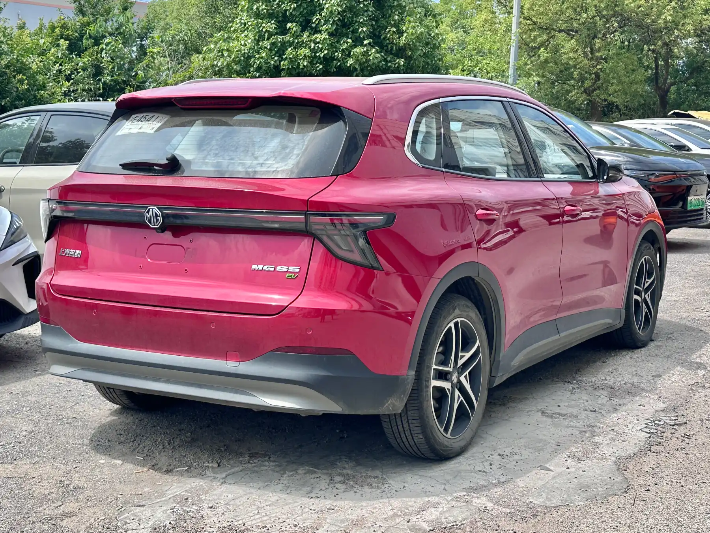

El problema confirmado más serio de la **MG S5 EV** es un **llamado a revisión mundial por riesgo de incendio**, publicado en julio de 2026, que afecta a **9.806 carros** fabricados entre el 22 de enero de 2025 y el 29 de enero de 2026. El resto de fallas que circulan en internet vienen de foros de dueños: son reales para quien las vive, pero no hay datos que muestren qué tan frecuentes son.

La S5 EV es uno de los SUV eléctricos más vendidos de Colombia, cuarta en matrículas de eléctricos en septiembre de 2026, y tiene cinco estrellas en Euro NCAP. Por eso vale la pena separar lo confirmado de lo anecdótico.

## El llamado a revisión: un ventilador que se congela

Según la autoridad alemana de transporte (KBA), que supervisa el llamado en Alemania, el problema está en el **ventilador del radiador**. Con temperaturas muy bajas, el ventilador se puede congelar y bloquear. Si en ese momento se usa la calefacción de la cabina, una resistencia del controlador del ventilador se puede recalentar y, en el peor caso, provocar un incendio.

La KBA recibió reportes de incidentes con daños materiales o personas lesionadas, aunque no publicó cuántos. La solución de MG es una **actualización de software** de la unidad de control, que evita el recalentamiento en esas condiciones. En Alemania hay 1.830 carros afectados.

*La solución de MG para el llamado es una actualización de software. Foto: JustAnotherCarDesigner, dominio público (CC0), vía Wikimedia Commons.*

## Qué significa para Colombia

La falla depende del congelamiento del ventilador, algo que en casi todo el territorio colombiano es muy poco probable. Eso no quiere decir que el llamado no aplique: la revisión es por fecha de fabricación, no por país. Si su S5 EV se fabricó entre enero de 2025 y enero de 2026, pregunte en el concesionario si está dentro del llamado y si la actualización ya se instaló. La MG S5 EV llegó a Colombia en 2026, así que buena parte de las unidades del país podrían estar en ese rango.

En Colombia, la Superintendencia de Industria y Comercio publica en su página las campañas de seguridad de vehículos reportadas en el país, y ahí se puede verificar si el llamado ya se registró.

## Lo que reportan los dueños en los foros

En el foro de dueños MGEVs, que reúne sobre todo a conductores de Reino Unido y Australia, se repiten dos quejas.

**Una falla intermitente de motor.** Varios dueños, unos cinco o seis en Australia y uno en Malta según el hilo, contaron pérdidas súbitas de potencia al bajar de velocidad de autopista, con un aviso de "falla de motor" en el tablero. En un caso, una actualización de software no resolvió el problema y el taller terminó cambiando una pieza del motor. Son casos de carros matriculados entre mayo y junio de 2025, y MG no ha anunciado una campaña por esta causa.

**El baúl eléctrico que no abre a la altura programada.** Algunos dueños reportaron que el baúl no llega a la altura máxima o no cierra bien y enciende un aviso en el tablero. No hay una causa confirmada.

Un foro no es una estadística. Quien tiene un problema escribe más que quien no lo tiene, y pocos casos pueden parecer muchos. Sirven como alerta para revisar esos puntos en la prueba de manejo y en el primer mantenimiento.

> Si tiene una S5 EV y presenta una falla, pida que el concesionario la deje registrada en la orden de trabajo aunque no la pueda reproducir ese día. Ese registro es lo que respalda un reclamo de garantía si la falla vuelve.

## Preguntas frecuentes

### ¿La MG S5 EV tiene problemas?

Tiene un llamado a revisión mundial por riesgo de incendio en frío extremo, que se corrige con software. Los demás problemas conocidos son reportes individuales de dueños en foros.

### ¿Cómo sé si mi MG S5 EV está en el llamado a revisión?

Pregunte en el concesionario con el número de identificación del vehículo (VIN). Aplica a carros fabricados entre el 22 de enero de 2025 y el 29 de enero de 2026.

### ¿La MG S5 EV es segura?

Tiene cinco estrellas en Euro NCAP, con 90 % en protección de adultos. Lo explicamos en [su nota de seguridad](/es/notas/mg-s5-ev-euro-ncap-5-estrellas/).

---

**Fuentes:** [Electrive: MG llama a revisión la S5 EV por riesgo de incendio](https://www.electrive.com/es/2026/07/20/mg-retira-del-mercado-el-s5-ev-debido-a-un-posible-riesgo-de-incendio/) · [MGEVs: hilo sobre fallas de motor de la MG S5](https://www.mgevs.com/posts/435682/) · [MGEVs: hilo sobre la apertura del baúl](https://www.mgevs.com/threads/brand-new-s5-boot-opening-problems.24252/) · [Portafolio: eléctricos más vendidos en septiembre de 2026](https://www.portafolio.co/negocios/vehiculo/tesla-domina-los-electricos-mas-vendidos-en-colombia-concentro-41-3-de-las-matriculas-durante-septiembre-504120) · [Euro NCAP: ficha de la prueba de la MG S5 EV](https://cdn.euroncap.com/media/87623/euroncap-2025-mg-mgs5-ev-datasheet.pdf)
