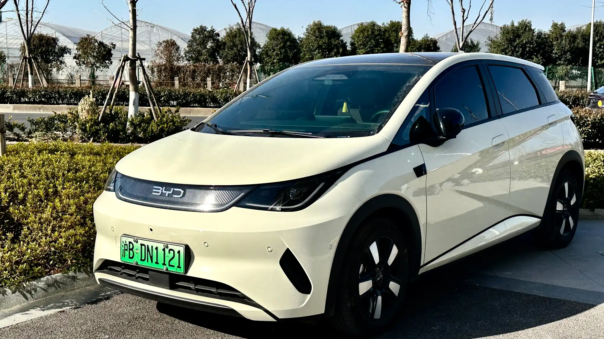

BYD renovó el **Dolphin** en Colombia, y el cambio responde a la crítica principal que tenía el modelo anterior: le faltaban asistencias a la conducción. El nuevo Dolphin llegó en una sola versión, **GS**, por **$89.990.000**, y ahora trae de serie frenado autónomo de emergencia, crucero adaptativo, mantenimiento de carril y cámara 540°. Lo distribuye **Motorysa**.

## Lo esencial

- **Precio:** $89.990.000, versión única GS.
- **Batería:** Blade LFP de 45,1 kWh.
- **Autonomía:** 405 km en ciclo NEDC.
- **Motor:** 174 hp y 290 Nm.
- **Carga rápida:** hasta 80 kW; del 30 % al 80 % en unos 20 minutos.
- **Garantía:** 6 años o 150.000 km para el carro y 8 años o 150.000 km para la batería.

## Qué cambió frente al Dolphin anterior

| | Dolphin anterior en Colombia | Nuevo Dolphin GS |
|---|---|---|
| Largo | 4,12 m | 4,28 m |
| Airbags | 6 | 6 |
| Frenado autónomo de emergencia | No | Sí |
| Crucero adaptativo | No | Sí |
| Mantenimiento de carril y punto ciego | No | Sí |
| Suspensión trasera | Barra de torsión | Multibrazo, independiente |
| Pantalla central | Giratoria | Fija de 12,8 pulgadas, con Google integrado |

El Dolphin anterior fue el centro de una confusión: en diciembre de 2024, Latin NCAP le dio cinco estrellas al **Dolphin Plus** que se vende en Brasil, que sí tenía asistencias, pero esa calificación no aplicaba al Dolphin colombiano, que no las traía. Lo explicamos en [nuestra nota sobre esa prueba](/es/notas/byd-dolphin-plus-latin-ncap-5-estrellas/). El nuevo Dolphin cierra buena parte de esa brecha de equipo, aunque no ha sido evaluado por ningún programa de choques en su versión colombiana.

*El Dolphin renovado creció 16 cm y estrenó frente, luces y paragolpes. Foto: JustAnotherCarDesigner, dominio público (CC0), vía Wikimedia Commons.*

## Lo que no mejoró

El **baúl** sigue siendo pequeño: 250 litros, menos que el de un hatchback compacto de gasolina. Y la autonomía se publica en ciclo **NEDC**, optimista; en uso real, un cálculo prudente es esperar entre 15 % y 20 % menos.

## Frente a sus rivales

A $89,99 millones, el Dolphin queda al mismo precio que el **Kia EV2** y por encima de la **Chery E5** de entrada ($79,99 millones), que no trae asistencias en esa versión. Frente al EV2, el Dolphin ofrece más potencia (174 hp contra 145) y cámara 540°, mientras que el Kia tiene más baúl (362 litros) y autonomía medida en WLTP.

Con este cambio, el Dolphin se suma al Kia EV2 entre los eléctricos de menos de $90 millones que traen frenado autónomo de serie.

## Preguntas frecuentes

### ¿Cuánto cuesta el nuevo BYD Dolphin en Colombia?

$89.990.000 en su única versión, GS.

### ¿Tiene frenado autónomo?

Sí. A diferencia del modelo anterior, trae frenado autónomo de emergencia, crucero adaptativo y mantenimiento de carril.

### ¿Cuánta autonomía tiene?

405 km en ciclo NEDC.

### ¿Cuál es la garantía de la batería?

8 años o 150.000 km, lo que ocurra primero.

Compare el Dolphin con el Kia EV2 en el [comparador de Mejor Eléctrico](/es/comparador/?a=byd-dolphin-60-4-kwh-2026-eu&b=kia-ev2-air-2026-co).

---

**Fuentes:** [El Carro Colombiano: nuevo BYD Dolphin en Colombia](https://www.elcarrocolombiano.com/novedades/byd-dolphin-nuevo-colombia-precio-versiones-caracteristicas-2026/) · [Latin NCAP: BYD Dolphin Plus](https://www.latinncap.com/es/area-de-prensa/noticia/867617e084abbd/byd-dolphin-plus-primer-fabricante-chino-y-primer-auto-electrico-en-lograr-cinco-estrellas-en-latin-ncap)
